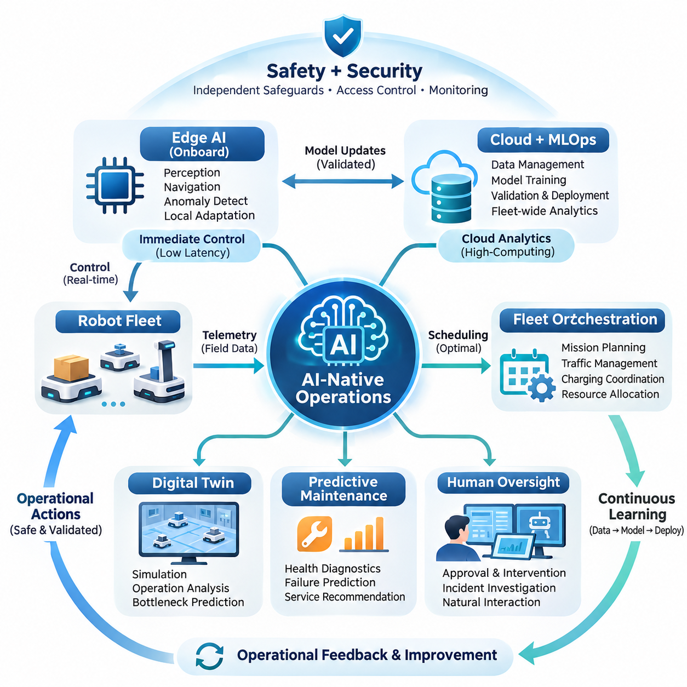
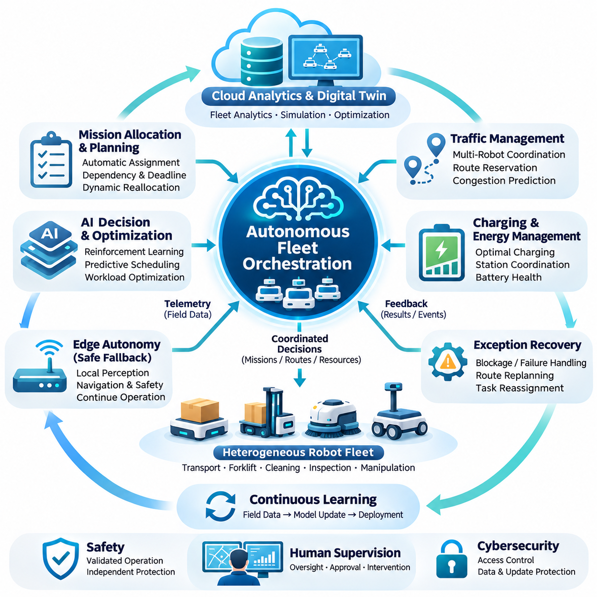
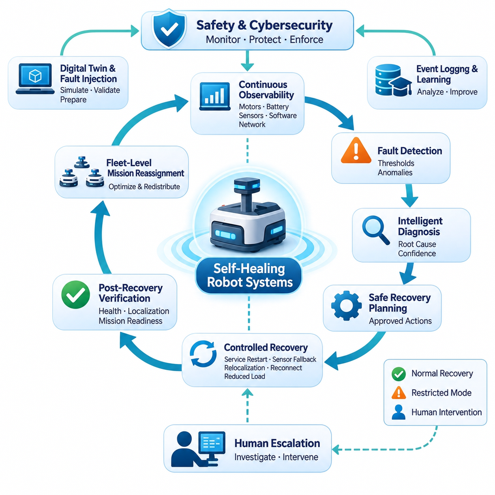
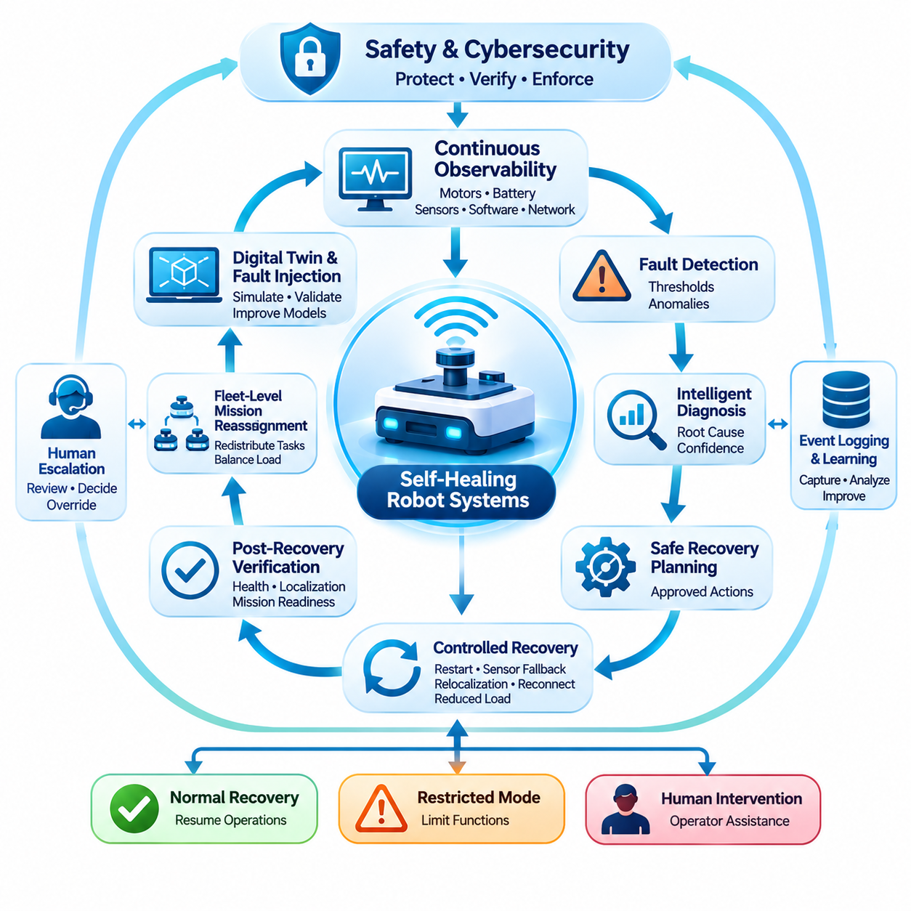
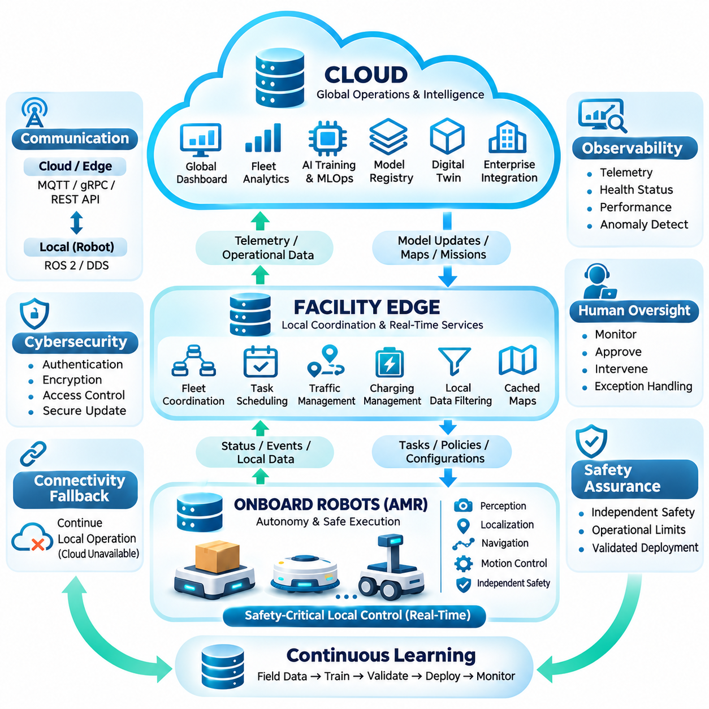
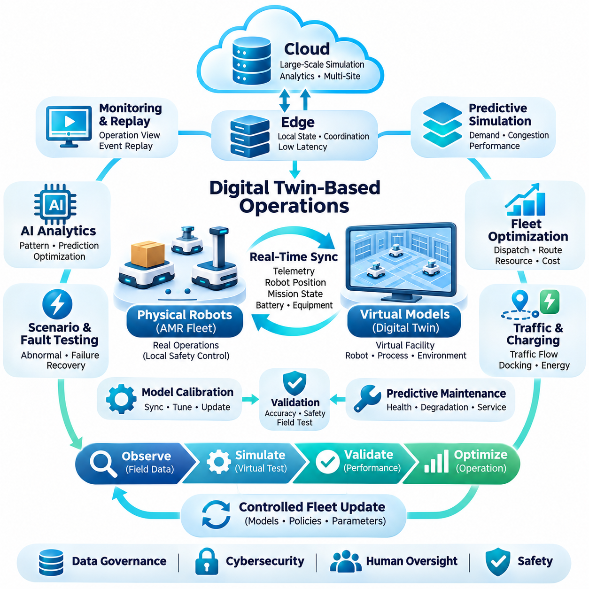
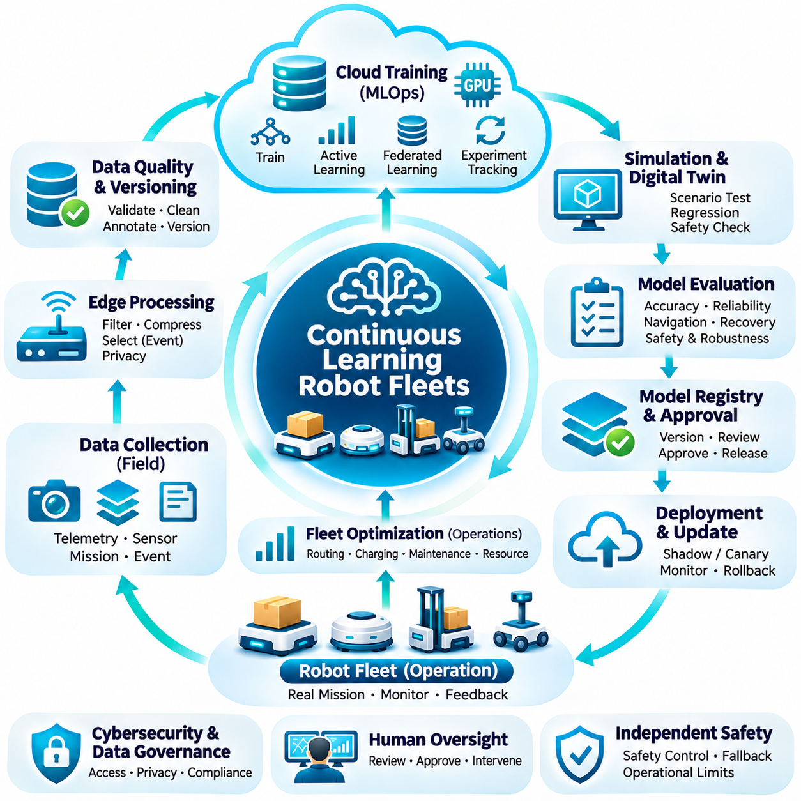
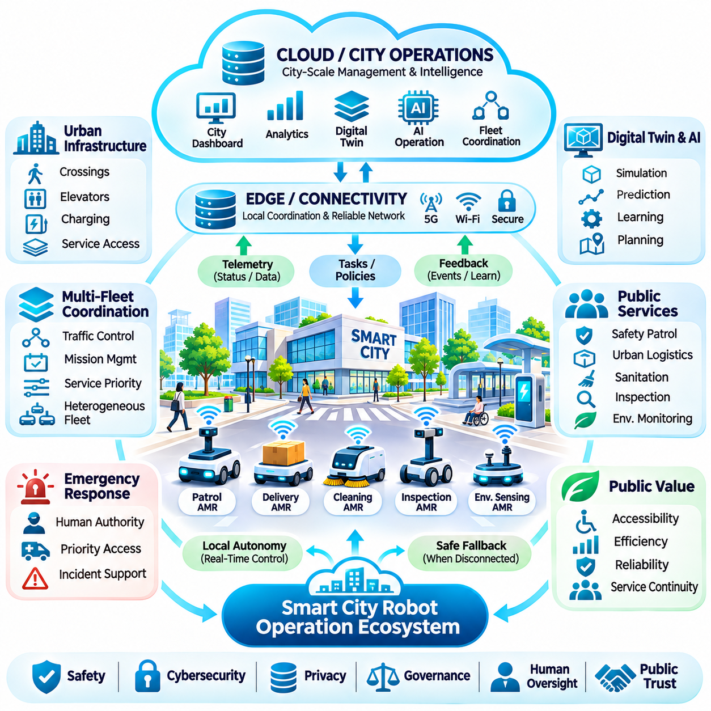
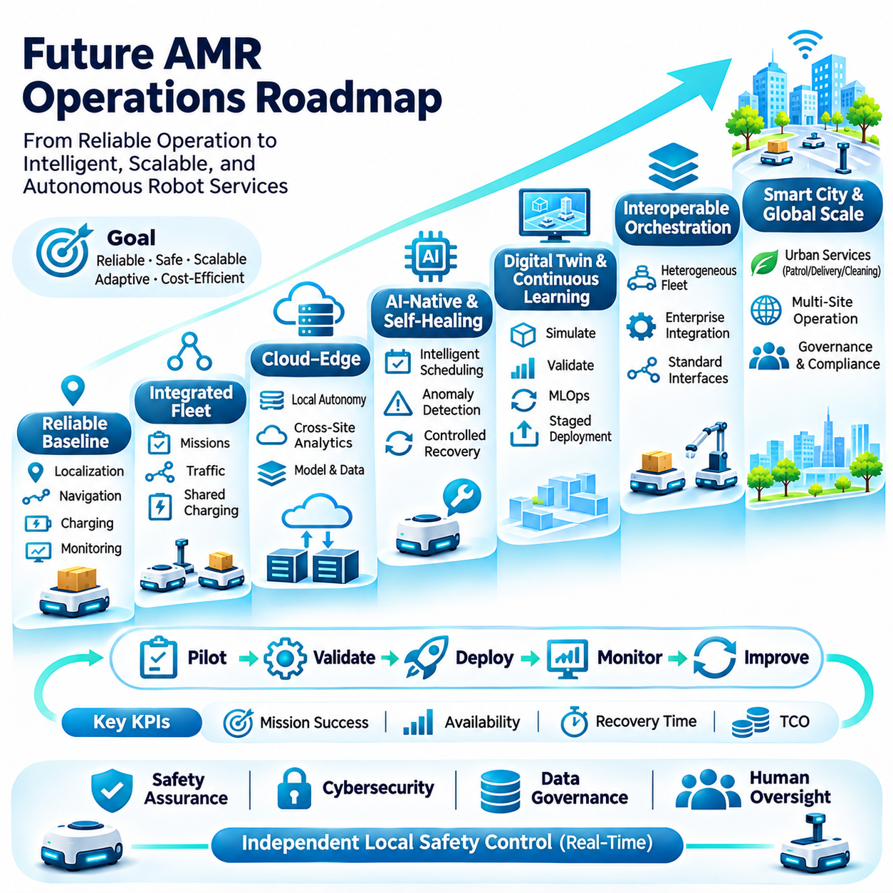

**Volume 08. AMR Operations, Deployment, and MLOps**


# Chapter 25. Future of Robot Operations

##  

## 25.1 AI-Native Robot Operations

{width="7.268055555555556in" height="7.268055555555556in"}

AI-native robot operations represent a fundamental transformation in how autonomous mobile robots are deployed, managed, monitored, and continuously improved. Instead of treating artificial intelligence as an isolated perception or navigation component, AI becomes the operational foundation connecting mission planning, fleet coordination, maintenance, safety management, and business workflows. This approach enables robot systems to make increasingly informed operational decisions.

Traditional robot operations rely on predefined schedules, fixed operational rules, manual supervision, and reactive maintenance procedures. Although these approaches provide predictable behavior, they often struggle with changing environments, unexpected failures, and complex fleet interactions. AI-native operations introduce adaptive decision-making mechanisms that interpret operational context, predict emerging conditions, and recommend or execute appropriate responses within defined safety constraints.

The architecture of an AI-native robot operation platform integrates robot management systems, fleet management systems, edge computing, cloud infrastructure, and machine learning operations. These components exchange operational information through standardized interfaces and event-driven communication mechanisms. A unified intelligence layer analyzes robot status, mission priorities, environmental conditions, and historical performance to coordinate operational decisions across the entire fleet.

Operational intelligence begins with continuous acquisition of high-quality field data. Robots generate sensor observations, localization estimates, navigation events, battery measurements, diagnostic information, and mission execution records. These data streams provide the foundation for understanding actual operating conditions. Effective AI-native platforms transform raw telemetry into structured operational knowledge through filtering, synchronization, contextual labeling, and automated event correlation.

AI-driven mission orchestration extends conventional task scheduling by considering dynamic operational priorities and resource availability. A fleet management platform can evaluate robot capabilities, payload requirements, travel distances, battery reserves, traffic congestion, and service deadlines before assigning missions. When conditions change, the orchestration system can reconsider assignments and recommend alternative execution strategies while preserving operational constraints and mission dependencies.

Context-aware decision-making is particularly important in environments shared by robots, people, and conventional equipment. An AI-native platform combines real-time perception with historical observations to recognize patterns that influence operational performance. For example, recurring congestion near elevators, loading stations, or warehouse intersections can inform scheduling adjustments. Such intelligence allows the system to anticipate operational bottlenecks rather than responding only after delays occur.

Edge intelligence provides the computational foundation for decisions requiring immediate responses. Onboard processors execute perception, localization, navigation, anomaly detection, and local mission adaptation without depending on continuous cloud connectivity. Cloud infrastructure supports computationally intensive analytics, historical optimization, model development, and fleet-wide coordination. This division allows AI-native operations to balance response latency, computational efficiency, communication costs, and operational resilience.

AI-native operations also introduce intelligent resource management across heterogeneous robot fleets. Different platforms may possess distinct mobility configurations, payload capacities, sensors, manipulators, and computing capabilities. The orchestration system must understand these differences when selecting robots for specific tasks. Capability-aware scheduling prevents unsuitable assignments while improving utilization of specialized equipment and reducing unnecessary mission interruptions.

Predictive maintenance becomes an integrated function of operational intelligence rather than a separate maintenance activity. Machine learning models examine battery degradation, motor current, vibration, thermal behavior, communication reliability, and component fault histories. By identifying deviations from established operating patterns, the platform can estimate maintenance requirements and recommend service windows. Predictions must include uncertainty estimates and remain subject to engineering validation.

A major advantage of AI-native operations is the ability to connect operational performance with continuous learning pipelines. Difficult navigation scenarios, unexpected obstacles, localization failures, and unsuccessful mission executions can be identified automatically for further investigation. Selected field data are transferred into controlled data management and model development environments. Updated models undergo validation, regression testing, approval, and staged deployment before entering operational service.

Large language models and multimodal foundation models can provide additional capabilities for operational interpretation and human interaction. Operators may describe mission requirements using natural language, investigate incidents through conversational interfaces, or request explanations of fleet behavior. However, language-model outputs should be translated into validated commands through structured interfaces. Safety-critical motion control must remain governed by deterministic controllers and independently enforced safety mechanisms.

Intelligent incident management combines event detection, contextual analysis, and coordinated recovery procedures. When a robot reports an abnormal condition, the platform can correlate diagnostic logs, recent software updates, environmental observations, and related fleet events. AI-based reasoning may help identify probable causes and propose recovery actions. Automated recovery should be restricted to verified procedures, while uncertain or potentially hazardous situations require authorized human intervention.

Operational safety remains a foundational requirement regardless of the intelligence available to the platform. AI-native systems must maintain clear boundaries between adaptive optimization and safety-related control functions. Emergency stopping, protective separation, speed limitations, and safety-zone enforcement require appropriate independent safeguards. Every autonomous operational decision should be traceable through recorded inputs, applicable constraints, software versions, and resulting actions.

Cybersecurity becomes increasingly important as robots exchange information across distributed intelligence platforms. Secure identity management, encrypted communications, authenticated software packages, and role-based access control protect operational infrastructure. AI-driven security monitoring can identify unusual network behavior, unauthorized command patterns, and suspicious configuration changes. Security responses must preserve safe robot behavior and prevent compromised services from issuing uncontrolled physical commands.

Human supervision evolves from continuous manual monitoring toward exception-based operational management. Instead of observing every robot movement, operators supervise fleet objectives, investigate abnormal events, approve sensitive decisions, and evaluate operational performance. Explainable AI interfaces can present the evidence supporting scheduling changes, maintenance recommendations, or mission reassignment. Effective human-machine collaboration requires clear responsibility boundaries and accessible mechanisms for overriding autonomous decisions.

The performance of AI-native operations should be evaluated through measurable operational outcomes rather than model accuracy alone. Relevant indicators include mission completion rate, fleet availability, intervention frequency, recovery time, energy consumption, task throughput, and maintenance cost. AI-specific measurements should also examine prediction reliability, decision latency, model drift, and automated action success. These metrics connect intelligent capabilities with operational value and customer expectations.

Digital twins can strengthen AI-native operations by providing simulation environments connected to real fleet conditions. Operational data continuously update virtual representations of robots, infrastructure, traffic patterns, and mission workflows. The platform can evaluate alternative schedules, charging strategies, or routing policies before applying them to physical systems. Simulation results require validation against real-world behavior because incomplete models may produce misleading operational recommendations.

Scalable AI-native platforms must support deployments spanning individual facilities, multiple customer sites, and geographically distributed fleets. Standardized robot interfaces, modular services, and hierarchical orchestration architectures enable consistent management across different environments. Local controllers maintain site-level autonomy, while regional or global services coordinate analytics, software governance, and operational policies. This architecture reduces dependence on centralized connectivity and improves deployment flexibility.

The transition toward AI-native operations should follow a progressive engineering strategy. Initial capabilities may focus on unified telemetry, automated diagnostics, and intelligent dashboards. Subsequent stages introduce predictive maintenance, adaptive scheduling, assisted incident recovery, and controlled autonomous orchestration. Each expansion requires operational validation, cybersecurity assessment, safety review, and evidence that automated decisions improve performance without introducing unacceptable risks.

Ultimately, AI-native robot operations transform autonomous robots from individually managed machines into coordinated, data-driven operational systems. Their long-term value depends on combining machine intelligence with reliable engineering, disciplined MLOps, transparent governance, and human accountability. As these capabilities mature, robot fleets can become more adaptive, efficient, and resilient while maintaining the safety and predictability required for sustained deployment in real-world environments.

인공지능 네이티브 로봇 운영(AI-Native Robot Operations)은 자율이동로봇(Autonomous Mobile Robot, AMR)의 배포, 관리, 모니터링 및 지속적인 개선 방식을 근본적으로 변화시키는 운영 패러다임이다. 인공지능(Artificial Intelligence, AI)을 독립적인 인식(Perception) 또는 내비게이션(Navigation) 구성요소로 취급하는 대신, 임무 계획(Mission Planning), 로봇 군집 조정(Fleet Coordination), 유지보수(Maintenance), 안전 관리(Safety Management), 비즈니스 워크플로(Business Workflow)를 연결하는 운영 기반으로 활용한다. 이러한 접근 방식은 로봇 시스템이 운영 상황에 관한 정보를 종합적으로 분석하고 더욱 지능적인 의사결정을 수행하도록 지원한다.

기존 로봇 운영(Traditional Robot Operations)은 사전에 정의된 일정(Predefined Schedule), 고정된 운영 규칙(Fixed Operational Rules), 수동 감독(Manual Supervision), 사후 대응형 유지보수(Reactive Maintenance)에 의존한다. 이러한 방식은 예측 가능한 동작을 제공하지만, 변화하는 환경과 예상하지 못한 장애, 복잡한 로봇 군집 상호작용에 대응하는 데 한계가 있다. 인공지능 네이티브 운영(AI-Native Operations)은 운영 맥락(Operational Context)을 해석하고 잠재적인 상황 변화를 예측하며, 정의된 안전 제약조건(Safety Constraints) 내에서 적절한 대응을 권고하거나 실행하는 적응형 의사결정(Adaptive Decision-Making) 메커니즘을 도입한다.

인공지능 네이티브 로봇 운영 플랫폼(AI-Native Robot Operation Platform)의 아키텍처(Architecture)는 로봇 관리 시스템(Robot Management System, RMS), 군집 관리 시스템(Fleet Management System, FMS), 엣지 컴퓨팅(Edge Computing), 클라우드 인프라(Cloud Infrastructure), 머신러닝 운영(Machine Learning Operations, MLOps)을 통합한다. 이러한 구성요소는 표준화된 인터페이스(Standardized Interface)와 이벤트 기반 통신(Event-Driven Communication)을 통해 운영 정보를 교환한다. 통합 지능 계층(Unified Intelligence Layer)은 로봇 상태, 임무 우선순위, 환경 조건, 과거 성능을 분석하여 전체 로봇 군집의 운영 의사결정을 조정한다.

운영 지능(Operational Intelligence)은 고품질 현장 데이터(Field Data)를 지속적으로 수집하는 과정에서 시작된다. 로봇은 센서 관측 데이터(Sensor Observations), 위치 추정값(Localization Estimates), 내비게이션 이벤트(Navigation Events), 배터리 측정값(Battery Measurements), 진단 정보(Diagnostic Information), 임무 실행 기록(Mission Execution Records)을 생성한다. 이러한 데이터 스트림(Data Streams)은 실제 운영 조건을 이해하는 기반이 된다. 효과적인 인공지능 네이티브 플랫폼은 필터링(Filtering), 시간 동기화(Synchronization), 맥락 기반 레이블링(Contextual Labeling), 자동 이벤트 상관분석(Automated Event Correlation)을 통해 원시 텔레메트리(Raw Telemetry)를 구조화된 운영 지식(Structured Operational Knowledge)으로 변환한다.

인공지능 기반 임무 오케스트레이션(AI-Driven Mission Orchestration)은 동적인 운영 우선순위와 자원 가용성을 고려하여 기존 작업 스케줄링(Task Scheduling)을 확장한다. 군집 관리 플랫폼(Fleet Management Platform)은 임무를 할당하기 전에 로봇의 기능, 적재 요구사항, 이동 거리, 배터리 잔량, 교통 혼잡도, 서비스 완료 기한을 평가할 수 있다. 운영 조건이 변경되면 오케스트레이션 시스템(Orchestration System)은 운영 제약조건과 임무 간 의존성을 유지하면서 작업 할당을 재검토하고 대체 실행 전략(Alternative Execution Strategies)을 권고할 수 있다.

맥락 인식 의사결정(Context-Aware Decision-Making)은 로봇, 사람, 기존 설비가 작업 공간을 공유하는 환경에서 특히 중요하다. 인공지능 네이티브 플랫폼은 실시간 인식(Real-Time Perception)과 과거 관측 데이터를 결합하여 운영 성능에 영향을 미치는 패턴을 식별한다. 예를 들어 엘리베이터(Elevator), 적재 스테이션(Loading Station), 창고 교차로(Warehouse Intersection) 주변에서 반복적으로 발생하는 혼잡을 분석하여 스케줄을 조정할 수 있다. 이러한 지능은 지연이 발생한 이후에 대응하는 수준을 넘어 운영 병목현상(Operational Bottleneck)을 사전에 예측하도록 지원한다.

엣지 지능(Edge Intelligence)은 즉각적인 대응이 필요한 의사결정을 위한 컴퓨팅 기반을 제공한다. 로봇에 탑재된 프로세서(Onboard Processor)는 지속적인 클라우드 연결에 의존하지 않고 인식, 위치 추정, 내비게이션, 이상 탐지(Anomaly Detection), 지역적 임무 적응(Local Mission Adaptation)을 실행한다. 클라우드 인프라는 고연산 분석(Computationally Intensive Analytics), 과거 데이터 기반 최적화(Historical Optimization), 모델 개발(Model Development), 군집 전체의 조정을 지원한다. 이러한 역할 분담은 응답 지연시간(Response Latency), 연산 효율성(Computational Efficiency), 통신 비용(Communication Costs), 운영 복원력(Operational Resilience)의 균형을 유지하도록 한다.

인공지능 네이티브 운영은 이기종 로봇 군집(Heterogeneous Robot Fleets) 전반에 걸친 지능형 자원 관리(Intelligent Resource Management)도 도입한다. 서로 다른 로봇 플랫폼은 이동 구조(Mobility Configuration), 적재 용량(Payload Capacity), 센서(Sensors), 매니퓰레이터(Manipulators), 컴퓨팅 성능(Computing Capabilities)에서 차이를 보일 수 있다. 오케스트레이션 시스템은 특정 작업에 적합한 로봇을 선택할 때 이러한 차이를 이해해야 한다. 기능 인식 스케줄링(Capability-Aware Scheduling)은 부적절한 작업 할당을 방지하고 특수 장비의 활용률을 높이며 불필요한 임무 중단을 줄인다.

예지보전(Predictive Maintenance)은 독립적인 유지보수 활동이 아니라 운영 지능에 통합된 기능으로 발전한다. 머신러닝 모델(Machine Learning Model)은 배터리 열화(Battery Degradation), 모터 전류(Motor Current), 진동(Vibration), 열적 거동(Thermal Behavior), 통신 신뢰성(Communication Reliability), 부품 고장 이력(Component Fault History)을 분석한다. 플랫폼은 기존 운영 패턴에서 벗어나는 편차를 식별하여 유지보수 필요성을 추정하고 적절한 정비 시점을 권고할 수 있다. 다만 예측 결과에는 불확실성 추정(Uncertainty Estimation)이 포함되어야 하며 엔지니어링 검증(Engineering Validation)을 거쳐야 한다.

인공지능 네이티브 운영의 주요 장점은 운영 성능과 지속적 학습 파이프라인(Continuous Learning Pipeline)을 연결할 수 있다는 점이다. 어려운 내비게이션 상황, 예상하지 못한 장애물, 위치 추정 실패, 임무 실행 실패를 자동으로 식별하여 추가 분석 대상으로 선정할 수 있다. 선택된 현장 데이터는 통제된 데이터 관리(Data Management) 및 모델 개발 환경으로 전달된다. 갱신된 모델은 운영 환경에 적용되기 전에 검증(Validation), 회귀 테스트(Regression Testing), 승인(Approval), 단계적 배포(Staged Deployment)를 거쳐야 한다.

대규모 언어 모델(Large Language Model, LLM)과 멀티모달 파운데이션 모델(Multimodal Foundation Model)은 운영 해석과 인간 상호작용을 위한 추가 기능을 제공할 수 있다. 운영자는 자연어(Natural Language)로 임무 요구사항을 설명하고, 대화형 인터페이스(Conversational Interface)를 통해 사고를 조사하거나 로봇 군집의 행동에 관한 설명을 요청할 수 있다. 그러나 언어 모델의 출력은 구조화된 인터페이스(Structured Interface)를 통해 검증된 명령으로 변환되어야 한다. 안전 필수 동작 제어(Safety-Critical Motion Control)는 결정론적 제어기(Deterministic Controller)와 독립적으로 적용되는 안전 메커니즘(Safety Mechanism)의 통제를 유지해야 한다.

지능형 사고 관리(Intelligent Incident Management)는 이벤트 탐지(Event Detection), 맥락 분석(Contextual Analysis), 조정된 복구 절차(Coordinated Recovery Procedures)를 결합한다. 로봇이 비정상 상태를 보고하면 플랫폼은 진단 로그(Diagnostic Logs), 최근 소프트웨어 업데이트(Software Updates), 환경 관측 데이터(Environmental Observations), 관련 군집 이벤트를 연관 분석할 수 있다. 인공지능 기반 추론(AI-Based Reasoning)은 가능한 원인을 식별하고 복구 조치를 제안하는 데 활용된다. 자동 복구(Automated Recovery)는 검증된 절차로 제한해야 하며 불확실하거나 위험 가능성이 있는 상황에서는 승인된 사람의 개입(Human Intervention)이 필요하다.

운영 안전(Operational Safety)은 플랫폼이 보유한 지능 수준과 관계없이 기본적인 요구사항으로 유지된다. 인공지능 네이티브 시스템은 적응형 최적화(Adaptive Optimization)와 안전 관련 제어 기능(Safety-Related Control Functions) 사이에 명확한 경계를 설정해야 한다. 비상정지(Emergency Stop), 보호 분리(Protective Separation), 속도 제한(Speed Limitations), 안전구역 적용(Safety-Zone Enforcement)에는 적절한 독립적 보호장치(Independent Safeguards)가 필요하다. 모든 자율 운영 의사결정은 기록된 입력 데이터, 적용된 제약조건, 소프트웨어 버전, 실행 결과를 통해 추적할 수 있어야 한다.

로봇이 분산 지능 플랫폼(Distributed Intelligence Platform) 전반에서 정보를 교환함에 따라 사이버보안(Cybersecurity)의 중요성은 더욱 높아진다. 보안 신원 관리(Secure Identity Management), 암호화 통신(Encrypted Communications), 인증된 소프트웨어 패키지(Authenticated Software Packages), 역할 기반 접근제어(Role-Based Access Control)는 운영 인프라를 보호한다. 인공지능 기반 보안 모니터링(AI-Driven Security Monitoring)은 비정상 네트워크 동작, 무단 명령 패턴, 의심스러운 구성 변경을 식별할 수 있다. 보안 대응은 로봇의 안전한 동작을 유지하고 침해된 서비스가 통제되지 않은 물리적 명령을 실행하지 못하도록 해야 한다.

인간 감독(Human Supervision)은 지속적인 수동 모니터링에서 예외 기반 운영 관리(Exception-Based Operational Management)로 발전한다. 운영자는 모든 로봇의 움직임을 관찰하는 대신 군집 목표를 감독하고 비정상 이벤트를 조사하며 민감한 의사결정을 승인하고 운영 성능을 평가한다. 설명 가능한 인공지능(Explainable AI, XAI) 인터페이스는 스케줄 변경, 유지보수 권고, 임무 재할당의 근거를 제시할 수 있다. 효과적인 인간-기계 협업(Human-Machine Collaboration)을 위해서는 명확한 책임 경계와 자율 의사결정을 재정의하거나 중단할 수 있는 접근 가능한 수단이 필요하다.

인공지능 네이티브 운영의 성능은 모델 정확도(Model Accuracy)만이 아니라 측정 가능한 운영 성과(Operational Outcomes)를 통해 평가해야 한다. 주요 지표에는 임무 완료율(Mission Completion Rate), 군집 가용성(Fleet Availability), 개입 빈도(Intervention Frequency), 복구 시간(Recovery Time), 에너지 소비(Energy Consumption), 작업 처리량(Task Throughput), 유지보수 비용(Maintenance Cost)이 포함된다. 인공지능 관련 측정에는 예측 신뢰성(Prediction Reliability), 의사결정 지연시간(Decision Latency), 모델 드리프트(Model Drift), 자동화된 조치의 성공률도 포함되어야 한다. 이러한 지표는 지능형 기능을 운영 가치 및 고객 기대와 연결한다.

디지털 트윈(Digital Twin)은 실제 로봇 군집의 운영 조건과 연결된 시뮬레이션 환경(Simulation Environment)을 제공하여 인공지능 네이티브 운영을 강화할 수 있다. 운영 데이터는 로봇, 인프라, 교통 패턴, 임무 워크플로의 가상 표현(Virtual Representation)을 지속적으로 갱신한다. 플랫폼은 물리적 시스템에 적용하기 전에 대체 스케줄, 충전 전략(Charging Strategies), 경로 정책(Routing Policies)을 평가할 수 있다. 다만 불완전한 모델은 잘못된 운영 권고를 생성할 수 있으므로 시뮬레이션 결과는 실제 환경의 동작과 비교하여 검증해야 한다.

확장 가능한 인공지능 네이티브 플랫폼(Scalable AI-Native Platform)은 개별 시설부터 여러 고객 현장 및 지리적으로 분산된 로봇 군집까지 지원해야 한다. 표준화된 로봇 인터페이스(Standardized Robot Interfaces), 모듈형 서비스(Modular Services), 계층형 오케스트레이션 아키텍처(Hierarchical Orchestration Architecture)는 서로 다른 환경에서도 일관된 관리를 가능하게 한다. 로컬 제어기(Local Controller)는 현장 수준의 자율성을 유지하고, 지역 또는 글로벌 서비스는 분석, 소프트웨어 거버넌스(Software Governance), 운영 정책(Operational Policies)을 조정한다. 이러한 아키텍처는 중앙 연결에 대한 의존도를 줄이고 배포 유연성(Deployment Flexibility)을 높인다.

인공지능 네이티브 운영으로의 전환은 단계적인 엔지니어링 전략(Progressive Engineering Strategy)을 따라야 한다. 초기 단계에서는 통합 텔레메트리(Unified Telemetry), 자동 진단(Automated Diagnostics), 지능형 대시보드(Intelligent Dashboards)에 집중할 수 있다. 이후 예지보전, 적응형 스케줄링(Adaptive Scheduling), 지원형 사고 복구(Assisted Incident Recovery), 통제된 자율 오케스트레이션(Controlled Autonomous Orchestration)으로 확장한다. 각 단계에서는 운영 검증(Operational Validation), 사이버보안 평가(Cybersecurity Assessment), 안전 검토(Safety Review), 자동화된 의사결정이 허용할 수 없는 위험을 초래하지 않으면서 성능을 개선한다는 객관적인 증거가 필요하다.

궁극적으로 인공지능 네이티브 로봇 운영은 자율로봇을 개별적으로 관리되는 기계에서 조정되고 데이터 중심으로 운영되는 시스템(Coordinated Data-Driven Operational Systems)으로 전환한다. 장기적인 가치는 기계 지능(Machine Intelligence)을 신뢰할 수 있는 엔지니어링(Reliable Engineering), 체계적인 머신러닝 운영(Disciplined MLOps), 투명한 거버넌스(Transparent Governance), 인간의 책임성(Human Accountability)과 결합하는 능력에 달려 있다. 이러한 역량이 성숙하면 로봇 군집은 실제 운영 환경에서 지속적인 배포에 필요한 안전성과 예측 가능성을 유지하면서 적응성(Adaptability), 효율성(Efficiency), 복원력(Resilience)을 더욱 향상시킬 수 있다.

##  

## 25.2 Autonomous Fleet Operations

{width="7.268055555555556in" height="7.268055555555556in"}

Autonomous fleet operations represent the evolution from centrally supervised robot management toward intelligent systems capable of coordinating multiple autonomous mobile robots with minimal human intervention. Rather than executing isolated missions according to fixed schedules, robots operate as collaborative resources within a shared operational environment. Fleet-level intelligence continuously evaluates mission demand, robot availability, environmental conditions, and operational constraints to optimize overall system performance.

Traditional fleet management systems depend heavily on predefined dispatching rules, static traffic policies, and operator intervention when unexpected situations occur. Autonomous fleet operations introduce adaptive coordination mechanisms that respond to changing workloads, robot failures, and environmental disruptions. These mechanisms combine real-time operational data with predictive models and optimization algorithms to maintain mission continuity while reducing unnecessary delays and manual supervision.

The architecture of an autonomous fleet operation platform integrates robot management systems, fleet management systems, mission orchestration engines, distributed edge controllers, and cloud-based analytics services. Individual robots retain responsibility for local perception, navigation, and immediate obstacle avoidance. Fleet-level services coordinate shared resources, task priorities, traffic flow, and operational objectives through standardized communication interfaces and synchronized system states.

Autonomous task allocation is a central capability of intelligent fleet operations. The orchestration system evaluates robot location, payload capacity, battery condition, equipment configuration, mission priority, and estimated completion time before assigning tasks. Dynamic allocation algorithms can redistribute missions when demand changes or robots become unavailable. This approach improves resource utilization and reduces the operational inefficiencies associated with fixed robot-to-task assignments.

Fleet-wide mission planning extends beyond selecting the nearest available robot. Intelligent planning must consider task dependencies, service deadlines, charging requirements, congestion risks, and the availability of shared infrastructure. For example, a hospital delivery mission may depend on elevator access, restricted-area permissions, and coordinated handover procedures. Autonomous orchestration evaluates these dependencies to establish feasible execution sequences and reduce conflicts between simultaneous missions.

Multi-robot traffic coordination becomes increasingly important as fleet density increases. Robots operating in shared corridors, intersections, docking areas, and loading zones must avoid deadlocks while maintaining predictable movement. Fleet management algorithms can reserve critical route segments, assign intersection priorities, and regulate access to constrained spaces. Local safety controllers remain responsible for immediate collision prevention, independently of centralized traffic optimization decisions.

Predictive traffic management improves fleet efficiency by anticipating congestion before it affects mission execution. Historical navigation records and real-time robot positions can reveal recurring bottlenecks associated with elevators, narrow passages, charging stations, or production schedules. Predictive models estimate future traffic demand and recommend alternative routes or departure times. Such capabilities reduce unnecessary waiting and improve the consistency of mission completion times.

Autonomous fleet operations require coordinated energy management because charging decisions directly influence mission availability. Intelligent charging strategies consider battery state of charge, predicted energy consumption, mission urgency, charging station occupancy, and expected workload. Instead of charging every robot according to fixed thresholds, the platform schedules charging opportunities according to operational demand. Battery health constraints and minimum energy reserves remain mandatory throughout optimization.

Heterogeneous fleet coordination enables different robot types to participate in shared operational workflows. Mobile transport robots, autonomous forklifts, towing platforms, inspection robots, and mobile manipulators possess different capabilities and operational limitations. A capability-aware orchestration system matches mission requirements with suitable platforms while coordinating their interactions. Standardized interfaces help integrate equipment from different manufacturers without assuming identical navigation or control architectures.

Distributed intelligence improves operational resilience by separating immediate robot control from fleet-level optimization. Edge controllers maintain essential navigation and safety functions when communication with centralized services becomes unavailable. Local coordination mechanisms may continue previously authorized missions under defined conditions. When connectivity is restored, the platform reconciles operational states, resolves conflicting assignments, and updates mission records without compromising safety or data consistency.

Autonomous exception handling allows fleet systems to respond systematically to operational disruptions. When a robot encounters a blocked route, failed docking attempt, unavailable elevator, or hardware malfunction, the system evaluates alternative actions. These may include route replanning, task reassignment, controlled waiting, or dispatching another robot. Recovery actions must respect validated operating boundaries, while uncertain or hazardous situations require escalation to authorized personnel.

Artificial intelligence can enhance fleet-level decision-making through reinforcement learning, predictive optimization, and learned operational policies. Simulation environments provide opportunities to evaluate scheduling and traffic strategies under varied workload conditions. However, learned policies require extensive testing against deterministic baselines, safety constraints, and unusual operating scenarios. Production deployment should include monitoring, bounded decision authority, and mechanisms for reverting to verified control strategies.

Digital twin technology supports autonomous fleet operations by maintaining virtual representations of robots, facilities, traffic networks, and operational resources. These models enable evaluation of alternative mission schedules, fleet sizes, charging configurations, and infrastructure layouts. Real operational data can continuously improve simulation fidelity. Nevertheless, digital twin predictions must be validated against field measurements before they influence consequential operational decisions.

Continuous operational learning enables fleet management policies to improve through accumulated experience. Mission delays, traffic conflicts, battery consumption, recovery events, and operator interventions provide valuable information about system behavior. Data analysis identifies recurring inefficiencies and opportunities for optimization. Proposed improvements are evaluated through controlled experiments, simulation, and staged deployment before becoming part of routine autonomous operations.

Human supervision remains essential even when fleet coordination becomes highly autonomous. Operators define mission objectives, operational priorities, safety restrictions, and acceptable service levels. Autonomous systems manage routine scheduling and coordination within these boundaries, while humans investigate exceptional situations and authorize high-impact changes. Explainable operational interfaces should present the reasoning behind task reassignment, traffic restrictions, and resource allocation decisions.

Operational cybersecurity must protect the communication and decision-making infrastructure connecting autonomous robots. Secure device identities, authenticated commands, encrypted communication channels, and role-based access controls prevent unauthorized fleet manipulation. Monitoring systems detect suspicious command sequences, unusual network behavior, and unexpected configuration changes. Security failures must trigger controlled responses that preserve safe robot operation and prevent unauthorized physical actions.

Performance evaluation should measure the effectiveness of the complete fleet rather than individual robot productivity alone. Important indicators include mission completion rate, fleet utilization, average task waiting time, traffic congestion duration, charging efficiency, intervention frequency, and operational availability. Additional measurements assess scheduling stability, recovery performance, and resource fairness. These metrics help determine whether autonomous coordination produces measurable improvements in service quality and operating cost.

Scalable fleet architectures must support increasing robot populations without creating excessive communication overhead or centralized processing bottlenecks. Hierarchical orchestration can distribute coordination responsibilities across robots, local facility controllers, and regional management services. Event-driven communication and selective state synchronization reduce unnecessary data exchange. Capacity planning should evaluate computational demand, network reliability, database performance, and the complexity of shared operational resources.

The transition toward autonomous fleet operations should follow a progressive deployment strategy. Initial implementations may automate task dispatching and charging coordination while retaining conventional traffic management. Later stages introduce predictive scheduling, adaptive traffic optimization, autonomous exception handling, and coordinated multi-site operations. Each stage requires measurable acceptance criteria, field validation, operational risk assessment, and clearly defined procedures for human intervention.

Ultimately, autonomous fleet operations transform collections of independent robots into coordinated operational systems capable of adapting to changing demands and environmental conditions. Their effectiveness depends on combining distributed autonomy, reliable communication, intelligent orchestration, continuous learning, and enforceable safety constraints. As these technologies mature, robot fleets can achieve greater operational flexibility, resource efficiency, and resilience while preserving human accountability and predictable service delivery.

자율 로봇 군집 운영(Autonomous Fleet Operations)은 중앙 집중식 감독에 의존하는 로봇 관리 방식에서 최소한의 인간 개입으로 여러 자율이동로봇(Autonomous Mobile Robots, AMR)을 조정할 수 있는 지능형 시스템(Intelligent Systems)으로 발전하는 것을 의미한다. 로봇은 고정된 일정에 따라 개별 임무를 수행하는 대신 공유된 운영 환경(Shared Operational Environment)에서 협력적인 자원으로 작동한다. 군집 수준의 지능(Fleet-Level Intelligence)은 임무 수요, 로봇 가용성, 환경 조건, 운영 제약조건을 지속적으로 평가하여 전체 시스템의 성능을 최적화한다.

기존 군집 관리 시스템(Traditional Fleet Management Systems)은 사전에 정의된 작업 배차 규칙(Dispatching Rules), 정적인 교통 정책(Static Traffic Policies), 예상하지 못한 상황에서의 운영자 개입(Operator Intervention)에 크게 의존한다. 자율 로봇 군집 운영은 변화하는 작업량, 로봇 고장, 환경적 장애에 대응하는 적응형 조정 메커니즘(Adaptive Coordination Mechanisms)을 도입한다. 이러한 메커니즘은 실시간 운영 데이터(Real-Time Operational Data), 예측 모델(Predictive Models), 최적화 알고리즘(Optimization Algorithms)을 결합하여 불필요한 지연과 수동 감독을 줄이면서 임무 연속성(Mission Continuity)을 유지한다.

자율 로봇 군집 운영 플랫폼(Autonomous Fleet Operation Platform)의 아키텍처(Architecture)는 로봇 관리 시스템(Robot Management System, RMS), 군집 관리 시스템(Fleet Management System, FMS), 임무 오케스트레이션 엔진(Mission Orchestration Engine), 분산 엣지 제어기(Distributed Edge Controllers), 클라우드 기반 분석 서비스(Cloud-Based Analytics Services)를 통합한다. 개별 로봇은 로컬 인식(Local Perception), 내비게이션(Navigation), 즉각적인 장애물 회피(Obstacle Avoidance)를 담당한다. 군집 수준의 서비스는 표준화된 통신 인터페이스와 동기화된 시스템 상태를 통해 공유 자원, 작업 우선순위, 교통 흐름, 운영 목표를 조정한다.

자율 작업 할당(Autonomous Task Allocation)은 지능형 군집 운영(Intelligent Fleet Operations)의 핵심 기능이다. 오케스트레이션 시스템(Orchestration System)은 작업을 할당하기 전에 로봇 위치, 적재 용량(Payload Capacity), 배터리 상태, 장비 구성, 임무 우선순위, 예상 완료 시간을 평가한다. 동적 할당 알고리즘(Dynamic Allocation Algorithms)은 작업 수요가 변경되거나 로봇을 사용할 수 없게 되면 임무를 재분배할 수 있다. 이러한 접근 방식은 자원 활용률(Resource Utilization)을 높이고 고정된 로봇-작업 할당 방식에서 발생하는 운영 비효율성을 줄인다.

군집 전체의 임무 계획(Fleet-Wide Mission Planning)은 가장 가까운 가용 로봇을 선택하는 수준을 넘어선다. 지능형 계획(Intelligent Planning)은 작업 간 의존성(Task Dependencies), 서비스 완료 기한(Service Deadlines), 충전 요구사항(Charging Requirements), 혼잡 위험(Congestion Risks), 공유 인프라의 가용성을 고려해야 한다. 예를 들어 병원 배송 임무(Hospital Delivery Mission)는 엘리베이터 접근, 제한구역 출입 권한, 조정된 인계 절차에 의존할 수 있다. 자율 오케스트레이션은 이러한 의존성을 평가하여 실행 가능한 작업 순서를 수립하고 동시 임무 사이의 충돌을 줄인다.

다중 로봇 교통 조정(Multi-Robot Traffic Coordination)은 군집 밀도(Fleet Density)가 증가할수록 더욱 중요해진다. 공유 복도, 교차로, 도킹 구역(Docking Areas), 적재 구역(Loading Zones)에서 작동하는 로봇은 예측 가능한 이동을 유지하면서 교착상태(Deadlock)를 방지해야 한다. 군집 관리 알고리즘은 주요 경로 구간을 예약하고 교차로 통행 우선순위를 할당하며 제한된 공간에 대한 접근을 조절할 수 있다. 로컬 안전 제어기(Local Safety Controllers)는 중앙 집중식 교통 최적화 결정과 독립적으로 즉각적인 충돌 방지(Collision Prevention)를 담당한다.

예측형 교통 관리(Predictive Traffic Management)는 혼잡이 임무 수행에 영향을 미치기 전에 이를 예측하여 군집 효율성을 향상시킨다. 과거 내비게이션 기록(Historical Navigation Records)과 실시간 로봇 위치(Real-Time Robot Positions)는 엘리베이터, 좁은 통로, 충전 스테이션, 생산 일정과 관련된 반복적인 병목현상을 식별하는 데 활용된다. 예측 모델은 미래 교통 수요를 추정하고 대체 경로 또는 출발 시간을 권고한다. 이러한 기능은 불필요한 대기 시간을 줄이고 임무 완료 시간의 일관성을 향상시킨다.

자율 로봇 군집 운영에는 조정된 에너지 관리(Coordinated Energy Management)가 필요하다. 충전 의사결정이 임무 가용성(Mission Availability)에 직접적인 영향을 미치기 때문이다. 지능형 충전 전략(Intelligent Charging Strategies)은 배터리 충전 상태(State of Charge, SoC), 예상 에너지 소비량, 임무 긴급도, 충전 스테이션 점유 상태, 예상 작업량을 고려한다. 모든 로봇을 고정된 임계값에 따라 충전하는 대신 운영 수요에 맞춰 충전 기회를 배정한다. 최적화 과정에서도 배터리 건전성 제약조건(Battery Health Constraints)과 최소 에너지 예비량(Minimum Energy Reserves)은 반드시 유지되어야 한다.

이기종 로봇 군집 조정(Heterogeneous Fleet Coordination)은 서로 다른 유형의 로봇이 공동 운영 워크플로(Shared Operational Workflows)에 참여하도록 지원한다. 이동형 운송 로봇(Mobile Transport Robots), 자율 지게차(Autonomous Forklifts), 견인 플랫폼(Towing Platforms), 검사 로봇(Inspection Robots), 이동형 매니퓰레이터(Mobile Manipulators)는 서로 다른 기능과 운영상 제약을 가진다. 기능 인식 오케스트레이션 시스템(Capability-Aware Orchestration System)은 임무 요구사항에 적합한 플랫폼을 연결하고 상호작용을 조정한다. 표준화된 인터페이스는 동일한 내비게이션 또는 제어 아키텍처를 전제로 하지 않고도 서로 다른 제조사의 장비를 통합하도록 지원한다.

분산 지능(Distributed Intelligence)은 즉각적인 로봇 제어와 군집 수준의 최적화를 분리하여 운영 복원력(Operational Resilience)을 향상시킨다. 엣지 제어기(Edge Controllers)는 중앙 서비스와의 통신이 중단되더라도 필수 내비게이션 및 안전 기능을 유지한다. 로컬 조정 메커니즘(Local Coordination Mechanisms)은 정의된 조건에서 사전에 승인된 임무를 계속 수행할 수 있다. 연결이 복구되면 플랫폼은 운영 상태를 동기화하고 충돌하는 작업 할당을 해결하며 안전성과 데이터 일관성(Data Consistency)을 손상시키지 않고 임무 기록을 갱신한다.

자율 예외 처리(Autonomous Exception Handling)는 군집 시스템이 운영 중단 상황에 체계적으로 대응하도록 한다. 로봇이 차단된 경로, 도킹 실패(Failed Docking), 사용할 수 없는 엘리베이터, 하드웨어 오작동(Hardware Malfunction)을 만나면 시스템은 대체 조치를 평가한다. 이러한 조치에는 경로 재계획(Route Replanning), 작업 재할당(Task Reassignment), 통제된 대기(Controlled Waiting), 대체 로봇 배치가 포함될 수 있다. 복구 조치는 검증된 운영 범위(Validated Operating Boundaries)를 준수해야 하며 불확실하거나 위험한 상황에서는 승인된 담당자에게 대응을 이관해야 한다.

인공지능(Artificial Intelligence, AI)은 강화학습(Reinforcement Learning, RL), 예측 최적화(Predictive Optimization), 학습된 운영 정책(Learned Operational Policies)을 통해 군집 수준의 의사결정을 강화할 수 있다. 시뮬레이션 환경(Simulation Environments)은 다양한 작업량 조건에서 스케줄링과 교통 관리 전략을 평가할 기회를 제공한다. 그러나 학습된 정책은 결정론적 기준 모델(Deterministic Baselines), 안전 제약조건(Safety Constraints), 비정상 운영 시나리오에 대한 충분한 검증이 필요하다. 실제 운영 환경에 배포할 때는 모니터링, 제한된 의사결정 권한(Bounded Decision Authority), 검증된 제어 전략으로 복귀하는 메커니즘을 포함해야 한다.

디지털 트윈 기술(Digital Twin Technology)은 로봇, 시설, 교통 네트워크, 운영 자원의 가상 표현(Virtual Representations)을 유지하여 자율 로봇 군집 운영을 지원한다. 이러한 모델은 대체 임무 일정, 군집 규모, 충전 구성, 인프라 배치를 평가할 수 있도록 한다. 실제 운영 데이터는 시뮬레이션 충실도(Simulation Fidelity)를 지속적으로 향상시키는 데 활용된다. 그러나 디지털 트윈의 예측 결과가 중요한 운영 의사결정에 영향을 미치기 전에 현장 측정값(Field Measurements)과 비교하여 검증해야 한다.

지속적 운영 학습(Continuous Operational Learning)은 축적된 경험을 통해 군집 관리 정책(Fleet Management Policies)을 개선하도록 한다. 임무 지연, 교통 충돌, 배터리 소비, 복구 이벤트, 운영자 개입은 시스템 동작을 이해하는 데 중요한 정보를 제공한다. 데이터 분석(Data Analysis)은 반복되는 비효율성과 최적화 기회를 식별한다. 제안된 개선 사항은 일상적인 자율 운영에 적용되기 전에 통제된 실험(Controlled Experiments), 시뮬레이션, 단계적 배포(Staged Deployment)를 통해 평가된다.

군집 조정이 고도로 자율화되더라도 인간 감독(Human Supervision)은 필수적이다. 운영자는 임무 목표(Mission Objectives), 운영 우선순위(Operational Priorities), 안전 제한조건(Safety Restrictions), 허용 가능한 서비스 수준(Service Levels)을 정의한다. 자율 시스템은 이러한 범위 내에서 일상적인 스케줄링과 조정을 수행하고, 사람은 예외적인 상황을 조사하며 영향이 큰 변경을 승인한다. 설명 가능한 운영 인터페이스(Explainable Operational Interfaces)는 작업 재할당, 교통 제한, 자원 할당 결정의 근거를 제시해야 한다.

운영 사이버보안(Operational Cybersecurity)은 자율로봇을 연결하는 통신 및 의사결정 인프라를 보호해야 한다. 보안 장치 신원(Secure Device Identities), 인증된 명령(Authenticated Commands), 암호화된 통신 채널(Encrypted Communication Channels), 역할 기반 접근제어(Role-Based Access Controls)는 무단 군집 조작을 방지한다. 모니터링 시스템은 의심스러운 명령 순서, 비정상 네트워크 동작, 예상하지 못한 구성 변경을 탐지한다. 보안 장애가 발생하면 로봇의 안전한 동작을 유지하고 승인되지 않은 물리적 동작을 방지하는 통제된 대응이 이루어져야 한다.

성능 평가(Performance Evaluation)는 개별 로봇의 생산성뿐 아니라 전체 군집의 효율성을 측정해야 한다. 주요 지표에는 임무 완료율(Mission Completion Rate), 군집 활용률(Fleet Utilization), 평균 작업 대기 시간(Average Task Waiting Time), 교통 혼잡 지속시간(Traffic Congestion Duration), 충전 효율(Charging Efficiency), 개입 빈도(Intervention Frequency), 운영 가용성(Operational Availability)이 포함된다. 추가 지표는 스케줄링 안정성(Scheduling Stability), 복구 성능(Recovery Performance), 자원 배분의 공정성(Resource Fairness)을 평가한다. 이러한 지표는 자율 조정이 서비스 품질과 운영 비용에 실질적인 개선을 제공하는지 판단하는 데 활용된다.

확장 가능한 군집 아키텍처(Scalable Fleet Architectures)는 과도한 통신 부하(Communication Overhead)나 중앙 처리 병목현상(Centralized Processing Bottlenecks)을 발생시키지 않으면서 증가하는 로봇 수를 지원해야 한다. 계층형 오케스트레이션(Hierarchical Orchestration)은 로봇, 로컬 시설 제어기(Local Facility Controllers), 지역 관리 서비스(Regional Management Services)에 조정 책임을 분산할 수 있다. 이벤트 기반 통신(Event-Driven Communication)과 선택적 상태 동기화(Selective State Synchronization)는 불필요한 데이터 교환을 줄인다. 용량 계획(Capacity Planning)은 연산 수요, 네트워크 신뢰성, 데이터베이스 성능, 공유 운영 자원의 복잡성을 평가해야 한다.

자율 로봇 군집 운영으로의 전환은 단계적 배포 전략(Progressive Deployment Strategy)을 따라야 한다. 초기 구현에서는 기존 교통 관리 방식을 유지하면서 작업 배차(Task Dispatching)와 충전 조정(Charging Coordination)을 자동화할 수 있다. 이후 단계에서는 예측형 스케줄링(Predictive Scheduling), 적응형 교통 최적화(Adaptive Traffic Optimization), 자율 예외 처리(Autonomous Exception Handling), 다중 현장 조정 운영(Coordinated Multi-Site Operations)을 도입한다. 각 단계에는 측정 가능한 인수 기준(Acceptance Criteria), 현장 검증(Field Validation), 운영 위험 평가(Operational Risk Assessment), 명확하게 정의된 인간 개입 절차(Human Intervention Procedures)가 필요하다.

궁극적으로 자율 로봇 군집 운영은 독립적인 로봇들의 집합을 변화하는 수요와 환경 조건에 적응할 수 있는 조정된 운영 시스템(Coordinated Operational Systems)으로 전환한다. 그 효과는 분산 자율성(Distributed Autonomy), 신뢰할 수 있는 통신(Reliable Communication), 지능형 오케스트레이션(Intelligent Orchestration), 지속적 학습(Continuous Learning), 강제 적용 가능한 안전 제약조건(Enforceable Safety Constraints)을 결합하는 데 달려 있다. 이러한 기술이 성숙하면 로봇 군집은 인간의 책임성(Human Accountability)과 예측 가능한 서비스 제공(Predictable Service Delivery)을 유지하면서 운영 유연성(Operational Flexibility), 자원 효율성(Resource Efficiency), 복원력(Resilience)을 더욱 향상시킬 수 있다.

##  

## 25.3 Self-Healing Robot Systems

{width="7.268055555555556in" height="7.268055555555556in"}

{width="7.268055555555556in" height="7.268055555555556in"}

Self-healing robot systems represent an advanced operational architecture in which autonomous mobile robots can detect abnormalities, diagnose failures, and execute controlled recovery procedures with limited human intervention. Unlike conventional fault management, which primarily reports errors to operators, self-healing systems actively evaluate recovery options. Their objective is to restore operational functionality, maintain mission continuity, and prevent minor disturbances from escalating into major service interruptions.

The foundation of self-healing robotics is continuous system observability across hardware, software, communication, and operational processes. Robots collect diagnostic information from motors, batteries, sensors, controllers, operating systems, and network interfaces. Monitoring services correlate these measurements with mission execution records and environmental conditions. This integrated perspective enables early identification of abnormal behavior that isolated component monitoring might overlook.

Self-healing architectures typically combine fault detection, diagnosis, recovery planning, execution, and post-recovery verification within a closed operational loop. Each stage requires clearly defined interfaces and decision boundaries. Detection identifies deviations from expected behavior, diagnosis estimates probable causes, and recovery planning selects permissible corrective actions. Verification determines whether the intervention restored acceptable operation or whether further escalation is necessary.

Fault detection mechanisms use threshold monitoring, statistical analysis, anomaly detection, and model-based consistency checks. A motor controller may report abnormal current consumption, while localization software may detect growing uncertainty in position estimates. Combining multiple observations improves diagnostic confidence and reduces false alarms. Detection algorithms must distinguish temporary disturbances from persistent faults to avoid unnecessary recovery actions.

Intelligent fault diagnosis extends beyond recognizing error codes by examining relationships between symptoms and underlying system conditions. Diagnostic models can correlate sensor degradation, processor overload, network latency, and navigation instability. Historical failure records and dependency graphs provide additional context for identifying probable root causes. Because diagnosis remains uncertain, recovery decisions should consider confidence levels, potential consequences, and available evidence.

Recovery planning determines how a robot can safely return to an acceptable operational state. Possible actions include restarting a noncritical software service, switching to a redundant sensor, recalibrating a permitted subsystem, reducing computational workload, or requesting mission reassignment. Recovery policies must distinguish reversible software interventions from hardware failures requiring physical inspection. No automated action should bypass established safety functions or equipment protection limits.

Software self-healing is particularly valuable in distributed robot architectures containing numerous interconnected processes. Supervisory services can detect crashed applications, stalled communication channels, memory exhaustion, and abnormal execution delays. Container orchestration and process supervision mechanisms may restart failed components or restore verified configurations. However, automatic restarts require dependency checks and controlled sequencing to prevent repeated failures or inconsistent system states.

Sensor fault tolerance enables robots to maintain limited functionality when individual sensing components become unreliable. A robot using LiDAR, cameras, inertial sensors, and wheel odometry can compare observations to identify inconsistent measurements. Under validated conditions, the localization system may reduce reliance on a degraded sensor or transition to an approved fallback configuration. Such adaptation must preserve required safety coverage and avoid unsupported assumptions about environmental visibility.

Communication resilience is another essential capability because autonomous robots frequently depend on wireless networks for fleet coordination and remote supervision. Self-healing communication services can detect packet loss, excessive latency, interrupted sessions, and unavailable network paths. Recovery strategies may include reconnecting services, switching approved communication channels, or temporarily entering a restricted operating mode. Mission execution must respect connectivity requirements and local safety constraints.

Battery and power management systems can contribute to self-healing operations by detecting abnormal voltage, temperature, current, and state-of-charge behavior. Intelligent monitoring identifies degradation patterns and potential power distribution problems before they cause unexpected shutdowns. When appropriate, the robot may reduce nonessential computational loads or request early charging. Critical battery protection remains under dedicated hardware and battery management safeguards rather than adaptive AI decisions.

Self-healing navigation systems address disturbances such as localization degradation, blocked routes, map inconsistencies, and unsuccessful docking attempts. Recovery may involve controlled relocalization, alternative route planning, temporary waiting, or returning to a validated reference position. Repeated navigation failures should trigger diagnostic escalation rather than unlimited retries. Recovery logic must maintain collision avoidance, speed restrictions, and environmental safety requirements throughout the process.

Fleet-level self-healing extends recovery capabilities beyond individual robots. When a robot becomes unavailable, the fleet management system can redistribute pending missions, reserve alternative resources, and adjust operational schedules. Other robots may continue essential services while the affected unit enters maintenance or diagnostic mode. This coordinated response improves service continuity without assuming that every hardware or software failure can be repaired autonomously.

Artificial intelligence enhances self-healing through predictive anomaly detection, probabilistic diagnosis, and recovery policy optimization. Machine learning models can identify complex relationships between operational symptoms that conventional rules may not capture. Nevertheless, AI-generated recommendations require validation against established engineering constraints. High-risk interventions should remain subject to human authorization, and uncertain diagnoses must not trigger uncontrolled physical actions.

Digital twins and simulation environments provide valuable tools for developing and validating self-healing mechanisms. Engineers can reproduce sensor failures, communication interruptions, software crashes, and actuator abnormalities without exposing operational robots to unnecessary risk. Fault injection experiments reveal whether recovery procedures behave correctly under controlled conditions. Simulation results must be supplemented by hardware testing and representative field validation.

Recovery verification is essential because successful execution of a corrective action does not necessarily mean that the underlying problem has been resolved. After recovery, the system should evaluate component health, communication stability, localization quality, and mission readiness. Repeated failures or deteriorating measurements may indicate unresolved root causes. Verification outcomes should determine whether normal operation resumes, restricted operation continues, or maintenance intervention becomes mandatory.

Self-healing systems require comprehensive event logging and traceability to support engineering analysis and operational governance. Each incident record should include detection time, observed symptoms, diagnostic evidence, selected recovery action, software configuration, and verification results. These records support root cause analysis, reliability improvement, and future model development. Structured incident histories also help identify recurring failures that require permanent engineering corrections.

Cybersecurity controls must prevent self-healing mechanisms from becoming unauthorized pathways for modifying robot behavior. Recovery commands should be authenticated, authorized, logged, and restricted to approved operational functions. Software restoration must use trusted packages and verified configurations. Security incidents may require isolation or controlled shutdown rather than automatic reconnection. Recovery automation must never override cybersecurity boundaries or established safety protections.

The effectiveness of self-healing robot systems should be evaluated using measurable reliability and recovery indicators. Important metrics include fault detection latency, diagnostic accuracy, mean time to recovery, successful recovery rate, repeated failure frequency, and human intervention requirements. Operational availability and mission completion rates provide broader evidence of service improvement. Evaluation should also measure false recovery attempts and unintended consequences to prevent excessive automation.

A practical deployment strategy introduces self-healing capabilities progressively, beginning with monitoring, diagnostics, and low-risk software recovery. Subsequent stages may incorporate redundant sensor management, controlled navigation recovery, predictive maintenance integration, and fleet-level mission redistribution. Every recovery function requires documented operating boundaries, validation criteria, rollback procedures, and escalation rules before production deployment.

Ultimately, self-healing robot systems transform fault management from a predominantly reactive maintenance activity into a continuous process of detection, diagnosis, controlled adaptation, and verification. Their long-term effectiveness depends on reliable system observability, validated recovery mechanisms, intelligent fleet coordination, and strict safety governance. As these capabilities mature, autonomous robot fleets can achieve greater resilience, higher availability, and reduced operational disruption without sacrificing human accountability.

자가 복구 로봇 시스템(Self-Healing Robot Systems)은 자율이동로봇(Autonomous Mobile Robots, AMR)이 제한적인 인간 개입(Human Intervention)만으로 이상 상태를 탐지하고, 고장을 진단하며, 통제된 복구 절차(Controlled Recovery Procedures)를 실행할 수 있는 고급 운영 아키텍처(Advanced Operational Architecture)를 의미한다. 주로 운영자에게 오류를 보고하는 기존 고장 관리(Conventional Fault Management)와 달리, 자가 복구 시스템은 가능한 복구 방법을 능동적으로 평가한다. 주요 목표는 운영 기능을 복원하고 임무 연속성(Mission Continuity)을 유지하며, 경미한 장애가 심각한 서비스 중단으로 확대되는 것을 방지하는 것이다.

자가 복구 로봇 기술(Self-Healing Robotics)의 기반은 하드웨어(Hardware), 소프트웨어(Software), 통신(Communication), 운영 프로세스(Operational Processes) 전반에 걸친 지속적인 시스템 관측 가능성(System Observability)이다. 로봇은 모터, 배터리, 센서, 제어기, 운영체제, 네트워크 인터페이스에서 진단 정보(Diagnostic Information)를 수집한다. 모니터링 서비스(Monitoring Services)는 이러한 측정값을 임무 실행 기록 및 환경 조건과 연관 분석한다. 이러한 통합적 관점은 개별 구성요소의 모니터링만으로는 발견하기 어려운 비정상 동작을 조기에 식별할 수 있도록 한다.

자가 복구 아키텍처(Self-Healing Architecture)는 일반적으로 고장 탐지(Fault Detection), 진단(Diagnosis), 복구 계획(Recovery Planning), 실행(Execution), 복구 후 검증(Post-Recovery Verification)을 폐쇄 루프 운영 구조(Closed Operational Loop)로 결합한다. 각 단계에는 명확하게 정의된 인터페이스와 의사결정 경계(Decision Boundaries)가 필요하다. 탐지 단계에서는 예상 동작과의 편차를 식별하고, 진단 단계에서는 가능한 원인을 추정하며, 복구 계획 단계에서는 허용된 시정 조치(Corrective Actions)를 선택한다. 검증 단계에서는 개입을 통해 허용 가능한 운영 상태가 복원되었는지 또는 추가적인 대응 단계로의 이관(Escalation)이 필요한지를 판단한다.

고장 탐지 메커니즘(Fault Detection Mechanisms)은 임계값 모니터링(Threshold Monitoring), 통계 분석(Statistical Analysis), 이상 탐지(Anomaly Detection), 모델 기반 일관성 검사(Model-Based Consistency Checks)를 활용한다. 모터 제어기는 비정상적인 전류 소비를 보고할 수 있으며, 위치 추정 소프트웨어(Localization Software)는 위치 추정값의 불확실성이 증가하는 현상을 탐지할 수 있다. 여러 관측값을 결합하면 진단 신뢰도(Diagnostic Confidence)가 높아지고 오경보(False Alarms)가 감소한다. 탐지 알고리즘은 불필요한 복구 조치를 방지하기 위해 일시적인 교란(Temporary Disturbances)과 지속적인 고장(Persistent Faults)을 구분해야 한다.

지능형 고장 진단(Intelligent Fault Diagnosis)은 증상과 근본적인 시스템 상태 사이의 관계를 분석함으로써 단순한 오류 코드(Error Codes) 인식을 넘어선다. 진단 모델(Diagnostic Models)은 센서 성능 저하(Sensor Degradation), 프로세서 과부하(Processor Overload), 네트워크 지연(Network Latency), 내비게이션 불안정성(Navigation Instability) 사이의 상관관계를 분석할 수 있다. 과거 고장 기록(Historical Failure Records)과 의존성 그래프(Dependency Graphs)는 가능한 근본 원인(Root Causes)을 식별하는 데 추가적인 맥락을 제공한다. 진단에는 불확실성이 존재하므로 복구 의사결정은 신뢰도 수준(Confidence Levels), 잠재적 결과, 이용 가능한 증거를 함께 고려해야 한다.

복구 계획(Recovery Planning)은 로봇이 허용 가능한 운영 상태로 안전하게 복귀하는 방법을 결정한다. 가능한 조치에는 비안전 필수 소프트웨어 서비스(Noncritical Software Service)의 재시작, 이중화 센서(Redundant Sensor)로의 전환, 허용된 하위 시스템의 재보정(Recalibration), 연산 부하 감소(Computational Workload Reduction), 임무 재할당(Mission Reassignment) 요청 등이 포함된다. 복구 정책(Recovery Policies)은 복원 가능한 소프트웨어 개입과 물리적 점검이 필요한 하드웨어 고장을 구분해야 한다. 어떠한 자동화 조치도 기존 안전 기능(Safety Functions)이나 장비 보호 한계(Equipment Protection Limits)를 우회해서는 안 된다.

소프트웨어 자가 복구(Software Self-Healing)는 다수의 상호 연결된 프로세스로 구성된 분산 로봇 아키텍처(Distributed Robot Architecture)에서 특히 유용하다. 감독 서비스(Supervisory Services)는 애플리케이션 충돌(Application Crashes), 통신 채널 정지(Stalled Communication Channels), 메모리 고갈(Memory Exhaustion), 비정상적인 실행 지연(Abnormal Execution Delays)을 탐지할 수 있다. 컨테이너 오케스트레이션(Container Orchestration)과 프로세스 감독 메커니즘(Process Supervision Mechanisms)은 실패한 구성요소를 재시작하거나 검증된 구성을 복원할 수 있다. 그러나 자동 재시작은 반복적인 고장이나 시스템 상태 불일치를 방지하기 위해 의존성 검사(Dependency Checks)와 통제된 실행 순서(Controlled Sequencing)를 필요로 한다.

센서 고장 허용성(Sensor Fault Tolerance)은 개별 센서 구성요소의 신뢰성이 저하되더라도 로봇이 제한된 기능을 유지하도록 한다. 라이다(LiDAR), 카메라(Cameras), 관성 센서(Inertial Sensors), 휠 오도메트리(Wheel Odometry)를 사용하는 로봇은 관측값을 비교하여 일관성이 없는 측정값을 식별할 수 있다. 검증된 조건에서는 위치 추정 시스템이 성능이 저하된 센서에 대한 의존도를 낮추거나 승인된 대체 구성(Fallback Configuration)으로 전환할 수 있다. 이러한 적응은 필수적인 안전 감지 범위(Safety Coverage)를 유지해야 하며 환경 가시성(Environmental Visibility)에 관한 검증되지 않은 가정에 의존해서는 안 된다.

통신 복원력(Communication Resilience)은 자율로봇이 군집 조정(Fleet Coordination)과 원격 감독(Remote Supervision)을 위해 무선 네트워크(Wireless Networks)에 자주 의존하기 때문에 중요한 기능이다. 자가 복구 통신 서비스(Self-Healing Communication Services)는 패킷 손실(Packet Loss), 과도한 지연(Excessive Latency), 세션 중단(Interrupted Sessions), 사용할 수 없는 네트워크 경로(Unavailable Network Paths)를 탐지할 수 있다. 복구 전략에는 서비스 재연결, 승인된 통신 채널로의 전환, 일시적인 제한 운영 모드(Restricted Operating Mode) 진입이 포함될 수 있다. 임무 실행은 통신 연결 요구사항(Connectivity Requirements)과 로컬 안전 제약조건(Local Safety Constraints)을 준수해야 한다.

배터리 및 전력 관리 시스템(Battery and Power Management Systems)은 비정상적인 전압, 온도, 전류, 충전 상태(State of Charge, SoC)를 탐지하여 자가 복구 운영에 기여할 수 있다. 지능형 모니터링(Intelligent Monitoring)은 예상하지 못한 시스템 종료가 발생하기 전에 배터리 열화 패턴(Battery Degradation Patterns)과 잠재적인 전력 분배 문제(Power Distribution Problems)를 식별한다. 적절한 경우 로봇은 비필수 연산 부하(Nonessential Computational Loads)를 줄이거나 조기 충전(Early Charging)을 요청할 수 있다. 핵심 배터리 보호 기능(Critical Battery Protection)은 적응형 인공지능 의사결정이 아니라 전용 하드웨어와 배터리 관리 시스템(Battery Management System, BMS)의 보호장치에 의해 유지되어야 한다.

자가 복구 내비게이션 시스템(Self-Healing Navigation Systems)은 위치 추정 성능 저하(Localization Degradation), 경로 차단(Blocked Routes), 지도 불일치(Map Inconsistencies), 도킹 실패(Unsuccessful Docking Attempts)와 같은 장애에 대응한다. 복구 방법에는 통제된 재위치 추정(Controlled Relocalization), 대체 경로 계획(Alternative Route Planning), 일시적인 대기, 검증된 기준 위치(Validated Reference Position)로의 복귀가 포함될 수 있다. 반복적인 내비게이션 실패는 무제한 재시도 대신 진단 대응 단계로의 이관(Diagnostic Escalation)을 유발해야 한다. 복구 로직(Recovery Logic)은 전체 과정에서 충돌 회피(Collision Avoidance), 속도 제한(Speed Restrictions), 환경 안전 요구사항(Environmental Safety Requirements)을 유지해야 한다.

군집 수준의 자가 복구(Fleet-Level Self-Healing)는 개별 로봇을 넘어 전체 로봇 군집으로 복구 기능을 확장한다. 로봇을 사용할 수 없게 되면 군집 관리 시스템(Fleet Management System, FMS)은 대기 중인 임무를 재분배하고 대체 자원을 확보하며 운영 일정을 조정할 수 있다. 영향을 받은 로봇이 유지보수 모드(Maintenance Mode) 또는 진단 모드(Diagnostic Mode)로 전환되는 동안 다른 로봇은 필수 서비스를 계속 수행할 수 있다. 이러한 조정된 대응은 모든 하드웨어 또는 소프트웨어 고장을 자율적으로 수리할 수 있다고 가정하지 않으면서 서비스 연속성(Service Continuity)을 향상시킨다.

인공지능(Artificial Intelligence, AI)은 예측형 이상 탐지(Predictive Anomaly Detection), 확률적 진단(Probabilistic Diagnosis), 복구 정책 최적화(Recovery Policy Optimization)를 통해 자가 복구 기능을 강화한다. 머신러닝 모델(Machine Learning Models)은 기존 규칙 기반 방식으로는 파악하기 어려운 운영 증상 사이의 복잡한 관계를 식별할 수 있다. 그러나 인공지능이 생성한 권고사항은 기존 엔지니어링 제약조건(Engineering Constraints)에 따라 검증해야 한다. 고위험 개입(High-Risk Interventions)은 인간의 승인(Human Authorization)을 받아야 하며, 불확실한 진단이 통제되지 않은 물리적 동작을 유발해서는 안 된다.

디지털 트윈(Digital Twins)과 시뮬레이션 환경(Simulation Environments)은 자가 복구 메커니즘을 개발하고 검증하는 데 유용한 도구를 제공한다. 엔지니어는 실제 운영 로봇을 불필요한 위험에 노출하지 않고 센서 고장, 통신 중단, 소프트웨어 충돌, 액추에이터 이상(Actuator Abnormalities)을 재현할 수 있다. 고장 주입 실험(Fault Injection Experiments)은 통제된 조건에서 복구 절차가 올바르게 동작하는지 확인하는 데 활용된다. 시뮬레이션 결과는 하드웨어 시험(Hardware Testing)과 실제 운영 환경을 대표하는 현장 검증(Field Validation)으로 보완해야 한다.

복구 검증(Recovery Verification)은 시정 조치(Corrective Action)가 성공적으로 실행되었다고 해서 근본적인 문제가 반드시 해결된 것은 아니기 때문에 필수적이다. 복구 이후 시스템은 구성요소 건전성(Component Health), 통신 안정성(Communication Stability), 위치 추정 품질(Localization Quality), 임무 준비 상태(Mission Readiness)를 평가해야 한다. 반복적인 고장이나 악화되는 측정값은 해결되지 않은 근본 원인(Unresolved Root Causes)을 나타낼 수 있다. 검증 결과에 따라 정상 운영 재개, 제한 운영 지속, 필수 유지보수 개입(Mandatory Maintenance Intervention) 여부를 결정해야 한다.

자가 복구 시스템은 엔지니어링 분석(Engineering Analysis)과 운영 거버넌스(Operational Governance)를 지원하기 위해 포괄적인 이벤트 로깅(Event Logging)과 추적 가능성(Traceability)을 필요로 한다. 각 사고 기록(Incident Record)에는 탐지 시각, 관측된 증상, 진단 증거, 선택된 복구 조치, 소프트웨어 구성, 검증 결과가 포함되어야 한다. 이러한 기록은 근본 원인 분석(Root Cause Analysis), 신뢰성 개선(Reliability Improvement), 향후 모델 개발(Model Development)을 지원한다. 구조화된 사고 이력(Structured Incident Histories)은 영구적인 엔지니어링 수정(Permanent Engineering Corrections)이 필요한 반복 고장을 식별하는 데도 도움이 된다.

사이버보안 통제(Cybersecurity Controls)는 자가 복구 메커니즘이 로봇 동작을 무단으로 변경하는 경로가 되지 않도록 방지해야 한다. 복구 명령(Recovery Commands)은 인증(Authentication), 권한 검증(Authorization), 기록(Logging)을 거쳐야 하며 승인된 운영 기능으로 제한되어야 한다. 소프트웨어 복원(Software Restoration)은 신뢰할 수 있는 패키지(Trusted Packages)와 검증된 구성(Verified Configurations)을 사용해야 한다. 보안 사고(Security Incidents)는 자동 재연결 대신 격리(Isolation) 또는 통제된 종료(Controlled Shutdown)를 요구할 수 있다. 복구 자동화(Recovery Automation)는 사이버보안 경계나 기존 안전 보호장치를 우회해서는 안 된다.

자가 복구 로봇 시스템의 효과는 측정 가능한 신뢰성 및 복구 지표(Reliability and Recovery Indicators)를 통해 평가해야 한다. 주요 지표에는 고장 탐지 지연시간(Fault Detection Latency), 진단 정확도(Diagnostic Accuracy), 평균 복구 시간(Mean Time to Recovery, MTTR), 복구 성공률(Successful Recovery Rate), 반복 고장 빈도(Repeated Failure Frequency), 인간 개입 요구사항(Human Intervention Requirements)이 포함된다. 운영 가용성(Operational Availability)과 임무 완료율(Mission Completion Rates)은 서비스 개선에 관한 보다 포괄적인 근거를 제공한다. 과도한 자동화를 방지하기 위해 잘못된 복구 시도(False Recovery Attempts)와 의도하지 않은 결과(Unintended Consequences)도 평가해야 한다.

실용적인 배포 전략(Practical Deployment Strategy)은 모니터링, 진단, 저위험 소프트웨어 복구(Low-Risk Software Recovery)부터 시작하여 자가 복구 기능을 단계적으로 도입한다. 이후 단계에서는 이중화 센서 관리(Redundant Sensor Management), 통제된 내비게이션 복구(Controlled Navigation Recovery), 예지보전 통합(Predictive Maintenance Integration), 군집 수준의 임무 재분배(Fleet-Level Mission Redistribution)를 포함할 수 있다. 모든 복구 기능은 실제 운영 환경에 배포하기 전에 문서화된 운영 경계(Operating Boundaries), 검증 기준(Validation Criteria), 롤백 절차(Rollback Procedures), 대응 단계 이관 규칙(Escalation Rules)을 갖추어야 한다.

궁극적으로 자가 복구 로봇 시스템은 고장 관리(Fault Management)를 주로 사후 대응형 유지보수(Reactive Maintenance)에 의존하는 활동에서 지속적인 탐지, 진단, 통제된 적응(Controlled Adaptation), 검증으로 구성된 운영 프로세스로 전환한다. 장기적인 효과는 신뢰할 수 있는 시스템 관측 가능성(System Observability), 검증된 복구 메커니즘(Validated Recovery Mechanisms), 지능형 군집 조정(Intelligent Fleet Coordination), 엄격한 안전 거버넌스(Safety Governance)에 달려 있다. 이러한 역량이 성숙하면 자율로봇 군집은 인간의 책임성(Human Accountability)을 유지하면서 더욱 높은 복원력(Resilience), 운영 가용성(Availability), 운영 중단 감소(Reduced Operational Disruption)를 달성할 수 있다.

##  

## 25.4 Cloud-Edge Robot Operation Platform

{width="7.268055555555556in" height="7.268055555555556in"}

A cloud-edge robot operation platform provides a unified architecture for managing autonomous mobile robots through coordinated cloud services, local edge infrastructure, and onboard computing systems. Its primary objective is to distribute intelligence and operational responsibilities according to latency, reliability, security, and computational requirements. This approach enables robot fleets to maintain immediate local autonomy while benefiting from centralized analytics, orchestration, and continuous improvement.

Traditional robot management architectures often depend on centralized servers or isolated onboard controllers, creating limitations in scalability and operational flexibility. Cloud-edge integration addresses these limitations by separating time-critical control from computationally intensive fleet services. Robots execute essential perception, navigation, and safety functions locally, while edge servers coordinate nearby resources and cloud platforms manage broader operational intelligence and historical information.

The platform architecture typically consists of three interconnected computing layers. Onboard robot controllers handle sensor processing, localization, motion planning, and actuator interfaces. Facility-level edge servers provide low-latency mission coordination, traffic management, and local data processing. Cloud infrastructure supports global fleet visibility, machine learning pipelines, long-term storage, and enterprise integration. Clearly defined interfaces establish responsibility boundaries between these layers.

Workload placement is a fundamental engineering consideration in cloud-edge robot operations. Tasks requiring deterministic timing or immediate physical responses must remain close to the robot hardware. Fleet scheduling, map distribution, and operational diagnostics may execute on facility edge servers when local coordination is advantageous. Large-scale model training, historical analytics, and cross-site optimization are generally better suited to cloud or dedicated data center infrastructure.

Communication architecture connects distributed computing resources through reliable messaging and standardized interfaces. Robot systems may use ROS 2 and DDS for local communication, while MQTT, gRPC, REST APIs, or event streaming technologies support higher-level integration. Protocol selection depends on message frequency, delivery guarantees, network conditions, and interoperability requirements. Communication design must distinguish command channels from telemetry and bulk data transfer.

Reliable operation requires explicit management of communication latency, bandwidth, and connectivity failures. High-frequency control loops should not depend on unpredictable wide-area network delays. Edge services can cache mission information, maintain local coordination, and continue authorized workflows during temporary cloud outages. When connectivity returns, synchronization mechanisms reconcile mission states and operational records while preventing duplicate commands or inconsistent task assignments.

Edge computing infrastructure acts as an operational coordination layer between individual robots and centralized services. Local servers can maintain facility maps, coordinate shared intersections, manage docking stations, and process selected sensor data. Edge intelligence reduces unnecessary cloud communication and supports faster responses to site-specific events. Redundant infrastructure and failover mechanisms may be required where operational continuity is critical.

Cloud services provide centralized capabilities that benefit from aggregated fleet information and scalable computing resources. These include global dashboards, model registries, software distribution, operational analytics, customer management, and multi-site performance comparison. Cloud-native services can scale independently according to workload demand. However, their availability must not become a prerequisite for maintaining essential robot safety or immediate motion control.

Data management is central to effective cloud-edge integration because robot fleets generate large volumes of heterogeneous information. Raw sensor recordings, diagnostic logs, mission events, maps, and AI inference results have different storage and transmission requirements. Edge filtering, compression, event-based selection, and retention policies reduce bandwidth consumption. Data pipelines should preserve timestamps, robot identities, software versions, and contextual metadata for reliable analysis.

Artificial intelligence deployment across cloud and edge environments requires coordinated model lifecycle management. Training and evaluation may occur on centralized GPU infrastructure, while optimized inference models execute on onboard accelerators or local edge servers. Model packaging must account for hardware compatibility, memory constraints, runtime dependencies, and inference latency. Controlled distribution and version tracking ensure that operational robots execute approved configurations.

Machine learning operations connect field observations with continuous model improvement. Operational data are collected, validated, labeled, and incorporated into controlled training datasets. Candidate models undergo offline benchmarking, simulation, regression testing, and deployment approval. Cloud-edge orchestration then distributes approved versions through staged updates. Monitoring services detect performance degradation and support rollback when updated models fail to satisfy operational requirements.

Fleet management systems use cloud-edge coordination to optimize mission execution across multiple robots. Facility edge controllers can manage real-time task assignment, traffic reservations, charging schedules, and shared infrastructure access. Cloud services aggregate information across sites to support capacity planning and strategic optimization. Hierarchical orchestration prevents global management functions from interfering with time-sensitive local coordination and safety enforcement.

Digital twins can extend the platform by maintaining virtual representations of robots, operational environments, and infrastructure resources. Edge systems provide current operational states, while cloud computing supports large-scale simulation and historical scenario analysis. Engineers can evaluate traffic policies, charging strategies, and fleet configurations before physical deployment. Simulation predictions require validation against actual field measurements to avoid unreliable operational decisions.

Cybersecurity must be implemented consistently across onboard controllers, edge servers, communication networks, and cloud infrastructure. Secure boot, device authentication, encrypted communication, role-based authorization, and signed software packages protect distributed operations. Network segmentation limits unauthorized movement between services. Security monitoring correlates events across computing layers, while recovery procedures preserve safe robot behavior during suspected compromise.

Operational observability requires unified monitoring of robot health, edge infrastructure, cloud services, and communication performance. Distributed tracing, structured logging, metrics collection, and synchronized timestamps enable engineers to investigate failures across system boundaries. Monitoring dashboards should distinguish robot faults from infrastructure or network problems. Automated alerts and diagnostic correlation improve incident response while reducing unnecessary operator intervention.

Scalability depends on modular services, standardized interfaces, and carefully designed resource allocation. Increasing robot populations creates additional demands on messaging infrastructure, databases, compute accelerators, and network capacity. Horizontal scaling can expand cloud services, while additional edge nodes distribute facility workloads. Capacity testing should evaluate peak traffic, concurrent missions, data ingestion rates, and recovery behavior under degraded operating conditions.

Cost optimization is another important consideration because cloud-edge platforms introduce expenses associated with computing, networking, storage, and maintenance. Intelligent workload placement reduces unnecessary data transfer and avoids excessive cloud processing. Edge aggregation can lower recurring bandwidth costs, while centralized services reduce duplicated management infrastructure. Economic evaluation should consider total cost of ownership, service availability, operational efficiency, and future fleet expansion.

Human operators interact with the platform through unified operational interfaces that combine robot status, mission progress, alerts, and maintenance information. Role-based dashboards provide appropriate visibility for technicians, facility managers, fleet operators, and administrators. Remote intervention functions require authenticated access and clearly defined control authority. Operational interfaces should explain automated decisions and preserve traceability for safety reviews and incident investigations.

Deployment should progress from a validated single-site architecture toward distributed multi-site operations. Initial implementations establish reliable onboard control, edge coordination, cloud connectivity, and monitoring. Later stages introduce advanced analytics, automated model deployment, predictive maintenance, and cross-site orchestration. Each expansion requires cybersecurity assessment, performance benchmarking, failure testing, and documented operational acceptance criteria.

Ultimately, the cloud-edge robot operation platform establishes the infrastructure required for scalable, intelligent, and resilient autonomous robot services. Its effectiveness depends on assigning responsibilities to appropriate computing layers, maintaining reliable communication, and integrating operational intelligence with rigorous safety controls. As robot fleets expand, this architecture enables coordinated automation, continuous learning, and consistent service delivery across diverse environments.

클라우드-엣지 로봇 운영 플랫폼(Cloud-Edge Robot Operation Platform)은 클라우드 서비스(Cloud Services), 로컬 엣지 인프라(Local Edge Infrastructure), 로봇 탑재 컴퓨팅 시스템(Onboard Computing Systems)을 통합적으로 조정하여 자율이동로봇(Autonomous Mobile Robots, AMR)을 관리하는 통합 아키텍처(Unified Architecture)를 제공한다. 주요 목표는 지연시간(Latency), 신뢰성(Reliability), 보안(Security), 연산 요구사항(Computational Requirements)에 따라 지능과 운영 책임을 분산하는 것이다. 이러한 접근 방식은 로봇 군집이 즉각적인 로컬 자율성(Local Autonomy)을 유지하면서 중앙 집중식 분석, 오케스트레이션(Orchestration), 지속적인 개선의 이점을 활용하도록 한다.

기존 로봇 관리 아키텍처(Traditional Robot Management Architectures)는 중앙 집중식 서버(Centralized Servers) 또는 독립적인 탑재 제어기(Isolated Onboard Controllers)에 의존하는 경우가 많아 확장성(Scalability)과 운영 유연성(Operational Flexibility)에 한계가 있다. 클라우드-엣지 통합(Cloud-Edge Integration)은 시간에 민감한 제어(Time-Critical Control)와 연산 집약적인 군집 서비스(Computationally Intensive Fleet Services)를 분리하여 이러한 한계를 해결한다. 로봇은 필수 인식(Perception), 내비게이션(Navigation), 안전 기능(Safety Functions)을 로컬에서 실행하고, 엣지 서버(Edge Servers)는 주변 자원을 조정하며, 클라우드 플랫폼(Cloud Platforms)은 광범위한 운영 지능(Operational Intelligence)과 이력 정보를 관리한다.

플랫폼 아키텍처(Platform Architecture)는 일반적으로 상호 연결된 세 가지 컴퓨팅 계층(Computing Layers)으로 구성된다. 로봇 탑재 제어기(Onboard Robot Controllers)는 센서 처리(Sensor Processing), 위치 추정(Localization), 동작 계획(Motion Planning), 액추에이터 인터페이스(Actuator Interfaces)를 담당한다. 시설 수준의 엣지 서버(Facility-Level Edge Servers)는 저지연 임무 조정(Low-Latency Mission Coordination), 교통 관리(Traffic Management), 로컬 데이터 처리(Local Data Processing)를 제공한다. 클라우드 인프라(Cloud Infrastructure)는 글로벌 군집 가시성(Global Fleet Visibility), 머신러닝 파이프라인(Machine Learning Pipelines), 장기 저장소(Long-Term Storage), 기업 시스템 통합(Enterprise Integration)을 지원한다. 명확하게 정의된 인터페이스는 각 계층 사이의 책임 경계(Responsibility Boundaries)를 설정한다.

워크로드 배치(Workload Placement)는 클라우드-엣지 로봇 운영에서 핵심적인 엔지니어링 고려사항이다. 결정론적 타이밍(Deterministic Timing)이나 즉각적인 물리적 대응이 필요한 작업은 로봇 하드웨어와 가까운 위치에서 실행되어야 한다. 군집 스케줄링(Fleet Scheduling), 지도 배포(Map Distribution), 운영 진단(Operational Diagnostics)은 로컬 조정이 유리한 경우 시설 엣지 서버에서 실행할 수 있다. 대규모 모델 학습(Large-Scale Model Training), 이력 데이터 분석(Historical Analytics), 다중 현장 최적화(Cross-Site Optimization)는 일반적으로 클라우드 또는 전용 데이터센터 인프라(Dedicated Data Center Infrastructure)에 더 적합하다.

통신 아키텍처(Communication Architecture)는 신뢰할 수 있는 메시징(Reliable Messaging)과 표준화된 인터페이스(Standardized Interfaces)를 통해 분산 컴퓨팅 자원(Distributed Computing Resources)을 연결한다. 로봇 시스템은 로컬 통신에 ROS 2와 데이터 분산 서비스(Data Distribution Service, DDS)를 사용할 수 있으며, MQTT, gRPC, REST API 또는 이벤트 스트리밍 기술(Event Streaming Technologies)은 상위 수준의 통합을 지원한다. 프로토콜 선택(Protocol Selection)은 메시지 빈도(Message Frequency), 전달 보장(Delivery Guarantees), 네트워크 조건(Network Conditions), 상호운용성 요구사항(Interoperability Requirements)에 따라 결정된다. 통신 설계에서는 명령 채널(Command Channels), 텔레메트리(Telemetry), 대용량 데이터 전송(Bulk Data Transfer)을 구분해야 한다.

신뢰할 수 있는 운영을 위해서는 통신 지연시간(Communication Latency), 대역폭(Bandwidth), 연결 장애(Connectivity Failures)를 명시적으로 관리해야 한다. 고주파 제어 루프(High-Frequency Control Loops)는 예측하기 어려운 광역 네트워크 지연(Wide-Area Network Delays)에 의존해서는 안 된다. 엣지 서비스는 임무 정보를 캐싱(Caching)하고 로컬 조정을 유지하며 일시적인 클라우드 장애(Cloud Outages) 중에도 승인된 워크플로를 계속 수행할 수 있다. 연결이 복구되면 동기화 메커니즘(Synchronization Mechanisms)은 중복 명령(Duplicate Commands)이나 일관성이 없는 작업 할당(Inconsistent Task Assignments)을 방지하면서 임무 상태와 운영 기록을 일치시킨다.

엣지 컴퓨팅 인프라(Edge Computing Infrastructure)는 개별 로봇과 중앙 집중식 서비스 사이에서 운영 조정 계층(Operational Coordination Layer)의 역할을 수행한다. 로컬 서버(Local Servers)는 시설 지도(Facility Maps)를 유지하고 공유 교차로를 조정하며 도킹 스테이션(Docking Stations)을 관리하고 선택된 센서 데이터를 처리할 수 있다. 엣지 지능(Edge Intelligence)은 불필요한 클라우드 통신을 줄이고 현장별 이벤트(Site-Specific Events)에 대한 신속한 대응을 지원한다. 운영 연속성(Operational Continuity)이 중요한 환경에서는 이중화 인프라(Redundant Infrastructure)와 장애 조치 메커니즘(Failover Mechanisms)이 필요할 수 있다.

클라우드 서비스(Cloud Services)는 집계된 군집 정보(Aggregated Fleet Information)와 확장 가능한 컴퓨팅 자원(Scalable Computing Resources)의 이점을 활용하는 중앙 집중식 기능을 제공한다. 여기에는 글로벌 대시보드(Global Dashboards), 모델 레지스트리(Model Registries), 소프트웨어 배포(Software Distribution), 운영 분석(Operational Analytics), 고객 관리(Customer Management), 다중 현장 성능 비교(Multi-Site Performance Comparison)가 포함된다. 클라우드 네이티브 서비스(Cloud-Native Services)는 워크로드 수요에 따라 독립적으로 확장할 수 있다. 그러나 클라우드 서비스의 가용성이 필수적인 로봇 안전 기능이나 즉각적인 동작 제어를 유지하기 위한 전제조건이 되어서는 안 된다.

데이터 관리(Data Management)는 로봇 군집이 대량의 이기종 정보(Heterogeneous Information)를 생성하기 때문에 효과적인 클라우드-엣지 통합의 핵심 요소이다. 원시 센서 기록(Raw Sensor Recordings), 진단 로그(Diagnostic Logs), 임무 이벤트(Mission Events), 지도(Maps), 인공지능 추론 결과(AI Inference Results)는 서로 다른 저장 및 전송 요구사항을 가진다. 엣지 필터링(Edge Filtering), 압축(Compression), 이벤트 기반 선택(Event-Based Selection), 데이터 보존 정책(Retention Policies)은 대역폭 소비를 줄인다. 데이터 파이프라인(Data Pipelines)은 신뢰할 수 있는 분석을 위해 타임스탬프(Timestamps), 로봇 식별정보(Robot Identities), 소프트웨어 버전(Software Versions), 맥락 메타데이터(Contextual Metadata)를 보존해야 한다.

클라우드 및 엣지 환경 전반에 걸친 인공지능 배포(AI Deployment)는 조정된 모델 수명주기 관리(Model Lifecycle Management)를 필요로 한다. 학습과 평가(Training and Evaluation)는 중앙 집중식 GPU 인프라(Centralized GPU Infrastructure)에서 수행할 수 있으며, 최적화된 추론 모델(Optimized Inference Models)은 로봇 탑재 가속기(Onboard Accelerators) 또는 로컬 엣지 서버에서 실행된다. 모델 패키징(Model Packaging)은 하드웨어 호환성(Hardware Compatibility), 메모리 제약조건(Memory Constraints), 런타임 의존성(Runtime Dependencies), 추론 지연시간(Inference Latency)을 고려해야 한다. 통제된 배포(Controlled Distribution)와 버전 추적(Version Tracking)은 운영 중인 로봇이 승인된 구성을 실행하도록 보장한다.

머신러닝 운영(Machine Learning Operations, MLOps)은 현장 관측 데이터(Field Observations)를 지속적인 모델 개선(Continuous Model Improvement)과 연결한다. 운영 데이터는 수집, 검증, 레이블링(Labeling)을 거쳐 통제된 학습 데이터셋(Training Datasets)에 통합된다. 후보 모델(Candidate Models)은 오프라인 벤치마킹(Offline Benchmarking), 시뮬레이션(Simulation), 회귀 테스트(Regression Testing), 배포 승인(Deployment Approval)을 거친다. 이후 클라우드-엣지 오케스트레이션(Cloud-Edge Orchestration)은 승인된 버전을 단계적 업데이트(Staged Updates)를 통해 배포한다. 모니터링 서비스(Monitoring Services)는 성능 저하를 탐지하고 업데이트된 모델이 운영 요구사항을 충족하지 못할 경우 롤백(Rollback)을 지원한다.

군집 관리 시스템(Fleet Management Systems, FMS)은 클라우드-엣지 조정(Cloud-Edge Coordination)을 활용하여 여러 로봇의 임무 실행을 최적화한다. 시설 엣지 제어기(Facility Edge Controllers)는 실시간 작업 할당(Real-Time Task Assignment), 교통 구간 예약(Traffic Reservations), 충전 일정(Charging Schedules), 공유 인프라 접근(Shared Infrastructure Access)을 관리할 수 있다. 클라우드 서비스는 여러 현장의 정보를 집계하여 용량 계획(Capacity Planning)과 전략적 최적화(Strategic Optimization)를 지원한다. 계층형 오케스트레이션(Hierarchical Orchestration)은 글로벌 관리 기능이 시간에 민감한 로컬 조정과 안전 기능 적용(Safety Enforcement)을 방해하지 않도록 한다.

디지털 트윈(Digital Twins)은 로봇, 운영 환경, 인프라 자원의 가상 표현(Virtual Representations)을 유지함으로써 플랫폼 기능을 확장할 수 있다. 엣지 시스템은 현재 운영 상태(Current Operational States)를 제공하고, 클라우드 컴퓨팅(Cloud Computing)은 대규모 시뮬레이션(Large-Scale Simulation)과 과거 시나리오 분석(Historical Scenario Analysis)을 지원한다. 엔지니어는 실제 배포 전에 교통 정책(Traffic Policies), 충전 전략(Charging Strategies), 군집 구성(Fleet Configurations)을 평가할 수 있다. 신뢰할 수 없는 운영 의사결정을 방지하기 위해 시뮬레이션 예측(Simulation Predictions)은 실제 현장 측정값(Actual Field Measurements)과 비교하여 검증해야 한다.

사이버보안(Cybersecurity)은 로봇 탑재 제어기(Onboard Controllers), 엣지 서버(Edge Servers), 통신 네트워크(Communication Networks), 클라우드 인프라(Cloud Infrastructure) 전반에 걸쳐 일관되게 구현되어야 한다. 보안 부팅(Secure Boot), 장치 인증(Device Authentication), 암호화 통신(Encrypted Communication), 역할 기반 권한 관리(Role-Based Authorization), 서명된 소프트웨어 패키지(Signed Software Packages)는 분산 운영을 보호한다. 네트워크 분할(Network Segmentation)은 서비스 간 무단 접근 및 이동을 제한한다. 보안 모니터링(Security Monitoring)은 여러 컴퓨팅 계층의 이벤트를 연관 분석하며, 복구 절차(Recovery Procedures)는 침해가 의심되는 상황에서도 로봇의 안전한 동작을 유지해야 한다.

운영 관측 가능성(Operational Observability)은 로봇 건전성(Robot Health), 엣지 인프라, 클라우드 서비스, 통신 성능을 통합적으로 모니터링해야 한다. 분산 추적(Distributed Tracing), 구조화된 로깅(Structured Logging), 메트릭 수집(Metrics Collection), 동기화된 타임스탬프(Synchronized Timestamps)는 엔지니어가 시스템 경계를 넘어 발생하는 장애를 조사하도록 지원한다. 모니터링 대시보드(Monitoring Dashboards)는 로봇 자체의 고장과 인프라 또는 네트워크 문제를 구분해야 한다. 자동 경보(Automated Alerts)와 진단 상관분석(Diagnostic Correlation)은 불필요한 운영자 개입을 줄이면서 사고 대응(Incident Response)을 개선한다.

확장성(Scalability)은 모듈형 서비스(Modular Services), 표준화된 인터페이스(Standardized Interfaces), 신중하게 설계된 자원 할당(Resource Allocation)에 달려 있다. 로봇 수가 증가하면 메시징 인프라(Messaging Infrastructure), 데이터베이스(Databases), 연산 가속기(Compute Accelerators), 네트워크 용량(Network Capacity)에 대한 요구도 증가한다. 수평적 확장(Horizontal Scaling)은 클라우드 서비스를 확장하고, 추가 엣지 노드(Edge Nodes)는 시설의 워크로드를 분산한다. 용량 시험(Capacity Testing)은 최대 트래픽(Peak Traffic), 동시 임무(Concurrent Missions), 데이터 수집 속도(Data Ingestion Rates), 성능이 저하된 운영 조건에서의 복구 동작을 평가해야 한다.

비용 최적화(Cost Optimization)도 중요한 고려사항이다. 클라우드-엣지 플랫폼은 컴퓨팅(Computing), 네트워킹(Networking), 저장소(Storage), 유지보수(Maintenance)와 관련된 비용을 발생시키기 때문이다. 지능형 워크로드 배치(Intelligent Workload Placement)는 불필요한 데이터 전송을 줄이고 과도한 클라우드 처리를 방지한다. 엣지 데이터 집계(Edge Aggregation)는 반복적인 대역폭 비용(Bandwidth Costs)을 낮출 수 있으며, 중앙 집중식 서비스는 중복된 관리 인프라를 줄인다. 경제성 평가(Economic Evaluation)는 총소유비용(Total Cost of Ownership, TCO), 서비스 가용성(Service Availability), 운영 효율성(Operational Efficiency), 향후 군집 확장(Future Fleet Expansion)을 고려해야 한다.

운영자는 로봇 상태(Robot Status), 임무 진행 상황(Mission Progress), 경보(Alerts), 유지보수 정보(Maintenance Information)를 결합한 통합 운영 인터페이스(Unified Operational Interfaces)를 통해 플랫폼과 상호작용한다. 역할 기반 대시보드(Role-Based Dashboards)는 기술자(Technicians), 시설 관리자(Facility Managers), 군집 운영자(Fleet Operators), 시스템 관리자(Administrators)에게 적절한 정보 접근 범위를 제공한다. 원격 개입 기능(Remote Intervention Functions)은 인증된 접근(Authenticated Access)과 명확하게 정의된 제어 권한(Control Authority)을 필요로 한다. 운영 인터페이스는 자동화된 의사결정을 설명하고 안전 검토(Safety Reviews)와 사고 조사(Incident Investigations)를 위한 추적 가능성(Traceability)을 유지해야 한다.

배포(Deployment)는 검증된 단일 현장 아키텍처(Validated Single-Site Architecture)에서 분산된 다중 현장 운영(Distributed Multi-Site Operations)으로 단계적으로 발전해야 한다. 초기 구현에서는 신뢰할 수 있는 로봇 탑재 제어(Onboard Control), 엣지 조정(Edge Coordination), 클라우드 연결(Cloud Connectivity), 모니터링(Monitoring)을 구축한다. 이후 단계에서는 고급 분석(Advanced Analytics), 자동화된 모델 배포(Automated Model Deployment), 예지보전(Predictive Maintenance), 현장 간 오케스트레이션(Cross-Site Orchestration)을 도입한다. 각 확장 단계에는 사이버보안 평가(Cybersecurity Assessment), 성능 벤치마킹(Performance Benchmarking), 장애 시험(Failure Testing), 문서화된 운영 인수 기준(Operational Acceptance Criteria)이 필요하다.

궁극적으로 클라우드-엣지 로봇 운영 플랫폼은 확장 가능하고 지능적이며 복원력이 높은 자율로봇 서비스(Autonomous Robot Services)에 필요한 인프라를 구축한다. 플랫폼의 효과는 적절한 컴퓨팅 계층에 책임을 할당하고 신뢰할 수 있는 통신을 유지하며 운영 지능(Operational Intelligence)을 엄격한 안전 통제(Safety Controls)와 통합하는 데 달려 있다. 로봇 군집이 확장됨에 따라 이러한 아키텍처는 다양한 환경에서 조정된 자동화(Coordinated Automation), 지속적 학습(Continuous Learning), 일관된 서비스 제공(Consistent Service Delivery)을 가능하게 한다.

##  

## 25.5 Digital Twin-Based Operations

{width="7.268055555555556in" height="7.268055555555556in"}

Digital twin-based operations represent an advanced approach to managing autonomous mobile robots through continuously updated virtual representations of physical robots, facilities, and operational processes. Unlike conventional simulation models, operational digital twins maintain connections with real-world data to reflect changing system conditions. Their primary purpose is to improve operational visibility, predict future behavior, evaluate alternative decisions, and support reliable fleet optimization.

A digital twin architecture integrates physical assets, virtual models, data synchronization services, simulation engines, and operational management applications. Physical robots provide sensor measurements, localization estimates, mission states, and diagnostic information. Virtual models reproduce relevant mechanical, computational, and environmental characteristics. Synchronization mechanisms connect both domains, enabling engineers to compare expected behavior with actual operating conditions.

Digital twin fidelity determines how accurately virtual models reproduce physical system behavior. Geometric fidelity represents facility layouts, obstacles, and robot dimensions, while dynamic fidelity describes motion, acceleration, braking, and energy consumption. Operational fidelity captures task scheduling, traffic interactions, and infrastructure availability. Model complexity should reflect the intended decision rather than unnecessarily reproducing every physical detail.

Real-time synchronization is essential for maintaining operational relevance. Robot telemetry, mission events, battery conditions, equipment status, and environmental observations update corresponding virtual entities. Timestamp alignment and consistent coordinate systems prevent misleading interpretations of robot positions and events. Synchronization services must also identify delayed, missing, or contradictory information rather than presenting outdated virtual states as current reality.

Digital twin-based monitoring provides operators with contextual awareness beyond conventional status dashboards. A virtual facility can display robot locations, active missions, congestion areas, charging stations, and restricted zones. Historical events may be replayed to investigate navigation failures or operational delays. Combining spatial information with diagnostic records helps engineers understand how local disturbances influence overall fleet performance.

Predictive simulation enables operators to evaluate possible future conditions before they affect physical operations. Simulation engines can estimate traffic congestion, mission completion times, charging demand, and equipment utilization under different workloads. These predictions support proactive scheduling and resource allocation. Because simulations contain uncertainty, operational decisions should consider prediction confidence and deviations between modeled and observed behavior.

Fleet optimization is a major application of operational digital twins. Engineers can compare robot population sizes, dispatching policies, route configurations, and charging strategies without disrupting production environments. Virtual experiments reveal potential bottlenecks and resource conflicts before implementation. Optimization results should be evaluated against mission completion rates, operational availability, energy efficiency, and total service cost.

Traffic management benefits from digital twins that reproduce shared corridors, intersections, elevators, and docking areas. Simulated robot interactions help identify deadlocks, congestion patterns, and inefficient routing policies. Alternative reservation rules and traffic priorities can be tested under representative operating conditions. Validated improvements may then be introduced through controlled fleet management updates while preserving independent local safety functions.

Digital twins also support predictive maintenance by linking equipment condition monitoring with virtual degradation models. Motor temperature, vibration, battery behavior, and actuator performance provide evidence of changing component health. Simulation and historical analysis can estimate maintenance requirements and possible failure consequences. Such predictions should supplement established inspection procedures rather than replace mandatory physical maintenance.

Scenario testing enables engineers to evaluate operational resilience under abnormal conditions. Virtual environments can reproduce network interruptions, sensor degradation, blocked passages, charging failures, and unexpected mission demand. Fault injection experiments reveal weaknesses in recovery procedures and fleet coordination. However, simulation cannot establish complete safety assurance, and critical recovery mechanisms require hardware testing and representative field validation.

Artificial intelligence can improve digital twin capabilities through learned environment models, predictive analytics, and adaptive operational optimization. Machine learning algorithms identify relationships between workload, traffic behavior, energy consumption, and mission outcomes. AI-assisted simulation may generate additional scenarios for testing. Learned predictions must remain distinguishable from measured facts and should be validated before influencing consequential operational decisions.

Cloud-edge integration determines where digital twin processing and synchronization should occur. Onboard controllers maintain immediate perception and safety functions, while edge servers manage facility-level states and low-latency coordination. Cloud infrastructure supports large-scale simulation, historical analysis, and multi-site comparisons. This distributed architecture prevents digital twin services from becoming dependencies for time-critical robot control.

Data governance is essential because digital twins combine operational records, spatial maps, sensor information, and potentially sensitive facility data. Standardized schemas, asset identifiers, version control, and retention policies support consistent model management. Access permissions should restrict sensitive information and unauthorized modifications. Data provenance allows engineers to trace simulation assumptions and operational conclusions to their original sources.

Model calibration maintains alignment between virtual representations and physical reality. Engineers compare simulated trajectories, energy consumption, task durations, and congestion patterns with field measurements. Differences reveal inaccurate parameters, missing environmental constraints, or changes in robot performance. Periodic recalibration is necessary because facility layouts, equipment characteristics, and operational workloads evolve over time.

Validation must establish whether a digital twin is sufficiently accurate for its intended operational purpose. A visualization model may tolerate larger approximations than a model used to evaluate braking behavior or safety-critical traffic interactions. Validation criteria should specify measurable error limits, operating conditions, and uncertainty bounds. Models that fail acceptance criteria must not be used to authorize consequential physical actions.

Digital twin-based commissioning can reduce deployment risks by evaluating facility configurations before robots begin routine operations. Virtual testing supports route design, docking placement, charging infrastructure planning, and mission scheduling. Engineers can identify accessibility limitations and resource conflicts early. Nevertheless, physical commissioning remains necessary to verify sensor performance, localization accuracy, communication reliability, and real-world safety behavior.

Operational cybersecurity must protect the interfaces connecting physical systems with their virtual counterparts. Authenticated data sources, encrypted communication, access control, and audit logging reduce risks of unauthorized manipulation. Digital twin commands capable of affecting real robots require stronger authorization than passive monitoring functions. Compromised or inconsistent model states should trigger controlled isolation rather than unsafe automated corrections.

Performance evaluation should measure both digital twin accuracy and its contribution to operational improvement. Relevant indicators include synchronization latency, model prediction error, simulation execution time, congestion reduction, maintenance effectiveness, and mission completion improvement. Engineers should also track false predictions and operational decisions that fail to produce expected benefits. These measurements establish whether digital twin investments deliver practical value.

Implementation should progress from basic visualization and historical replay toward predictive simulation and controlled operational optimization. Initial deployments establish reliable telemetry, asset models, and synchronization mechanisms. Later stages introduce calibrated simulation, predictive maintenance, AI-assisted scenario analysis, and multi-site coordination. Each capability requires documented validation procedures, cybersecurity controls, and clear boundaries for automated decisions.

Ultimately, digital twin-based operations connect physical robot fleets with continuously evolving computational models that support observation, prediction, experimentation, and optimization. Their effectiveness depends on trustworthy data, calibrated simulations, scalable computing infrastructure, and rigorous operational governance. As digital twin technologies mature, autonomous robot fleets can improve efficiency, resilience, and adaptability while preserving validated safety controls and human accountability.

디지털 트윈 기반 운영(Digital Twin-Based Operations)은 물리적 로봇(Physical Robots), 시설(Facilities), 운영 프로세스(Operational Processes)의 가상 표현(Virtual Representations)을 지속적으로 갱신하여 자율이동로봇(Autonomous Mobile Robots, AMR)을 관리하는 고급 운영 방식이다. 기존 시뮬레이션 모델(Conventional Simulation Models)과 달리 운영 디지털 트윈(Operational Digital Twins)은 실제 환경 데이터(Real-World Data)와의 연결을 유지하여 변화하는 시스템 상태를 반영한다. 주요 목적은 운영 가시성(Operational Visibility)을 향상시키고 미래 동작을 예측하며 대안적 의사결정을 평가하고 신뢰할 수 있는 군집 최적화(Fleet Optimization)를 지원하는 것이다.

디지털 트윈 아키텍처(Digital Twin Architecture)는 물리적 자산(Physical Assets), 가상 모델(Virtual Models), 데이터 동기화 서비스(Data Synchronization Services), 시뮬레이션 엔진(Simulation Engines), 운영 관리 애플리케이션(Operational Management Applications)을 통합한다. 물리적 로봇은 센서 측정값(Sensor Measurements), 위치 추정값(Localization Estimates), 임무 상태(Mission States), 진단 정보(Diagnostic Information)를 제공한다. 가상 모델은 관련된 기계적 특성(Mechanical Characteristics), 연산 특성(Computational Characteristics), 환경적 특성(Environmental Characteristics)을 재현한다. 동기화 메커니즘(Synchronization Mechanisms)은 두 영역을 연결하여 엔지니어가 예상 동작과 실제 운영 상태를 비교할 수 있도록 한다.

디지털 트윈 충실도(Digital Twin Fidelity)는 가상 모델이 물리적 시스템의 동작을 얼마나 정확하게 재현하는지를 결정한다. 기하학적 충실도(Geometric Fidelity)는 시설 배치, 장애물, 로봇 크기를 표현하며, 동적 충실도(Dynamic Fidelity)는 이동, 가속, 제동, 에너지 소비를 설명한다. 운영 충실도(Operational Fidelity)는 작업 스케줄링(Task Scheduling), 교통 상호작용(Traffic Interactions), 인프라 가용성(Infrastructure Availability)을 반영한다. 모델 복잡도(Model Complexity)는 모든 물리적 세부사항을 불필요하게 재현하기보다 의도된 의사결정 목적에 적합하도록 설정해야 한다.

실시간 동기화(Real-Time Synchronization)는 디지털 트윈의 운영 관련성(Operational Relevance)을 유지하는 데 필수적이다. 로봇 텔레메트리(Robot Telemetry), 임무 이벤트(Mission Events), 배터리 상태(Battery Conditions), 장비 상태(Equipment Status), 환경 관측값(Environmental Observations)은 대응되는 가상 개체(Virtual Entities)를 갱신한다. 타임스탬프 정렬(Timestamp Alignment)과 일관된 좌표계(Consistent Coordinate Systems)는 로봇 위치와 이벤트에 대한 잘못된 해석을 방지한다. 동기화 서비스는 지연되거나 누락되거나 상충되는 정보를 식별하여 오래된 가상 상태를 현재의 실제 상태로 제시하지 않도록 해야 한다.

디지털 트윈 기반 모니터링(Digital Twin-Based Monitoring)은 기존 상태 대시보드(Status Dashboards)를 넘어 운영자에게 상황 인식(Contextual Awareness)을 제공한다. 가상 시설(Virtual Facility)은 로봇 위치, 진행 중인 임무, 혼잡 구역(Congestion Areas), 충전 스테이션(Charging Stations), 제한구역(Restricted Zones)을 표시할 수 있다. 과거 이벤트(Historical Events)를 재생하여 내비게이션 실패(Navigation Failures)나 운영 지연(Operational Delays)을 조사할 수도 있다. 공간 정보(Spatial Information)와 진단 기록(Diagnostic Records)을 결합하면 엔지니어가 국지적인 장애가 전체 군집 성능에 미치는 영향을 이해하는 데 도움이 된다.

예측 시뮬레이션(Predictive Simulation)은 운영자가 미래의 잠재적 상황이 실제 운영에 영향을 미치기 전에 평가할 수 있도록 한다. 시뮬레이션 엔진(Simulation Engines)은 다양한 작업량 조건에서 교통 혼잡(Traffic Congestion), 임무 완료 시간(Mission Completion Times), 충전 수요(Charging Demand), 장비 활용률(Equipment Utilization)을 추정할 수 있다. 이러한 예측은 선제적 스케줄링(Proactive Scheduling)과 자원 할당(Resource Allocation)을 지원한다. 시뮬레이션에는 불확실성(Uncertainty)이 존재하므로 운영 의사결정은 예측 신뢰도(Prediction Confidence)와 모델 동작 및 실제 관측 동작 사이의 편차를 고려해야 한다.

군집 최적화(Fleet Optimization)는 운영 디지털 트윈(Operational Digital Twins)의 주요 활용 분야이다. 엔지니어는 실제 생산 환경을 방해하지 않고 로봇 운용 대수(Robot Population Sizes), 작업 배차 정책(Dispatching Policies), 경로 구성(Route Configurations), 충전 전략(Charging Strategies)을 비교할 수 있다. 가상 실험(Virtual Experiments)은 실제 구현 전에 잠재적인 병목현상(Bottlenecks)과 자원 충돌(Resource Conflicts)을 식별한다. 최적화 결과는 임무 완료율(Mission Completion Rates), 운영 가용성(Operational Availability), 에너지 효율(Energy Efficiency), 총서비스비용(Total Service Cost)을 기준으로 평가해야 한다.

교통 관리(Traffic Management)는 공유 복도(Shared Corridors), 교차로(Intersections), 엘리베이터(Elevators), 도킹 구역(Docking Areas)을 재현하는 디지털 트윈을 통해 개선될 수 있다. 시뮬레이션된 로봇 상호작용(Simulated Robot Interactions)은 교착상태(Deadlocks), 혼잡 패턴(Congestion Patterns), 비효율적인 경로 정책(Inefficient Routing Policies)을 식별하는 데 도움이 된다. 대체 구간 예약 규칙(Alternative Reservation Rules)과 교통 우선순위(Traffic Priorities)는 실제 운영을 대표하는 조건에서 시험할 수 있다. 검증된 개선 사항은 독립적인 로컬 안전 기능(Local Safety Functions)을 유지하면서 통제된 군집 관리 업데이트(Controlled Fleet Management Updates)를 통해 도입할 수 있다.

디지털 트윈은 장비 상태 모니터링(Equipment Condition Monitoring)과 가상 열화 모델(Virtual Degradation Models)을 연결하여 예지보전(Predictive Maintenance)도 지원한다. 모터 온도(Motor Temperature), 진동(Vibration), 배터리 동작(Battery Behavior), 액추에이터 성능(Actuator Performance)은 변화하는 구성요소 건전성(Component Health)에 관한 정보를 제공한다. 시뮬레이션과 과거 데이터 분석(Historical Analysis)은 유지보수 요구사항(Maintenance Requirements)과 잠재적인 고장 결과(Failure Consequences)를 추정할 수 있다. 이러한 예측은 기존 점검 절차(Inspection Procedures)를 보완해야 하며 필수적인 물리적 유지보수(Physical Maintenance)를 대체해서는 안 된다.

시나리오 시험(Scenario Testing)은 엔지니어가 비정상적인 조건에서 운영 복원력(Operational Resilience)을 평가할 수 있도록 한다. 가상 환경(Virtual Environments)은 네트워크 중단(Network Interruptions), 센서 성능 저하(Sensor Degradation), 통로 차단(Blocked Passages), 충전 장애(Charging Failures), 예상하지 못한 임무 수요(Unexpected Mission Demand)를 재현할 수 있다. 고장 주입 실험(Fault Injection Experiments)은 복구 절차(Recovery Procedures)와 군집 조정(Fleet Coordination)의 취약점을 드러낸다. 그러나 시뮬레이션만으로 완전한 안전 보증(Safety Assurance)을 확립할 수 없으며, 핵심 복구 메커니즘(Critical Recovery Mechanisms)은 하드웨어 시험(Hardware Testing)과 실제 운영 환경을 대표하는 현장 검증(Field Validation)이 필요하다.

인공지능(Artificial Intelligence, AI)은 학습된 환경 모델(Learned Environment Models), 예측 분석(Predictive Analytics), 적응형 운영 최적화(Adaptive Operational Optimization)를 통해 디지털 트윈의 기능을 향상시킬 수 있다. 머신러닝 알고리즘(Machine Learning Algorithms)은 작업량, 교통 동작, 에너지 소비, 임무 결과 사이의 관계를 식별한다. 인공지능 지원 시뮬레이션(AI-Assisted Simulation)은 시험을 위한 추가 시나리오를 생성할 수도 있다. 학습된 예측(Learned Predictions)은 실제 측정 사실(Measured Facts)과 명확하게 구분되어야 하며 중요한 운영 의사결정에 영향을 미치기 전에 검증해야 한다.

클라우드-엣지 통합(Cloud-Edge Integration)은 디지털 트윈 처리(Digital Twin Processing)와 동기화(Synchronization)가 수행되는 위치를 결정한다. 로봇 탑재 제어기(Onboard Controllers)는 즉각적인 인식(Perception)과 안전 기능(Safety Functions)을 유지하며, 엣지 서버(Edge Servers)는 시설 수준의 상태(Facility-Level States)와 저지연 조정(Low-Latency Coordination)을 관리한다. 클라우드 인프라(Cloud Infrastructure)는 대규모 시뮬레이션(Large-Scale Simulation), 과거 데이터 분석(Historical Analysis), 다중 현장 비교(Multi-Site Comparisons)를 지원한다. 이러한 분산 아키텍처(Distributed Architecture)는 디지털 트윈 서비스가 시간에 민감한 로봇 제어(Time-Critical Robot Control)의 필수 의존성이 되는 것을 방지한다.

데이터 거버넌스(Data Governance)는 디지털 트윈이 운영 기록(Operational Records), 공간 지도(Spatial Maps), 센서 정보(Sensor Information), 잠재적으로 민감한 시설 데이터(Sensitive Facility Data)를 결합하기 때문에 필수적이다. 표준화된 데이터 스키마(Standardized Schemas), 자산 식별자(Asset Identifiers), 버전 관리(Version Control), 데이터 보존 정책(Retention Policies)은 일관된 모델 관리를 지원한다. 접근 권한(Access Permissions)은 민감한 정보에 대한 접근과 승인되지 않은 수정을 제한해야 한다. 데이터 출처 추적(Data Provenance)은 엔지니어가 시뮬레이션 가정(Simulation Assumptions)과 운영 분석 결과(Operational Conclusions)를 원본 데이터까지 추적할 수 있도록 한다.

모델 보정(Model Calibration)은 가상 표현(Virtual Representations)과 물리적 현실(Physical Reality) 사이의 일치성을 유지한다. 엔지니어는 시뮬레이션된 이동 궤적(Simulated Trajectories), 에너지 소비(Energy Consumption), 작업 소요 시간(Task Durations), 혼잡 패턴(Congestion Patterns)을 현장 측정값(Field Measurements)과 비교한다. 차이는 부정확한 매개변수(Inaccurate Parameters), 누락된 환경 제약조건(Missing Environmental Constraints), 로봇 성능의 변화를 나타낼 수 있다. 시설 배치, 장비 특성, 운영 작업량이 시간에 따라 변화하므로 주기적인 재보정(Periodic Recalibration)이 필요하다.

검증(Validation)은 디지털 트윈이 의도된 운영 목적에 충분한 정확도를 갖추었는지 확인해야 한다. 시각화 모델(Visualization Model)은 제동 동작(Braking Behavior)이나 안전 필수 교통 상호작용(Safety-Critical Traffic Interactions)을 평가하는 모델보다 더 큰 근사 오차(Approximation Errors)를 허용할 수 있다. 검증 기준(Validation Criteria)은 측정 가능한 오차 한계(Error Limits), 운영 조건(Operating Conditions), 불확실성 범위(Uncertainty Bounds)를 명시해야 한다. 인수 기준(Acceptance Criteria)을 충족하지 못한 모델은 중요한 물리적 동작(Consequential Physical Actions)을 승인하는 데 사용해서는 안 된다.

디지털 트윈 기반 시운전(Digital Twin-Based Commissioning)은 로봇이 정규 운영을 시작하기 전에 시설 구성을 평가하여 배포 위험(Deployment Risks)을 줄일 수 있다. 가상 시험(Virtual Testing)은 경로 설계(Route Design), 도킹 위치 선정(Docking Placement), 충전 인프라 계획(Charging Infrastructure Planning), 임무 스케줄링(Mission Scheduling)을 지원한다. 엔지니어는 접근성 제약(Accessibility Limitations)과 자원 충돌(Resource Conflicts)을 조기에 식별할 수 있다. 그러나 센서 성능(Sensor Performance), 위치 추정 정확도(Localization Accuracy), 통신 신뢰성(Communication Reliability), 실제 환경의 안전 동작(Real-World Safety Behavior)을 검증하기 위해서는 물리적 시운전(Physical Commissioning)이 여전히 필요하다.

운영 사이버보안(Operational Cybersecurity)은 물리적 시스템과 가상 대응체(Virtual Counterparts)를 연결하는 인터페이스를 보호해야 한다. 인증된 데이터 소스(Authenticated Data Sources), 암호화 통신(Encrypted Communication), 접근제어(Access Control), 감사 로깅(Audit Logging)은 무단 조작(Unauthorized Manipulation)의 위험을 줄인다. 실제 로봇에 영향을 줄 수 있는 디지털 트윈 명령(Digital Twin Commands)은 수동 모니터링 기능(Passive Monitoring Functions)보다 강력한 권한 검증(Authorization)을 필요로 한다. 침해되거나 일관성이 없는 모델 상태(Compromised or Inconsistent Model States)는 안전하지 않은 자동 수정 대신 통제된 격리(Controlled Isolation)를 유발해야 한다.

성능 평가(Performance Evaluation)는 디지털 트윈의 정확도(Digital Twin Accuracy)와 운영 개선에 대한 기여도를 모두 측정해야 한다. 관련 지표에는 동기화 지연시간(Synchronization Latency), 모델 예측 오차(Model Prediction Error), 시뮬레이션 실행 시간(Simulation Execution Time), 혼잡 감소(Congestion Reduction), 유지보수 효과(Maintenance Effectiveness), 임무 완료 성능 향상(Mission Completion Improvement)이 포함된다. 엔지니어는 잘못된 예측(False Predictions)과 예상한 효과를 제공하지 못한 운영 의사결정도 추적해야 한다. 이러한 측정값은 디지털 트윈 투자(Digital Twin Investments)가 실질적인 가치를 제공하는지 판단하는 근거가 된다.

구현(Implementation)은 기본 시각화(Basic Visualization)와 과거 기록 재생(Historical Replay)에서 시작하여 예측 시뮬레이션(Predictive Simulation)과 통제된 운영 최적화(Controlled Operational Optimization)로 단계적으로 발전해야 한다. 초기 배포(Initial Deployments)에서는 신뢰할 수 있는 텔레메트리(Telemetry), 자산 모델(Asset Models), 동기화 메커니즘(Synchronization Mechanisms)을 구축한다. 이후 단계에서는 보정된 시뮬레이션(Calibrated Simulation), 예지보전(Predictive Maintenance), 인공지능 지원 시나리오 분석(AI-Assisted Scenario Analysis), 다중 현장 조정(Multi-Site Coordination)을 도입한다. 각 기능에는 문서화된 검증 절차(Validation Procedures), 사이버보안 통제(Cybersecurity Controls), 자동화된 의사결정의 명확한 경계(Automated Decision Boundaries)가 필요하다.

궁극적으로 디지털 트윈 기반 운영(Digital Twin-Based Operations)은 물리적 로봇 군집(Physical Robot Fleets)을 지속적으로 발전하는 컴퓨팅 모델(Computational Models)과 연결하여 관측(Observation), 예측(Prediction), 실험(Experimentation), 최적화(Optimization)를 지원한다. 그 효과는 신뢰할 수 있는 데이터(Trustworthy Data), 보정된 시뮬레이션(Calibrated Simulations), 확장 가능한 컴퓨팅 인프라(Scalable Computing Infrastructure), 엄격한 운영 거버넌스(Operational Governance)에 달려 있다. 디지털 트윈 기술이 성숙함에 따라 자율로봇 군집은 검증된 안전 통제(Validated Safety Controls)와 인간의 책임성(Human Accountability)을 유지하면서 효율성(Efficiency), 복원력(Resilience), 적응성(Adaptability)을 향상시킬 수 있다.

##  

## 25.6 Continuous Learning Robot Fleets

{width="7.268055555555556in" height="7.268055555555556in"}

Continuous learning robot fleets represent an advanced operational model in which autonomous mobile robots improve their capabilities through accumulated field experience. Instead of relying exclusively on models developed before deployment, these fleets collect operational evidence to refine perception, navigation, scheduling, and recovery strategies. Continuous learning connects real-world robot behavior with controlled model development while preserving safety, reliability, and operational accountability.

The foundation of continuous fleet learning is a structured feedback loop connecting robots, edge infrastructure, centralized data platforms, and model development environments. Robots generate observations during routine missions, including sensor measurements, navigation outcomes, task delays, and exceptional events. Data pipelines transform these observations into reusable learning resources. Validated improvements return to operational fleets through controlled software and model deployment.

Operational data collection must balance learning value against bandwidth, storage, privacy, and computational constraints. Recording every sensor stream continuously may be impractical for large fleets. Event-triggered collection, selective sampling, and edge filtering prioritize information associated with uncertainty, failures, or unusual conditions. Collection policies should preserve sufficient context for analysis while minimizing unnecessary data transfer and operational interference.

Data quality determines whether accumulated experience produces reliable improvements. Robot observations may contain corrupted measurements, inconsistent timestamps, incomplete metadata, or duplicated events. Validation pipelines identify these problems before data enter training repositories. Dataset versioning, provenance tracking, and standardized annotations establish traceability between field observations, training examples, model configurations, and deployment outcomes.

Learning systems must distinguish routine operational variation from meaningful changes in environmental conditions. Lighting, pedestrian traffic, floor surfaces, facility layouts, and equipment configurations can influence robot performance. Distribution shift detection identifies differences between current observations and previously validated training conditions. These signals help determine when additional data collection, model evaluation, or operational restrictions become necessary.

Active learning improves data efficiency by selecting observations that provide the greatest potential value for model development. Robots may identify uncertain object classifications, ambiguous navigation situations, or unfamiliar environmental features. Selected examples receive additional review or annotation before entering training datasets. Sampling strategies should account for rare but safety-relevant events rather than concentrating exclusively on frequently encountered situations.

Fleet-wide learning enables knowledge gathered by one robot to benefit other compatible platforms. Shared datasets can reveal recurring navigation difficulties, docking failures, and environmental patterns across facilities. However, differences in sensors, mechanical configurations, software versions, and operating environments affect transferability. Model improvements must be evaluated against the capabilities and limitations of each target robot configuration.

Centralized learning architectures aggregate operational data into shared training environments where computationally intensive model development can occur. Cloud platforms or dedicated GPU infrastructure support dataset processing, model training, benchmarking, and experiment tracking. Edge systems may perform preprocessing and local evaluation to reduce communication demands. Clear separation between learning infrastructure and safety-critical control prevents experimental models from directly influencing physical actions.

Federated learning provides an alternative when operational data cannot be transferred freely between facilities or organizations. Participating robots or edge servers train local model updates while sharing selected parameters or aggregated information. This approach can reduce raw data movement but introduces challenges involving heterogeneous data, communication overhead, and model consistency. Privacy and security guarantees require additional controls beyond federated training alone.

Continuous learning extends beyond perception models to operational decision-making and fleet coordination. Historical mission records can improve task allocation, charging schedules, congestion prediction, and maintenance planning. Optimization algorithms identify patterns associated with delays, resource conflicts, and inefficient energy use. Proposed policies must be tested against established operational baselines before replacing verified scheduling or traffic management strategies.

Simulation and digital twins provide controlled environments for evaluating candidate learning outcomes. Engineers can reproduce difficult navigation conditions, changing workloads, sensor disturbances, and rare operational failures. Synthetic scenarios expand test coverage when representative field examples are limited. Nevertheless, simulation fidelity and domain differences must be considered, and virtual success cannot replace physical validation for consequential behaviors.

Model evaluation requires measurable criteria covering both task performance and operational safety. Relevant indicators include perception accuracy, localization reliability, navigation success, mission completion rate, inference latency, and recovery effectiveness. Regression testing identifies capabilities that deteriorate after training updates. Evaluation should also include rare events, degraded sensors, unfamiliar environments, and interactions with people or other robots.

Machine learning operations provide governance for the complete model lifecycle, from dataset preparation to production monitoring. Model registries preserve training configurations, dataset versions, evaluation results, and deployment approvals. Automated pipelines support reproducible experiments and controlled software packaging. Human review remains necessary when updates affect safety boundaries, operational permissions, or behaviors that have not been adequately validated.

Deployment strategies should introduce improved models gradually rather than updating an entire fleet simultaneously. Shadow evaluation compares candidate predictions with active models without granting control authority. Canary deployments expose selected robots to approved updates under monitored conditions. Wider rollout follows only after predefined acceptance criteria are satisfied. Rollback mechanisms restore previously validated versions when unexpected performance degradation occurs.

Online adaptation requires particularly strict controls because model behavior may change during active operation. Limited adaptation may be appropriate for noncritical parameters or carefully bounded environmental estimates. Changes affecting collision avoidance, motion control, or safety decisions require independent validation and appropriate authorization. Learning components must never override certified safety functions or established operational constraints.

Human feedback contributes valuable information that automated metrics may fail to capture. Operators can identify incorrect object interpretations, inefficient routes, confusing recovery behavior, and unexpected service interruptions. Structured feedback interfaces associate observations with mission records and system states. Review processes distinguish genuine model weaknesses from infrastructure problems, operational misuse, or environmental conditions outside approved operating boundaries.

Cybersecurity and data governance protect continuous learning pipelines against unauthorized modification and contaminated training information. Secure data collection, authenticated model distribution, access controls, and integrity verification establish trust across the lifecycle. Data poisoning and malicious annotations can undermine model reliability. Sensitive operational records require appropriate retention, anonymization, and access restrictions according to applicable requirements.

Fleet learning performance should be evaluated through measurable operational benefits rather than model accuracy alone. Important indicators include reduction in human interventions, improved mission success, lower recovery frequency, better energy utilization, and reduced operational downtime. Learning efficiency can be assessed through data requirements, training cost, update frequency, and improvement stability. These measurements determine whether continuous learning produces sustainable operational value.

A progressive implementation strategy begins with reliable data collection, event analysis, and offline model improvement. Subsequent stages introduce automated dataset curation, simulation-based validation, staged deployment, and coordinated fleet-wide learning. More advanced implementations may incorporate federated learning and bounded adaptation. Every stage requires documented approval procedures, monitoring responsibilities, and clearly defined rollback conditions.

Ultimately, continuous learning robot fleets transform operational experience into a systematic source of intelligence and long-term performance improvement. Their success depends on trustworthy data, reproducible training, rigorous validation, secure deployment, and enforceable safety constraints. As learning infrastructure matures, autonomous robot fleets can become increasingly adaptable, efficient, and resilient while retaining predictable behavior and meaningful human oversight.

지속적 학습 로봇 군집(Continuous Learning Robot Fleets)은 자율이동로봇(Autonomous Mobile Robots, AMR)이 축적된 현장 경험(Field Experience)을 통해 기능을 개선하는 고급 운영 모델(Advanced Operational Model)을 의미한다. 이러한 로봇 군집은 배포 이전에 개발된 모델에만 의존하지 않고 운영 데이터를 수집하여 인식(Perception), 내비게이션(Navigation), 스케줄링(Scheduling), 복구 전략(Recovery Strategies)을 개선한다. 지속적 학습(Continuous Learning)은 안전성(Safety), 신뢰성(Reliability), 운영 책임성(Operational Accountability)을 유지하면서 실제 로봇 동작을 통제된 모델 개발(Controlled Model Development)과 연결한다.

지속적 군집 학습(Continuous Fleet Learning)의 기반은 로봇, 엣지 인프라(Edge Infrastructure), 중앙 집중식 데이터 플랫폼(Centralized Data Platforms), 모델 개발 환경(Model Development Environments)을 연결하는 구조화된 피드백 루프(Structured Feedback Loop)이다. 로봇은 일상적인 임무 수행 중 센서 측정값(Sensor Measurements), 내비게이션 결과(Navigation Outcomes), 작업 지연(Task Delays), 예외 이벤트(Exceptional Events)를 포함한 관측 데이터를 생성한다. 데이터 파이프라인(Data Pipelines)은 이러한 관측 데이터를 재사용 가능한 학습 자원(Learning Resources)으로 변환한다. 검증된 개선 사항은 통제된 소프트웨어 및 모델 배포(Controlled Software and Model Deployment)를 통해 운영 중인 로봇 군집에 다시 적용된다.

운영 데이터 수집(Operational Data Collection)은 학습 가치(Learning Value)와 대역폭(Bandwidth), 저장 용량(Storage), 개인정보 보호(Privacy), 연산 제약조건(Computational Constraints) 사이의 균형을 고려해야 한다. 대규모 로봇 군집에서 모든 센서 스트림(Sensor Streams)을 지속적으로 기록하는 것은 비현실적일 수 있다. 이벤트 기반 수집(Event-Triggered Collection), 선택적 샘플링(Selective Sampling), 엣지 필터링(Edge Filtering)은 불확실성, 고장, 비정상적인 조건과 관련된 정보를 우선적으로 수집한다. 데이터 수집 정책(Collection Policies)은 불필요한 데이터 전송과 운영 간섭을 최소화하면서 분석에 필요한 충분한 맥락 정보(Contextual Information)를 보존해야 한다.

데이터 품질(Data Quality)은 축적된 경험이 신뢰할 수 있는 개선으로 이어지는지를 결정한다. 로봇 관측 데이터에는 손상된 측정값(Corrupted Measurements), 일관성이 없는 타임스탬프(Inconsistent Timestamps), 불완전한 메타데이터(Incomplete Metadata), 중복 이벤트(Duplicated Events)가 포함될 수 있다. 검증 파이프라인(Validation Pipelines)은 데이터가 학습 저장소(Training Repositories)에 입력되기 전에 이러한 문제를 식별한다. 데이터셋 버전 관리(Dataset Versioning), 데이터 출처 추적(Provenance Tracking), 표준화된 주석(Standardized Annotations)은 현장 관측 데이터, 학습 예제(Training Examples), 모델 구성(Model Configurations), 배포 결과(Deployment Outcomes) 사이의 추적 가능성(Traceability)을 확립한다.

학습 시스템(Learning Systems)은 일상적인 운영 변화(Routine Operational Variation)와 환경 조건의 의미 있는 변화(Meaningful Environmental Changes)를 구분해야 한다. 조명(Lighting), 보행자 통행(Pedestrian Traffic), 바닥 표면(Floor Surfaces), 시설 배치(Facility Layouts), 장비 구성(Equipment Configurations)은 로봇 성능에 영향을 미칠 수 있다. 데이터 분포 변화 탐지(Distribution Shift Detection)는 현재 관측 데이터와 이전에 검증된 학습 조건 사이의 차이를 식별한다. 이러한 신호는 추가 데이터 수집, 모델 평가(Model Evaluation), 운영 제한(Operational Restrictions)이 필요한 시점을 결정하는 데 도움이 된다.

능동학습(Active Learning)은 모델 개발에 가장 높은 잠재적 가치를 제공하는 관측 데이터를 선택하여 데이터 효율성(Data Efficiency)을 향상시킨다. 로봇은 불확실한 객체 분류(Uncertain Object Classifications), 모호한 내비게이션 상황(Ambiguous Navigation Situations), 익숙하지 않은 환경 특징(Unfamiliar Environmental Features)을 식별할 수 있다. 선택된 예제는 학습 데이터셋(Training Datasets)에 포함되기 전에 추가적인 검토 또는 주석 작업(Annotation)을 거친다. 샘플링 전략(Sampling Strategies)은 자주 발생하는 상황에만 집중하지 않고 드물지만 안전과 관련된 이벤트(Rare but Safety-Relevant Events)도 고려해야 한다.

군집 전체 학습(Fleet-Wide Learning)은 한 로봇이 수집한 지식을 다른 호환 가능한 플랫폼(Compatible Platforms)에서도 활용할 수 있도록 한다. 공유 데이터셋(Shared Datasets)은 여러 시설에서 반복적으로 발생하는 내비게이션 문제(Navigation Difficulties), 도킹 실패(Docking Failures), 환경 패턴(Environmental Patterns)을 식별할 수 있다. 그러나 센서, 기계적 구성(Mechanical Configurations), 소프트웨어 버전(Software Versions), 운영 환경(Operating Environments)의 차이는 지식 전이 가능성(Transferability)에 영향을 미친다. 모델 개선 사항은 각 대상 로봇 구성(Target Robot Configuration)의 기능과 한계를 기준으로 평가해야 한다.

중앙 집중식 학습 아키텍처(Centralized Learning Architectures)는 운영 데이터를 공유 학습 환경(Shared Training Environments)에 집계하여 연산 집약적인 모델 개발(Computationally Intensive Model Development)을 수행할 수 있도록 한다. 클라우드 플랫폼(Cloud Platforms) 또는 전용 GPU 인프라(Dedicated GPU Infrastructure)는 데이터셋 처리(Dataset Processing), 모델 학습(Model Training), 벤치마킹(Benchmarking), 실험 추적(Experiment Tracking)을 지원한다. 엣지 시스템(Edge Systems)은 통신 요구량을 줄이기 위해 전처리(Preprocessing)와 로컬 평가(Local Evaluation)를 수행할 수 있다. 학습 인프라와 안전 필수 제어(Safety-Critical Control)를 명확하게 분리하면 실험적인 모델이 물리적 동작에 직접적인 영향을 미치는 것을 방지할 수 있다.

연합학습(Federated Learning)은 시설이나 조직 사이에서 운영 데이터를 자유롭게 전송할 수 없는 경우 대안적인 접근 방식을 제공한다. 참여 로봇 또는 엣지 서버는 로컬 모델 업데이트(Local Model Updates)를 학습하면서 선택된 매개변수(Parameters) 또는 집계된 정보(Aggregated Information)를 공유한다. 이러한 접근 방식은 원시 데이터 이동(Raw Data Movement)을 줄일 수 있지만 이기종 데이터(Heterogeneous Data), 통신 부하(Communication Overhead), 모델 일관성(Model Consistency)과 관련된 문제를 발생시킨다. 개인정보 보호와 보안 보장(Privacy and Security Guarantees)을 위해서는 연합학습 자체를 넘어서는 추가적인 통제 수단이 필요하다.

지속적 학습(Continuous Learning)은 인식 모델(Perception Models)을 넘어 운영 의사결정(Operational Decision-Making)과 군집 조정(Fleet Coordination)으로 확장된다. 과거 임무 기록(Historical Mission Records)은 작업 할당(Task Allocation), 충전 일정(Charging Schedules), 혼잡 예측(Congestion Prediction), 유지보수 계획(Maintenance Planning)을 개선할 수 있다. 최적화 알고리즘(Optimization Algorithms)은 지연, 자원 충돌(Resource Conflicts), 비효율적인 에너지 사용과 관련된 패턴을 식별한다. 제안된 정책(Proposed Policies)은 검증된 스케줄링 또는 교통 관리 전략을 대체하기 전에 기존 운영 기준(Baselines)과 비교하여 시험해야 한다.

시뮬레이션(Simulation)과 디지털 트윈(Digital Twins)은 후보 학습 결과(Candidate Learning Outcomes)를 평가하기 위한 통제된 환경(Controlled Environments)을 제공한다. 엔지니어는 어려운 내비게이션 조건, 변화하는 작업량(Changing Workloads), 센서 교란(Sensor Disturbances), 드문 운영 고장(Rare Operational Failures)을 재현할 수 있다. 합성 시나리오(Synthetic Scenarios)는 실제 현장 예제가 제한적인 경우 시험 범위(Test Coverage)를 확장한다. 그러나 시뮬레이션 충실도(Simulation Fidelity)와 도메인 차이(Domain Differences)를 고려해야 하며, 가상 환경에서의 성공이 중요한 동작에 대한 물리적 검증(Physical Validation)을 대체할 수는 없다.

모델 평가(Model Evaluation)는 작업 성능(Task Performance)과 운영 안전성(Operational Safety)을 모두 포함하는 측정 가능한 기준을 필요로 한다. 관련 지표에는 인식 정확도(Perception Accuracy), 위치 추정 신뢰성(Localization Reliability), 내비게이션 성공률(Navigation Success), 임무 완료율(Mission Completion Rate), 추론 지연시간(Inference Latency), 복구 효과(Recovery Effectiveness)가 포함된다. 회귀 테스트(Regression Testing)는 학습 업데이트 이후 성능이 저하되는 기능을 식별한다. 평가에는 드문 이벤트(Rare Events), 성능이 저하된 센서(Degraded Sensors), 익숙하지 않은 환경(Unfamiliar Environments), 사람 또는 다른 로봇과의 상호작용도 포함해야 한다.

머신러닝 운영(Machine Learning Operations, MLOps)은 데이터셋 준비(Dataset Preparation)부터 실제 운영 환경 모니터링(Production Monitoring)까지 전체 모델 수명주기(Model Lifecycle)에 대한 거버넌스(Governance)를 제공한다. 모델 레지스트리(Model Registries)는 학습 구성(Training Configurations), 데이터셋 버전(Dataset Versions), 평가 결과(Evaluation Results), 배포 승인(Deployment Approvals)을 보존한다. 자동화된 파이프라인(Automated Pipelines)은 재현 가능한 실험(Reproducible Experiments)과 통제된 소프트웨어 패키징(Controlled Software Packaging)을 지원한다. 업데이트가 안전 경계(Safety Boundaries), 운영 권한(Operational Permissions), 충분히 검증되지 않은 동작에 영향을 미치는 경우 인간 검토(Human Review)가 여전히 필요하다.

배포 전략(Deployment Strategies)은 전체 로봇 군집을 동시에 업데이트하기보다 개선된 모델을 점진적으로 도입해야 한다. 섀도 평가(Shadow Evaluation)는 제어 권한(Control Authority)을 부여하지 않은 상태에서 후보 모델의 예측을 현재 운영 모델(Active Models)과 비교한다. 카나리 배포(Canary Deployments)는 선택된 로봇에 승인된 업데이트를 적용하고 모니터링되는 조건에서 성능을 확인한다. 사전에 정의된 인수 기준(Acceptance Criteria)을 충족한 경우에만 배포 범위를 확대한다. 롤백 메커니즘(Rollback Mechanisms)은 예상하지 못한 성능 저하가 발생할 경우 이전에 검증된 버전(Previously Validated Versions)을 복원한다.

온라인 적응(Online Adaptation)은 실제 운영 중 모델 동작(Model Behavior)이 변경될 수 있으므로 특히 엄격한 통제가 필요하다. 제한적인 적응(Limited Adaptation)은 비핵심 매개변수(Noncritical Parameters) 또는 신중하게 범위가 제한된 환경 추정값(Bounded Environmental Estimates)에 적합할 수 있다. 충돌 회피(Collision Avoidance), 동작 제어(Motion Control), 안전 의사결정(Safety Decisions)에 영향을 미치는 변경은 독립적인 검증(Independent Validation)과 적절한 승인(Authorization)이 필요하다. 학습 구성요소(Learning Components)는 인증된 안전 기능(Certified Safety Functions)이나 기존 운영 제약조건(Operational Constraints)을 우회해서는 안 된다.

인간 피드백(Human Feedback)은 자동화된 지표(Automated Metrics)가 포착하지 못하는 중요한 정보를 제공한다. 운영자는 잘못된 객체 해석(Incorrect Object Interpretations), 비효율적인 경로(Inefficient Routes), 이해하기 어려운 복구 동작(Confusing Recovery Behavior), 예상하지 못한 서비스 중단(Unexpected Service Interruptions)을 식별할 수 있다. 구조화된 피드백 인터페이스(Structured Feedback Interfaces)는 관측 내용을 임무 기록(Mission Records)과 시스템 상태(System States)에 연결한다. 검토 프로세스(Review Processes)는 실제 모델의 취약점(Model Weaknesses)을 인프라 문제(Infrastructure Problems), 운영상 오용(Operational Misuse), 승인된 운영 경계(Approved Operating Boundaries)를 벗어난 환경 조건과 구분한다.

사이버보안(Cybersecurity)과 데이터 거버넌스(Data Governance)는 지속적 학습 파이프라인(Continuous Learning Pipelines)을 승인되지 않은 수정과 오염된 학습 정보(Contaminated Training Information)로부터 보호한다. 안전한 데이터 수집(Secure Data Collection), 인증된 모델 배포(Authenticated Model Distribution), 접근제어(Access Controls), 무결성 검증(Integrity Verification)은 전체 수명주기에 걸쳐 신뢰를 확립한다. 데이터 포이즈닝(Data Poisoning)과 악의적인 주석(Malicious Annotations)은 모델 신뢰성(Model Reliability)을 저하시킬 수 있다. 민감한 운영 기록(Sensitive Operational Records)은 적용 가능한 요구사항에 따라 적절한 보존(Retention), 익명화(Anonymization), 접근 제한(Access Restrictions)을 적용해야 한다.

군집 학습 성능(Fleet Learning Performance)은 모델 정확도(Model Accuracy)만이 아니라 측정 가능한 운영상의 이점(Measurable Operational Benefits)을 통해 평가해야 한다. 주요 지표에는 인간 개입 감소(Reduction in Human Interventions), 임무 성공률 향상(Improved Mission Success), 복구 빈도 감소(Lower Recovery Frequency), 에너지 활용률 개선(Better Energy Utilization), 운영 중단시간 감소(Reduced Operational Downtime)가 포함된다. 학습 효율성(Learning Efficiency)은 데이터 요구량(Data Requirements), 학습 비용(Training Cost), 업데이트 빈도(Update Frequency), 개선 안정성(Improvement Stability)을 통해 평가할 수 있다. 이러한 측정값은 지속적 학습이 지속 가능한 운영 가치(Sustainable Operational Value)를 창출하는지 판단하는 기준이 된다.

단계적 구현 전략(Progressive Implementation Strategy)은 신뢰할 수 있는 데이터 수집(Reliable Data Collection), 이벤트 분석(Event Analysis), 오프라인 모델 개선(Offline Model Improvement)부터 시작한다. 이후 단계에서는 자동화된 데이터셋 정제(Automated Dataset Curation), 시뮬레이션 기반 검증(Simulation-Based Validation), 단계적 배포(Staged Deployment), 조정된 군집 전체 학습(Coordinated Fleet-Wide Learning)을 도입한다. 더욱 발전된 구현에서는 연합학습(Federated Learning)과 범위가 제한된 적응(Bounded Adaptation)을 포함할 수 있다. 모든 단계에는 문서화된 승인 절차(Approval Procedures), 모니터링 책임(Monitoring Responsibilities), 명확하게 정의된 롤백 조건(Rollback Conditions)이 필요하다.

궁극적으로 지속적 학습 로봇 군집(Continuous Learning Robot Fleets)은 운영 경험(Operational Experience)을 체계적인 지능의 원천(Systematic Source of Intelligence)과 장기적인 성능 개선(Long-Term Performance Improvement)으로 전환한다. 성공 여부는 신뢰할 수 있는 데이터(Trustworthy Data), 재현 가능한 학습(Reproducible Training), 엄격한 검증(Rigorous Validation), 안전한 배포(Secure Deployment), 강제 적용 가능한 안전 제약조건(Enforceable Safety Constraints)에 달려 있다. 학습 인프라(Learning Infrastructure)가 성숙함에 따라 자율로봇 군집은 예측 가능한 동작(Predictable Behavior)과 실질적인 인간 감독(Meaningful Human Oversight)을 유지하면서 적응성(Adaptability), 효율성(Efficiency), 복원력(Resilience)을 지속적으로 향상시킬 수 있다.

##  

## 25.7 Smart City Robot Operation Ecosystem

{width="7.268055555555556in" height="7.268055555555556in"}

A smart city robot operation ecosystem integrates autonomous mobile robots, urban infrastructure, digital services, and public institutions into a coordinated operational environment. Rather than treating robots as isolated devices, the ecosystem manages them as interconnected urban service resources. Its primary objective is to improve public safety, municipal efficiency, accessibility, and service continuity through reliable automation and shared operational intelligence.

Smart city robotics encompasses diverse applications, including public safety patrols, environmental monitoring, facility inspection, urban logistics, sanitation, and infrastructure maintenance. Each application introduces different mobility requirements, sensing capabilities, and operational constraints. A unified ecosystem must support heterogeneous robots while maintaining consistent standards for safety, communication, service management, and public accountability.

The ecosystem architecture connects onboard robot intelligence, local edge infrastructure, city-level management platforms, and cloud services. Robots perform immediate perception, navigation, and motion control, while edge systems coordinate activities within designated urban zones. Centralized platforms aggregate operational information across districts and service providers. Clearly defined interfaces prevent centralized coordination from interfering with essential local autonomy.

Urban robot deployment requires integration with physical infrastructure such as sidewalks, pedestrian crossings, elevators, charging stations, and service access points. Digital interfaces may provide infrastructure status and authorized access permissions. Robots must still detect physical conditions independently because infrastructure information may be delayed or inaccurate. Successful integration depends on accessible design, reliable communication, and cooperation among infrastructure operators.

Multi-robot coordination becomes increasingly important as different service fleets share public spaces. Patrol robots, delivery platforms, cleaning machines, and inspection vehicles may operate simultaneously along common routes. Fleet coordination systems can manage shared resources, operational zones, and service priorities. However, traffic coordination must respect pedestrian rights, emergency access requirements, and the independent safety responsibilities of individual robots.

Urban connectivity combines cellular networks, municipal wireless infrastructure, local edge networks, and secure cloud communication. Different communication channels support telemetry, mission coordination, remote assistance, and software distribution. Network coverage may vary across buildings, underground passages, and densely developed areas. Robots therefore require local autonomy, connectivity monitoring, and safe fallback behavior when communication becomes unavailable.

City-scale robot management platforms provide unified visibility into fleet locations, mission progress, operational availability, and infrastructure conditions. Municipal operators can monitor service coverage and identify areas requiring intervention. Role-based interfaces distinguish responsibilities among city authorities, service providers, maintenance teams, and emergency personnel. Shared visibility should not imply unrestricted access to robot controls or sensitive operational information.

Public safety operations represent an important application of smart city robotics. Autonomous patrol robots can observe designated areas, identify predefined anomalies, and transmit relevant alerts to authorized personnel. Environmental sensors and imaging systems may support infrastructure monitoring and incident assessment. These capabilities require clear operational boundaries, privacy safeguards, and human review before consequential enforcement or emergency decisions.

Urban logistics robots can support short-distance delivery between public facilities, commercial buildings, transportation hubs, and community service locations. Coordinated routing and scheduled access to shared infrastructure can reduce operational conflicts. Delivery performance depends on pedestrian density, weather, accessibility, and secure handover procedures. Economic evaluation should consider service reliability and maintenance costs alongside transportation efficiency.

Environmental and infrastructure monitoring benefits from distributed robotic sensing across urban districts. Robots may collect information about air quality, surface conditions, structural anomalies, or equipment status within approved operating areas. Georeferenced observations support maintenance prioritization and trend analysis. Measurement accuracy, sensor calibration, and data provenance are essential because unreliable observations can produce inappropriate municipal responses.

Digital twins provide virtual representations of urban robot operations and supporting infrastructure. Real-time fleet information can update maps of service coverage, congestion, charging demand, and infrastructure availability. Simulation allows planners to evaluate deployment density, routing policies, and operational disruptions before implementing changes. Digital twin predictions require validation against actual city conditions and should not substitute for field safety testing.

Artificial intelligence supports urban perception, mission planning, anomaly detection, and predictive maintenance. Fleet learning systems can identify recurring operational difficulties and improve approved models using accumulated field data. However, urban environments introduce significant variability involving pedestrians, vehicles, weather, construction, and temporary obstacles. Model evaluation must address unfamiliar situations, distribution shifts, and interactions with vulnerable road users.

Cybersecurity is fundamental because interconnected robots and municipal systems expand the potential attack surface. Device authentication, encrypted communication, signed software updates, network segmentation, and access control protect operational infrastructure. Security monitoring should identify unauthorized commands and abnormal communication patterns. Incident response procedures must preserve safe robot behavior while isolating compromised systems and maintaining essential municipal services.

Privacy and data governance require particular attention when robots operate in publicly accessible environments. Cameras, microphones, localization systems, and operational records may capture information about individuals and sensitive locations. Data minimization, purpose limitation, retention controls, and authorized access reduce unnecessary exposure. Governance policies should define responsibility for collection, processing, sharing, deletion, and auditing under applicable regulations.

Regulatory compliance involves robotics safety requirements, traffic rules, accessibility standards, cybersecurity obligations, and local operating permissions. Requirements vary according to robot classification, operating location, and jurisdiction. Municipal authorities and service providers must establish approved operating domains and documented responsibilities. Regulatory review should occur before deployment and whenever robot capabilities or operating conditions materially change.

Public acceptance influences the long-term sustainability of urban robot services. Residents must be able to understand robot behavior, recognize operational purposes, and report unsafe or disruptive interactions. Clear identification, predictable movement, accessible reporting channels, and transparent service policies improve trust. Human-centered design should prioritize pedestrians and people with disabilities rather than maximizing robot throughput at the expense of accessibility.

Emergency management requires coordination between robotic services and authorized response organizations. Robots may provide situational observations, inspect accessible hazardous areas, or support logistics under defined operational permissions. Emergency vehicles and responders must retain priority over routine robotic missions. Communication failures, evacuation conditions, and unexpected crowds require conservative fallback procedures and explicit human control authority.

Economic sustainability depends on shared infrastructure, scalable management services, and measurable public value. Common charging facilities, standardized interfaces, and coordinated maintenance can reduce duplicated investment. Service performance should be evaluated through coverage, availability, incident response support, energy consumption, and total cost of ownership. Procurement decisions should consider interoperability and long-term maintenance rather than initial equipment cost alone.

Implementation should begin with limited operational zones and clearly defined municipal use cases. Pilot deployments establish safety performance, infrastructure compatibility, communication reliability, and community feedback mechanisms. Expansion across districts requires standardized data interfaces, coordinated fleet governance, and validated operational procedures. Each stage should include measurable acceptance criteria and independent review of significant risks.

Ultimately, a smart city robot operation ecosystem establishes a framework for integrating autonomous robotic services into everyday urban infrastructure. Its success depends on technical interoperability, trustworthy artificial intelligence, resilient operations, regulatory compliance, and public confidence. As cities adopt increasingly diverse robot fleets, coordinated governance and human-centered design will determine whether automation delivers sustainable improvements to urban life.

스마트시티 로봇 운영 생태계(Smart City Robot Operation Ecosystem)는 자율이동로봇(Autonomous Mobile Robots, AMR), 도시 인프라(Urban Infrastructure), 디지털 서비스(Digital Services), 공공기관(Public Institutions)을 통합된 운영 환경(Coordinated Operational Environment)으로 연결한다. 로봇을 독립적인 장치로 취급하는 대신 상호 연결된 도시 서비스 자원(Interconnected Urban Service Resources)으로 관리한다. 주요 목표는 신뢰할 수 있는 자동화(Reliable Automation)와 공유 운영 지능(Shared Operational Intelligence)을 통해 공공 안전(Public Safety), 도시 행정 효율성(Municipal Efficiency), 접근성(Accessibility), 서비스 연속성(Service Continuity)을 향상시키는 것이다.

스마트시티 로보틱스(Smart City Robotics)는 공공 안전 순찰(Public Safety Patrols), 환경 모니터링(Environmental Monitoring), 시설 점검(Facility Inspection), 도시 물류(Urban Logistics), 청소 및 위생 관리(Sanitation), 인프라 유지보수(Infrastructure Maintenance)를 포함한 다양한 응용 분야를 포괄한다. 각 응용 분야는 서로 다른 이동성 요구사항(Mobility Requirements), 센싱 기능(Sensing Capabilities), 운영 제약조건(Operational Constraints)을 가진다. 통합 생태계(Unified Ecosystem)는 이기종 로봇(Heterogeneous Robots)을 지원하면서 안전, 통신, 서비스 관리, 공공 책임성(Public Accountability)에 관한 일관된 표준을 유지해야 한다.

생태계 아키텍처(Ecosystem Architecture)는 로봇 탑재 지능(Onboard Robot Intelligence), 로컬 엣지 인프라(Local Edge Infrastructure), 도시 수준의 관리 플랫폼(City-Level Management Platforms), 클라우드 서비스(Cloud Services)를 연결한다. 로봇은 즉각적인 인식(Perception), 내비게이션(Navigation), 동작 제어(Motion Control)를 수행하며, 엣지 시스템(Edge Systems)은 지정된 도시 구역 내 활동을 조정한다. 중앙 집중식 플랫폼(Centralized Platforms)은 여러 행정구역과 서비스 제공업체의 운영 정보를 집계한다. 명확하게 정의된 인터페이스는 중앙 집중식 조정이 필수적인 로컬 자율성(Local Autonomy)을 방해하지 않도록 한다.

도시 로봇 배포(Urban Robot Deployment)는 보도(Sidewalks), 보행자 횡단보도(Pedestrian Crossings), 엘리베이터(Elevators), 충전 스테이션(Charging Stations), 서비스 접근 지점(Service Access Points)과 같은 물리적 인프라(Physical Infrastructure)와의 통합이 필요하다. 디지털 인터페이스(Digital Interfaces)는 인프라 상태(Infrastructure Status)와 승인된 접근 권한(Authorized Access Permissions)을 제공할 수 있다. 그러나 인프라 정보가 지연되거나 부정확할 수 있으므로 로봇은 물리적 환경을 독립적으로 감지해야 한다. 성공적인 통합은 접근성을 고려한 설계(Accessible Design), 신뢰할 수 있는 통신(Reliable Communication), 인프라 운영자(Infrastructure Operators) 간 협력에 달려 있다.

다중 로봇 조정(Multi-Robot Coordination)은 서로 다른 서비스 로봇 군집(Service Fleets)이 공공 공간(Public Spaces)을 공유함에 따라 더욱 중요해진다. 순찰 로봇(Patrol Robots), 배송 플랫폼(Delivery Platforms), 청소 로봇(Cleaning Machines), 점검 차량(Inspection Vehicles)은 공통 경로를 따라 동시에 운영될 수 있다. 군집 조정 시스템(Fleet Coordination Systems)은 공유 자원(Shared Resources), 운영 구역(Operational Zones), 서비스 우선순위(Service Priorities)를 관리할 수 있다. 그러나 교통 조정(Traffic Coordination)은 보행자 권리(Pedestrian Rights), 긴급 접근 요구사항(Emergency Access Requirements), 개별 로봇의 독립적인 안전 책임(Independent Safety Responsibilities)을 존중해야 한다.

도시 연결성(Urban Connectivity)은 셀룰러 네트워크(Cellular Networks), 도시 무선 인프라(Municipal Wireless Infrastructure), 로컬 엣지 네트워크(Local Edge Networks), 보안 클라우드 통신(Secure Cloud Communication)을 결합한다. 서로 다른 통신 채널(Communication Channels)은 텔레메트리(Telemetry), 임무 조정(Mission Coordination), 원격 지원(Remote Assistance), 소프트웨어 배포(Software Distribution)를 지원한다. 네트워크 커버리지(Network Coverage)는 건물, 지하 통로, 고밀도 개발 지역에 따라 달라질 수 있다. 따라서 로봇은 통신이 불가능해지는 경우에도 로컬 자율성(Local Autonomy), 연결 상태 모니터링(Connectivity Monitoring), 안전한 대체 동작(Safe Fallback Behavior)을 갖추어야 한다.

도시 규모 로봇 관리 플랫폼(City-Scale Robot Management Platforms)은 로봇 군집 위치(Fleet Locations), 임무 진행 상황(Mission Progress), 운영 가용성(Operational Availability), 인프라 상태(Infrastructure Conditions)에 대한 통합 가시성(Unified Visibility)을 제공한다. 도시 운영자(Municipal Operators)는 서비스 제공 범위(Service Coverage)를 모니터링하고 개입이 필요한 지역을 식별할 수 있다. 역할 기반 인터페이스(Role-Based Interfaces)는 도시 당국(City Authorities), 서비스 제공업체(Service Providers), 유지보수팀(Maintenance Teams), 긴급 대응 인력(Emergency Personnel)의 책임을 구분한다. 공유 가시성이 로봇 제어 기능이나 민감한 운영 정보(Sensitive Operational Information)에 대한 무제한 접근을 의미해서는 안 된다.

공공 안전 운영(Public Safety Operations)은 스마트시티 로보틱스의 중요한 응용 분야이다. 자율 순찰 로봇(Autonomous Patrol Robots)은 지정된 지역을 관찰하고 사전에 정의된 이상 상황(Predefined Anomalies)을 식별하며 관련 경보(Alerts)를 승인된 담당자에게 전송할 수 있다. 환경 센서(Environmental Sensors)와 영상 시스템(Imaging Systems)은 인프라 모니터링(Infrastructure Monitoring)과 사고 상황 평가(Incident Assessment)를 지원할 수 있다. 이러한 기능에는 명확한 운영 경계(Operational Boundaries), 개인정보 보호 조치(Privacy Safeguards), 중요한 법 집행 또는 긴급 의사결정 이전의 인간 검토(Human Review)가 필요하다.

도시 물류 로봇(Urban Logistics Robots)은 공공시설(Public Facilities), 상업용 건물(Commercial Buildings), 교통 거점(Transportation Hubs), 지역사회 서비스 시설(Community Service Locations) 사이의 단거리 배송(Short-Distance Delivery)을 지원할 수 있다. 조정된 경로 계획(Coordinated Routing)과 공유 인프라에 대한 예약 접근(Scheduled Access)은 운영 충돌(Operational Conflicts)을 줄일 수 있다. 배송 성능(Delivery Performance)은 보행자 밀도(Pedestrian Density), 기상 조건(Weather), 접근성(Accessibility), 안전한 인계 절차(Secure Handover Procedures)에 따라 달라진다. 경제성 평가(Economic Evaluation)는 운송 효율성(Transportation Efficiency)뿐 아니라 서비스 신뢰성(Service Reliability)과 유지보수 비용(Maintenance Costs)도 고려해야 한다.

환경 및 인프라 모니터링(Environmental and Infrastructure Monitoring)은 도시 행정구역 전반에 분산된 로봇 센싱(Distributed Robotic Sensing)을 통해 개선될 수 있다. 로봇은 승인된 운영 구역 내에서 대기질(Air Quality), 노면 상태(Surface Conditions), 구조적 이상(Structural Anomalies), 장비 상태(Equipment Status)에 관한 정보를 수집할 수 있다. 지리적 위치가 참조된 관측 데이터(Georeferenced Observations)는 유지보수 우선순위 설정(Maintenance Prioritization)과 추세 분석(Trend Analysis)을 지원한다. 부정확한 관측 데이터가 부적절한 도시 행정 대응(Municipal Responses)을 초래할 수 있으므로 측정 정확도(Measurement Accuracy), 센서 보정(Sensor Calibration), 데이터 출처 추적(Data Provenance)이 필수적이다.

디지털 트윈(Digital Twins)은 도시 로봇 운영(Urban Robot Operations)과 지원 인프라(Supporting Infrastructure)의 가상 표현(Virtual Representations)을 제공한다. 실시간 군집 정보(Real-Time Fleet Information)는 서비스 제공 범위(Service Coverage), 혼잡(Congestion), 충전 수요(Charging Demand), 인프라 가용성(Infrastructure Availability)을 나타내는 지도를 갱신할 수 있다. 시뮬레이션(Simulation)을 통해 도시 계획 담당자는 변경 사항을 구현하기 전에 배포 밀도(Deployment Density), 경로 정책(Routing Policies), 운영 중단(Operational Disruptions)을 평가할 수 있다. 디지털 트윈 예측(Digital Twin Predictions)은 실제 도시 환경 조건을 기준으로 검증해야 하며 현장 안전 시험(Field Safety Testing)을 대체해서는 안 된다.

인공지능(Artificial Intelligence, AI)은 도시 환경 인식(Urban Perception), 임무 계획(Mission Planning), 이상 탐지(Anomaly Detection), 예지보전(Predictive Maintenance)을 지원한다. 군집 학습 시스템(Fleet Learning Systems)은 반복적으로 발생하는 운영 문제를 식별하고 축적된 현장 데이터(Field Data)를 활용하여 승인된 모델(Approved Models)을 개선할 수 있다. 그러나 도시 환경은 보행자, 차량, 날씨, 공사, 임시 장애물과 관련된 상당한 변동성(Variability)을 가진다. 모델 평가(Model Evaluation)는 익숙하지 않은 상황(Unfamiliar Situations), 데이터 분포 변화(Distribution Shifts), 취약한 도로 이용자(Vulnerable Road Users)와의 상호작용을 다루어야 한다.

사이버보안(Cybersecurity)은 상호 연결된 로봇과 도시 시스템이 잠재적인 공격 표면(Attack Surface)을 확대하기 때문에 필수적이다. 장치 인증(Device Authentication), 암호화 통신(Encrypted Communication), 서명된 소프트웨어 업데이트(Signed Software Updates), 네트워크 분할(Network Segmentation), 접근제어(Access Control)는 운영 인프라(Operational Infrastructure)를 보호한다. 보안 모니터링(Security Monitoring)은 승인되지 않은 명령(Unauthorized Commands)과 비정상적인 통신 패턴(Abnormal Communication Patterns)을 식별해야 한다. 사고 대응 절차(Incident Response Procedures)는 침해된 시스템(Compromised Systems)을 격리하고 필수 도시 서비스(Essential Municipal Services)를 유지하면서 로봇의 안전한 동작을 보장해야 한다.

개인정보 보호(Privacy)와 데이터 거버넌스(Data Governance)는 로봇이 공공 접근 환경(Publicly Accessible Environments)에서 운영될 때 특별한 주의가 필요하다. 카메라(Cameras), 마이크(Microphones), 위치 추정 시스템(Localization Systems), 운영 기록(Operational Records)은 개인과 민감한 장소(Sensitive Locations)에 관한 정보를 수집할 수 있다. 데이터 최소화(Data Minimization), 목적 제한(Purpose Limitation), 보존 통제(Retention Controls), 승인된 접근(Authorized Access)은 불필요한 정보 노출을 줄인다. 거버넌스 정책(Governance Policies)은 적용 가능한 규정(Applicable Regulations)에 따라 데이터 수집, 처리, 공유, 삭제, 감사에 대한 책임을 정의해야 한다.

규제 준수(Regulatory Compliance)는 로봇 안전 요구사항(Robotics Safety Requirements), 교통 규칙(Traffic Rules), 접근성 표준(Accessibility Standards), 사이버보안 의무(Cybersecurity Obligations), 지역 운영 허가(Local Operating Permissions)를 포함한다. 요구사항은 로봇 분류(Robot Classification), 운영 위치(Operating Location), 관할권(Jurisdiction)에 따라 달라진다. 도시 당국과 서비스 제공업체는 승인된 운영 영역(Approved Operating Domains)과 문서화된 책임(Documented Responsibilities)을 확립해야 한다. 규제 검토(Regulatory Review)는 배포 이전과 로봇 기능 또는 운영 조건이 실질적으로 변경될 때마다 수행해야 한다.

시민 수용성(Public Acceptance)은 도시 로봇 서비스의 장기적인 지속 가능성(Long-Term Sustainability)에 영향을 미친다. 주민은 로봇의 동작을 이해하고 운영 목적(Operational Purposes)을 인식하며 안전하지 않거나 방해가 되는 상호작용을 신고할 수 있어야 한다. 명확한 식별 표시(Clear Identification), 예측 가능한 이동(Predictable Movement), 접근 가능한 신고 채널(Accessible Reporting Channels), 투명한 서비스 정책(Transparent Service Policies)은 신뢰를 향상시킨다. 인간 중심 설계(Human-Centered Design)는 접근성을 희생하면서 로봇 처리량(Robot Throughput)을 극대화하기보다 보행자와 장애인(People with Disabilities)을 우선적으로 고려해야 한다.

긴급 상황 관리(Emergency Management)는 로봇 서비스와 승인된 대응 기관(Authorized Response Organizations) 사이의 조정이 필요하다. 로봇은 정의된 운영 권한(Operational Permissions) 내에서 상황 관측(Situational Observations)을 제공하고 접근 가능한 위험 지역(Hazardous Areas)을 점검하거나 물류 지원(Logistics Support)을 수행할 수 있다. 긴급 차량(Emergency Vehicles)과 대응 인력(Responders)은 일상적인 로봇 임무보다 우선권을 유지해야 한다. 통신 장애(Communication Failures), 대피 상황(Evacuation Conditions), 예상하지 못한 군중(Unexpected Crowds)에 대해서는 보수적인 대체 절차(Conservative Fallback Procedures)와 명시적인 인간 제어 권한(Human Control Authority)이 필요하다.

경제적 지속 가능성(Economic Sustainability)은 공유 인프라(Shared Infrastructure), 확장 가능한 관리 서비스(Scalable Management Services), 측정 가능한 공공 가치(Measurable Public Value)에 달려 있다. 공용 충전 시설(Common Charging Facilities), 표준화된 인터페이스(Standardized Interfaces), 조정된 유지보수(Coordinated Maintenance)는 중복 투자를 줄일 수 있다. 서비스 성능(Service Performance)은 서비스 범위(Coverage), 가용성(Availability), 사고 대응 지원(Incident Response Support), 에너지 소비(Energy Consumption), 총소유비용(Total Cost of Ownership, TCO)을 기준으로 평가해야 한다. 조달 의사결정(Procurement Decisions)은 초기 장비 비용만이 아니라 상호운용성(Interoperability)과 장기 유지보수(Long-Term Maintenance)를 고려해야 한다.

구현(Implementation)은 제한된 운영 구역(Limited Operational Zones)과 명확하게 정의된 도시 서비스 활용 사례(Municipal Use Cases)에서 시작해야 한다. 시범 배포(Pilot Deployments)는 안전 성능(Safety Performance), 인프라 호환성(Infrastructure Compatibility), 통신 신뢰성(Communication Reliability), 지역사회 피드백 메커니즘(Community Feedback Mechanisms)을 확립한다. 여러 행정구역으로 확장하려면 표준화된 데이터 인터페이스(Standardized Data Interfaces), 조정된 군집 거버넌스(Coordinated Fleet Governance), 검증된 운영 절차(Validated Operational Procedures)가 필요하다. 각 단계에는 측정 가능한 인수 기준(Measurable Acceptance Criteria)과 중대한 위험(Significant Risks)에 대한 독립적인 검토(Independent Review)가 포함되어야 한다.

궁극적으로 스마트시티 로봇 운영 생태계(Smart City Robot Operation Ecosystem)는 자율로봇 서비스(Autonomous Robotic Services)를 일상적인 도시 인프라(Everyday Urban Infrastructure)에 통합하기 위한 체계를 구축한다. 성공 여부는 기술적 상호운용성(Technical Interoperability), 신뢰할 수 있는 인공지능(Trustworthy Artificial Intelligence), 복원력 있는 운영(Resilient Operations), 규제 준수(Regulatory Compliance), 시민 신뢰(Public Confidence)에 달려 있다. 도시가 점점 더 다양한 로봇 군집을 도입함에 따라 조정된 거버넌스(Coordinated Governance)와 인간 중심 설계(Human-Centered Design)는 자동화가 도시 생활(Urban Life)에 지속 가능한 개선을 제공할 수 있는지를 결정하게 될 것이다.

##  

## 25.8 Future AMR Operations Roadmap

{width="7.268055555555556in" height="7.268055555555556in"}

The future autonomous mobile robot operations roadmap describes a progressive transition from independently managed robots toward intelligent, coordinated, and increasingly autonomous service ecosystems. Its purpose is to align technological development with operational reliability, safety, scalability, and economic sustainability. Rather than assuming immediate full autonomy, the roadmap establishes measurable capabilities and validation requirements for each stage of operational maturity.

The initial development stage focuses on establishing dependable robot operations through standardized deployment, monitoring, and maintenance procedures. Robots must demonstrate stable localization, navigation, obstacle avoidance, charging, and mission execution. Operational teams require documented recovery procedures and performance indicators. Reliable baseline operations provide the evidence needed before introducing advanced automation or fleet-wide intelligence.

The next stage introduces integrated fleet management systems capable of coordinating multiple robots and shared infrastructure. Centralized mission assignment, traffic management, charging coordination, and operational dashboards improve resource utilization. Standardized interfaces reduce dependence on individual robot vendors. Fleet performance should be evaluated through mission success, availability, congestion, operator workload, and service continuity.

Cloud-edge integration provides the computing foundation for expanding robot operations across facilities and geographic regions. Onboard processors retain immediate perception and safety responsibilities, while edge infrastructure supports local coordination. Cloud services manage historical analytics, model distribution, and cross-site visibility. Clear responsibility boundaries prevent communication failures from compromising essential robot autonomy.

Artificial intelligence becomes increasingly important as operational environments grow more complex. AI-native operations can support contextual mission interpretation, anomaly recognition, adaptive scheduling, and intelligent recovery recommendations. However, learned models must operate within validated constraints. Human authorization remains necessary for consequential decisions, while independent safety mechanisms retain authority over physical motion and emergency responses.

Self-healing capabilities represent a transition from reactive maintenance toward automated fault detection and controlled recovery. Robots and infrastructure services monitor performance degradation, identify probable causes, and initiate approved corrective actions. Recovery mechanisms may restart noncritical services, restore configurations, or request assistance. Safety-critical faults must trigger conservative behavior and appropriate escalation rather than unrestricted automated intervention.

Digital twin-based operations extend fleet management through synchronized virtual representations of robots, facilities, and infrastructure. Simulation environments enable operators to evaluate routing policies, charging demand, deployment configurations, and potential disruptions. Historical replay supports incident investigation and model calibration. Predictive recommendations become operationally useful only when virtual models are validated against representative field measurements.

Continuous learning introduces structured feedback between deployed robots and centralized model development environments. Operational observations support dataset improvement, model training, simulation testing, and controlled deployment. Fleet-wide knowledge sharing can reduce repeated failures and improve performance across compatible platforms. Learning systems must preserve dataset traceability, model versioning, regression testing, and reliable rollback capabilities.

Interoperability becomes essential as organizations deploy heterogeneous robots from multiple manufacturers. Common communication interfaces, mission representations, operational status models, and infrastructure access protocols reduce integration complexity. Standards-based coordination enables robots to share facilities without requiring identical internal architectures. Compatibility testing must verify both functional behavior and safe interaction across different platforms.

Advanced operational orchestration combines fleet management, facility infrastructure, enterprise applications, and intelligent decision support. Hierarchical control separates immediate robot safety from local traffic coordination and global service optimization. Automated scheduling can consider mission priorities, battery availability, maintenance conditions, and resource constraints. Transparent decision records allow operators to understand and review automated actions.

Cybersecurity and data governance must evolve alongside increasing operational connectivity. Secure device identities, encrypted communication, signed updates, access controls, and continuous monitoring protect distributed robot services. Learning datasets and operational records require provenance, retention policies, and authorized access. Security architecture must also support isolation and recovery when individual robots, edge nodes, or cloud services become compromised.

Safety assurance remains a continuous requirement throughout the roadmap rather than a milestone completed during initial deployment. Hazard analysis, operational design domains, independent protective functions, and structured incident reviews establish safety boundaries. Changes to robot hardware, software, AI models, or operating environments require appropriate reassessment. Simulation evidence must be complemented by physical testing and documented field validation.

Operational observability develops from basic status monitoring into predictive diagnostics and coordinated incident management. Unified telemetry, structured logs, synchronized timestamps, and health indicators reveal interactions between robots and infrastructure. Predictive maintenance models can identify emerging failures before service interruptions occur. Operators should distinguish verified faults from uncertain predictions to avoid unnecessary maintenance or unsafe corrective actions.

The roadmap also requires improvements in energy management and infrastructure efficiency. Coordinated charging, battery health monitoring, route optimization, and workload balancing can reduce energy consumption and downtime. Larger fleets may benefit from shared charging infrastructure and demand-aware scheduling. Economic analysis should include battery replacement, infrastructure maintenance, electricity costs, and operational availability over the complete service lifecycle.

Human roles evolve as routine monitoring and coordination become increasingly automated. Operators transition toward exception handling, system supervision, service optimization, and governance responsibilities. Training programs must address AI limitations, cybersecurity, incident response, and remote intervention authority. Human-machine interfaces should communicate uncertainty, explain automated decisions, and provide clear mechanisms for authorized intervention.

City-scale deployment represents a later stage in which robotic services interact with public infrastructure and multiple institutional stakeholders. Patrol, logistics, inspection, and sanitation robots may share urban operating environments. Coordination platforms must account for pedestrians, accessibility, emergency services, and changing infrastructure conditions. Public acceptance, regulatory compliance, and transparent accountability become essential deployment requirements.

Global scaling requires operational models that accommodate regional regulations, language differences, service networks, and data governance requirements. Common platform architectures support consistent monitoring and maintenance across sites, while local configurations address jurisdiction-specific constraints. Regional support teams need standardized diagnostics and escalation procedures. Expansion decisions should reflect demonstrated service reliability rather than robot deployment numbers alone.

Roadmap governance should connect technical milestones with measurable operational acceptance criteria. Relevant indicators include mission completion rates, mean time between failures, recovery time, human intervention frequency, model regression results, and total cost of ownership. Each maturity transition requires evidence from representative operating conditions. Deployment expansion should pause when unresolved safety, reliability, or cybersecurity risks exceed approved limits.

Implementation priorities should be determined by operational value, technical dependencies, and organizational readiness. Early investment in data quality, safety engineering, standardized interfaces, and reliable infrastructure enables later AI capabilities. Advanced features should be introduced incrementally through pilots, monitored deployments, and documented acceptance reviews. This approach reduces technology risk while preserving opportunities for future architectural expansion.

Ultimately, the future AMR operations roadmap establishes a disciplined pathway toward scalable, adaptive, and resilient robotic service ecosystems. Progress depends on combining autonomous intelligence with trustworthy infrastructure, continuous learning, validated safety controls, and effective human governance. The long-term objective is not simply to increase robot autonomy, but to deliver dependable services that improve operational performance across diverse real-world environments.

미래 자율이동로봇 운영 로드맵(Future Autonomous Mobile Robot Operations Roadmap)은 개별적으로 관리되는 로봇에서 지능적이고 조정되며 자율성이 점차 높아지는 서비스 생태계(Intelligent, Coordinated, and Autonomous Service Ecosystems)로 전환하는 단계적 발전 방향을 제시한다. 주요 목적은 기술 개발(Technological Development)을 운영 신뢰성(Operational Reliability), 안전성(Safety), 확장성(Scalability), 경제적 지속 가능성(Economic Sustainability)과 연계하는 것이다. 즉각적인 완전 자율성(Full Autonomy)을 가정하기보다 운영 성숙도(Operational Maturity)의 각 단계에 필요한 측정 가능한 기능(Measurable Capabilities)과 검증 요구사항(Validation Requirements)을 확립한다.

초기 개발 단계(Initial Development Stage)는 표준화된 배포(Standardized Deployment), 모니터링(Monitoring), 유지보수 절차(Maintenance Procedures)를 통해 신뢰할 수 있는 로봇 운영(Dependable Robot Operations)을 구축하는 데 중점을 둔다. 로봇은 안정적인 위치 추정(Localization), 내비게이션(Navigation), 장애물 회피(Obstacle Avoidance), 충전(Charging), 임무 실행(Mission Execution) 능력을 입증해야 한다. 운영팀(Operational Teams)은 문서화된 복구 절차(Recovery Procedures)와 성능 지표(Performance Indicators)를 갖추어야 한다. 신뢰할 수 있는 기본 운영(Baseline Operations)은 고급 자동화(Advanced Automation)나 군집 전체 지능(Fleet-Wide Intelligence)을 도입하기 전에 필요한 검증 근거를 제공한다.

다음 단계에서는 여러 로봇과 공유 인프라(Shared Infrastructure)를 조정할 수 있는 통합 군집 관리 시스템(Integrated Fleet Management Systems, FMS)을 도입한다. 중앙 집중식 임무 할당(Centralized Mission Assignment), 교통 관리(Traffic Management), 충전 조정(Charging Coordination), 운영 대시보드(Operational Dashboards)는 자원 활용률(Resource Utilization)을 향상시킨다. 표준화된 인터페이스(Standardized Interfaces)는 개별 로봇 제조업체에 대한 의존성을 줄인다. 군집 성능(Fleet Performance)은 임무 성공률(Mission Success), 가용성(Availability), 혼잡(Congestion), 운영자 업무 부담(Operator Workload), 서비스 연속성(Service Continuity)을 기준으로 평가해야 한다.

클라우드-엣지 통합(Cloud-Edge Integration)은 시설과 지리적 지역 전반으로 로봇 운영을 확장하기 위한 컴퓨팅 기반(Computing Foundation)을 제공한다. 로봇 탑재 프로세서(Onboard Processors)는 즉각적인 인식(Perception)과 안전 책임(Safety Responsibilities)을 유지하며, 엣지 인프라(Edge Infrastructure)는 로컬 조정(Local Coordination)을 지원한다. 클라우드 서비스(Cloud Services)는 과거 데이터 분석(Historical Analytics), 모델 배포(Model Distribution), 현장 간 가시성(Cross-Site Visibility)을 관리한다. 명확한 책임 경계(Responsibility Boundaries)는 통신 장애(Communication Failures)가 필수적인 로봇 자율성(Essential Robot Autonomy)을 손상시키지 않도록 한다.

운영 환경(Operational Environments)이 복잡해짐에 따라 인공지능(Artificial Intelligence, AI)의 중요성은 더욱 커진다. 인공지능 네이티브 운영(AI-Native Operations)은 상황 기반 임무 해석(Contextual Mission Interpretation), 이상 상황 인식(Anomaly Recognition), 적응형 스케줄링(Adaptive Scheduling), 지능형 복구 권고(Intelligent Recovery Recommendations)를 지원할 수 있다. 그러나 학습된 모델(Learned Models)은 검증된 제약조건(Validated Constraints) 내에서 작동해야 한다. 중요한 의사결정(Consequential Decisions)에는 인간의 승인(Human Authorization)이 필요하며, 독립적인 안전 메커니즘(Independent Safety Mechanisms)은 물리적 동작(Physical Motion)과 비상 대응(Emergency Responses)에 대한 제어 권한을 유지한다.

자가 복구 기능(Self-Healing Capabilities)은 사후 대응형 유지보수(Reactive Maintenance)에서 자동화된 고장 탐지(Automated Fault Detection)와 통제된 복구(Controlled Recovery)로의 전환을 의미한다. 로봇과 인프라 서비스(Infrastructure Services)는 성능 저하(Performance Degradation)를 모니터링하고 가능한 원인을 식별하며 승인된 시정 조치(Approved Corrective Actions)를 시작한다. 복구 메커니즘(Recovery Mechanisms)은 비핵심 서비스(Noncritical Services)를 재시작하거나 구성을 복원하거나 지원을 요청할 수 있다. 안전 필수 고장(Safety-Critical Faults)은 제한 없는 자동 개입 대신 보수적인 동작(Conservative Behavior)과 적절한 상위 대응(Escalation)을 유발해야 한다.

디지털 트윈 기반 운영(Digital Twin-Based Operations)은 로봇, 시설, 인프라의 동기화된 가상 표현(Synchronized Virtual Representations)을 통해 군집 관리(Fleet Management)를 확장한다. 시뮬레이션 환경(Simulation Environments)은 운영자가 경로 정책(Routing Policies), 충전 수요(Charging Demand), 배포 구성(Deployment Configurations), 잠재적인 운영 중단(Potential Disruptions)을 평가할 수 있도록 한다. 과거 기록 재생(Historical Replay)은 사고 조사(Incident Investigation)와 모델 보정(Model Calibration)을 지원한다. 예측 권고(Predictive Recommendations)는 가상 모델(Virtual Models)이 실제 현장을 대표하는 측정값(Representative Field Measurements)을 기준으로 검증된 경우에만 운영상 유용성을 갖는다.

지속적 학습(Continuous Learning)은 배포된 로봇과 중앙 집중식 모델 개발 환경(Centralized Model Development Environments) 사이에 구조화된 피드백(Structured Feedback)을 도입한다. 운영 관측 데이터(Operational Observations)는 데이터셋 개선(Dataset Improvement), 모델 학습(Model Training), 시뮬레이션 시험(Simulation Testing), 통제된 배포(Controlled Deployment)를 지원한다. 군집 전체 지식 공유(Fleet-Wide Knowledge Sharing)는 반복적인 고장을 줄이고 호환 가능한 플랫폼(Compatible Platforms) 전반의 성능을 향상시킬 수 있다. 학습 시스템(Learning Systems)은 데이터셋 추적 가능성(Dataset Traceability), 모델 버전 관리(Model Versioning), 회귀 테스트(Regression Testing), 신뢰할 수 있는 롤백 기능(Reliable Rollback Capabilities)을 유지해야 한다.

조직이 여러 제조업체의 이기종 로봇(Heterogeneous Robots)을 배포함에 따라 상호운용성(Interoperability)은 필수 요소가 된다. 공통 통신 인터페이스(Common Communication Interfaces), 임무 표현 방식(Mission Representations), 운영 상태 모델(Operational Status Models), 인프라 접근 프로토콜(Infrastructure Access Protocols)은 통합 복잡성(Integration Complexity)을 줄인다. 표준 기반 조정(Standards-Based Coordination)은 로봇들이 동일한 내부 아키텍처(Internal Architectures)를 사용하지 않더라도 시설을 공유할 수 있도록 한다. 호환성 시험(Compatibility Testing)은 서로 다른 플랫폼 간 기능적 동작(Functional Behavior)과 안전한 상호작용(Safe Interaction)을 모두 검증해야 한다.

고급 운영 오케스트레이션(Advanced Operational Orchestration)은 군집 관리(Fleet Management), 시설 인프라(Facility Infrastructure), 기업 애플리케이션(Enterprise Applications), 지능형 의사결정 지원(Intelligent Decision Support)을 결합한다. 계층형 제어(Hierarchical Control)는 즉각적인 로봇 안전 기능을 로컬 교통 조정(Local Traffic Coordination) 및 글로벌 서비스 최적화(Global Service Optimization)와 분리한다. 자동화된 스케줄링(Automated Scheduling)은 임무 우선순위(Mission Priorities), 배터리 가용성(Battery Availability), 유지보수 상태(Maintenance Conditions), 자원 제약조건(Resource Constraints)을 고려할 수 있다. 투명한 의사결정 기록(Transparent Decision Records)은 운영자가 자동화된 동작을 이해하고 검토할 수 있도록 한다.

사이버보안(Cybersecurity)과 데이터 거버넌스(Data Governance)는 운영 연결성(Operational Connectivity)이 증가함에 따라 함께 발전해야 한다. 안전한 장치 식별(Secure Device Identities), 암호화 통신(Encrypted Communication), 서명된 업데이트(Signed Updates), 접근제어(Access Controls), 지속적인 모니터링(Continuous Monitoring)은 분산 로봇 서비스(Distributed Robot Services)를 보호한다. 학습 데이터셋(Learning Datasets)과 운영 기록(Operational Records)은 데이터 출처 추적(Provenance), 보존 정책(Retention Policies), 승인된 접근(Authorized Access)이 필요하다. 보안 아키텍처(Security Architecture)는 개별 로봇, 엣지 노드(Edge Nodes), 클라우드 서비스가 침해되었을 때 격리(Isolation)와 복구(Recovery)도 지원해야 한다.

안전 보증(Safety Assurance)은 초기 배포 단계에서 완료되는 일회성 목표가 아니라 로드맵 전체에 걸쳐 지속적으로 요구되는 사항이다. 위험요인 분석(Hazard Analysis), 운영 설계 영역(Operational Design Domains, ODD), 독립적인 보호 기능(Independent Protective Functions), 구조화된 사고 검토(Structured Incident Reviews)는 안전 경계(Safety Boundaries)를 확립한다. 로봇 하드웨어, 소프트웨어, 인공지능 모델 또는 운영 환경이 변경되면 적절한 재평가(Reassessment)가 필요하다. 시뮬레이션 근거(Simulation Evidence)는 물리적 시험(Physical Testing)과 문서화된 현장 검증(Documented Field Validation)으로 보완해야 한다.

운영 관측 가능성(Operational Observability)은 기본 상태 모니터링(Basic Status Monitoring)에서 예측 진단(Predictive Diagnostics)과 조정된 사고 관리(Coordinated Incident Management)로 발전한다. 통합 텔레메트리(Unified Telemetry), 구조화된 로그(Structured Logs), 동기화된 타임스탬프(Synchronized Timestamps), 건전성 지표(Health Indicators)는 로봇과 인프라 사이의 상호작용을 파악할 수 있도록 한다. 예지보전 모델(Predictive Maintenance Models)은 서비스 중단이 발생하기 전에 초기 고장 징후(Emerging Failures)를 식별할 수 있다. 운영자는 불필요한 유지보수나 안전하지 않은 시정 조치를 방지하기 위해 확인된 고장(Verified Faults)과 불확실한 예측(Uncertain Predictions)을 구분해야 한다.

로드맵은 에너지 관리(Energy Management)와 인프라 효율성(Infrastructure Efficiency)의 개선도 필요로 한다. 조정된 충전(Coordinated Charging), 배터리 건전성 모니터링(Battery Health Monitoring), 경로 최적화(Route Optimization), 작업량 균형 조정(Workload Balancing)은 에너지 소비(Energy Consumption)와 운영 중단시간(Downtime)을 줄일 수 있다. 대규모 로봇 군집은 공유 충전 인프라(Shared Charging Infrastructure)와 수요 인식형 스케줄링(Demand-Aware Scheduling)을 통해 이점을 얻을 수 있다. 경제성 분석(Economic Analysis)은 전체 서비스 수명주기(Service Lifecycle)에 걸쳐 배터리 교체(Battery Replacement), 인프라 유지보수(Infrastructure Maintenance), 전력 비용(Electricity Costs), 운영 가용성(Operational Availability)을 포함해야 한다.

일상적인 모니터링과 조정이 점차 자동화됨에 따라 인간의 역할(Human Roles)도 변화한다. 운영자는 예외 상황 처리(Exception Handling), 시스템 감독(System Supervision), 서비스 최적화(Service Optimization), 거버넌스 책임(Governance Responsibilities)에 더욱 집중하게 된다. 교육 프로그램(Training Programs)은 인공지능의 한계(AI Limitations), 사이버보안(Cybersecurity), 사고 대응(Incident Response), 원격 개입 권한(Remote Intervention Authority)을 다루어야 한다. 인간-기계 인터페이스(Human-Machine Interfaces)는 불확실성(Uncertainty)을 전달하고 자동화된 의사결정(Automated Decisions)을 설명하며 승인된 개입(Authorized Intervention)을 위한 명확한 수단을 제공해야 한다.

도시 규모 배포(City-Scale Deployment)는 로봇 서비스가 공공 인프라(Public Infrastructure) 및 여러 기관의 이해관계자(Institutional Stakeholders)와 상호작용하는 후기 발전 단계를 의미한다. 순찰(Patrol), 물류(Logistics), 점검(Inspection), 청소 및 위생 관리(Sanitation) 로봇은 도시 운영 환경(Urban Operating Environments)을 공유할 수 있다. 조정 플랫폼(Coordination Platforms)은 보행자(Pedestrians), 접근성(Accessibility), 긴급 서비스(Emergency Services), 변화하는 인프라 조건(Changing Infrastructure Conditions)을 고려해야 한다. 시민 수용성(Public Acceptance), 규제 준수(Regulatory Compliance), 투명한 책임성(Transparent Accountability)은 필수적인 배포 요구사항이 된다.

글로벌 확장(Global Scaling)을 위해서는 지역별 규정(Regional Regulations), 언어 차이(Language Differences), 서비스 네트워크(Service Networks), 데이터 거버넌스 요구사항(Data Governance Requirements)을 수용할 수 있는 운영 모델(Operational Models)이 필요하다. 공통 플랫폼 아키텍처(Common Platform Architectures)는 여러 현장에서 일관된 모니터링과 유지보수를 지원하며, 로컬 구성(Local Configurations)은 관할권별 제약조건(Jurisdiction-Specific Constraints)을 반영한다. 지역 지원팀(Regional Support Teams)은 표준화된 진단(Standardized Diagnostics)과 상위 대응 절차(Escalation Procedures)가 필요하다. 확장 의사결정(Expansion Decisions)은 단순한 로봇 배포 대수가 아니라 입증된 서비스 신뢰성(Demonstrated Service Reliability)을 기준으로 이루어져야 한다.

로드맵 거버넌스(Roadmap Governance)는 기술적 이정표(Technical Milestones)를 측정 가능한 운영 인수 기준(Measurable Operational Acceptance Criteria)과 연결해야 한다. 관련 지표에는 임무 완료율(Mission Completion Rates), 평균 고장 간격 시간(Mean Time Between Failures, MTBF), 복구 시간(Recovery Time), 인간 개입 빈도(Human Intervention Frequency), 모델 회귀 시험 결과(Model Regression Results), 총소유비용(Total Cost of Ownership, TCO)이 포함된다. 각 성숙도 전환(Maturity Transition)에는 실제 운영을 대표하는 조건에서 확보한 근거가 필요하다. 해결되지 않은 안전성, 신뢰성 또는 사이버보안 위험이 승인된 한계를 초과하면 배포 확장을 중단해야 한다.

구현 우선순위(Implementation Priorities)는 운영 가치(Operational Value), 기술적 의존성(Technical Dependencies), 조직 준비도(Organizational Readiness)를 기준으로 결정해야 한다. 데이터 품질(Data Quality), 안전 엔지니어링(Safety Engineering), 표준화된 인터페이스(Standardized Interfaces), 신뢰할 수 있는 인프라(Reliable Infrastructure)에 대한 초기 투자는 이후 인공지능 기능(AI Capabilities)의 도입을 가능하게 한다. 고급 기능(Advanced Features)은 시범 운영(Pilots), 모니터링되는 배포(Monitored Deployments), 문서화된 인수 검토(Documented Acceptance Reviews)를 통해 점진적으로 도입해야 한다. 이러한 접근 방식은 미래의 아키텍처 확장(Future Architectural Expansion) 가능성을 유지하면서 기술적 위험(Technology Risk)을 줄인다.

궁극적으로 미래 자율이동로봇 운영 로드맵(Future AMR Operations Roadmap)은 확장 가능하고 적응적이며 복원력 있는 로봇 서비스 생태계(Scalable, Adaptive, and Resilient Robotic Service Ecosystems)를 향한 체계적인 발전 경로를 확립한다. 발전은 자율 지능(Autonomous Intelligence)을 신뢰할 수 있는 인프라(Trustworthy Infrastructure), 지속적 학습(Continuous Learning), 검증된 안전 통제(Validated Safety Controls), 효과적인 인간 거버넌스(Effective Human Governance)와 결합하는 데 달려 있다. 장기적인 목표는 단순히 로봇 자율성(Robot Autonomy)을 높이는 것이 아니라 다양한 실제 운영 환경(Real-World Environments)에서 운영 성능(Operational Performance)을 향상시키는 신뢰할 수 있는 서비스(Dependable Services)를 제공하는 것이다.
