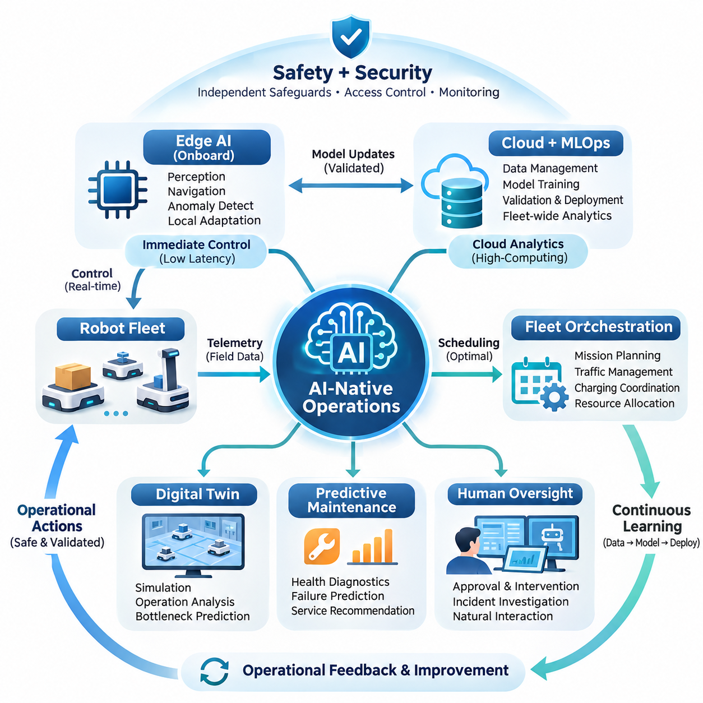
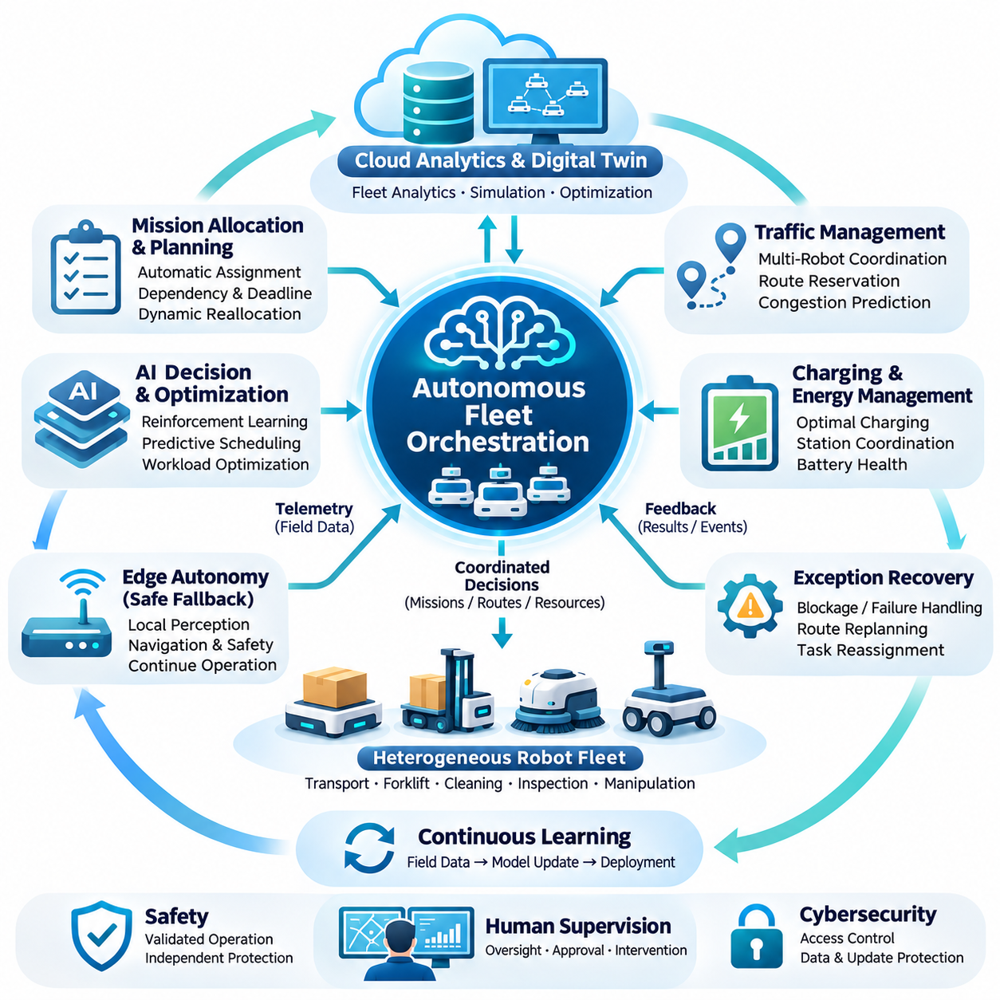
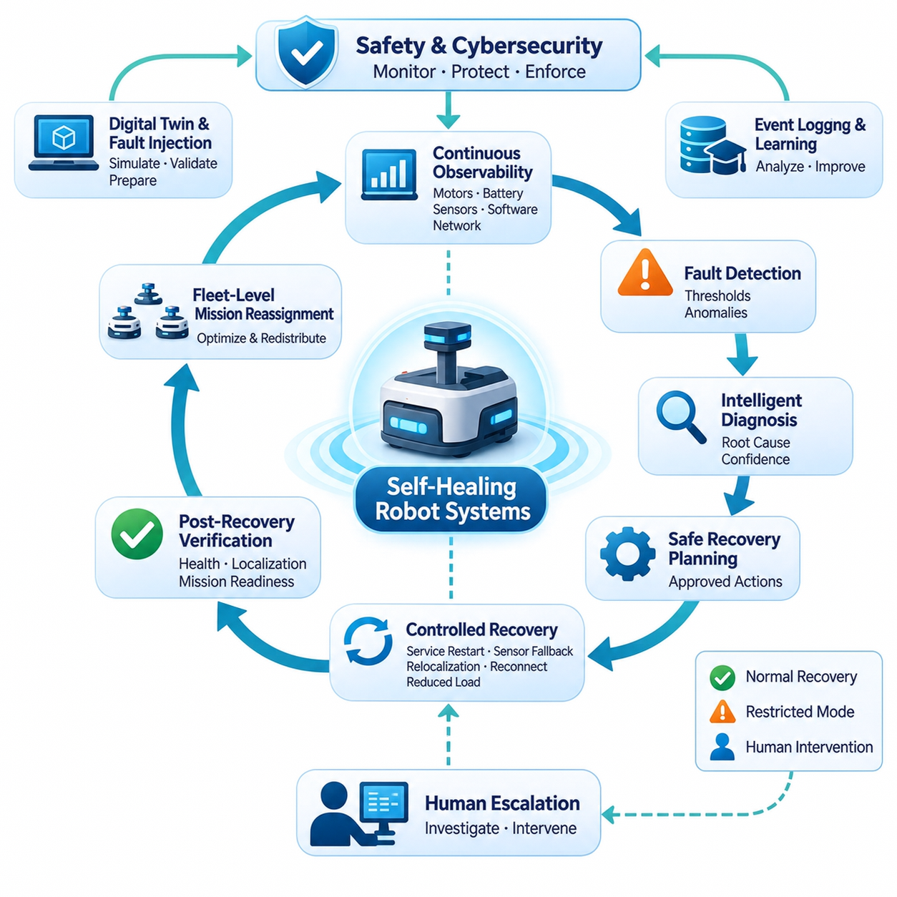
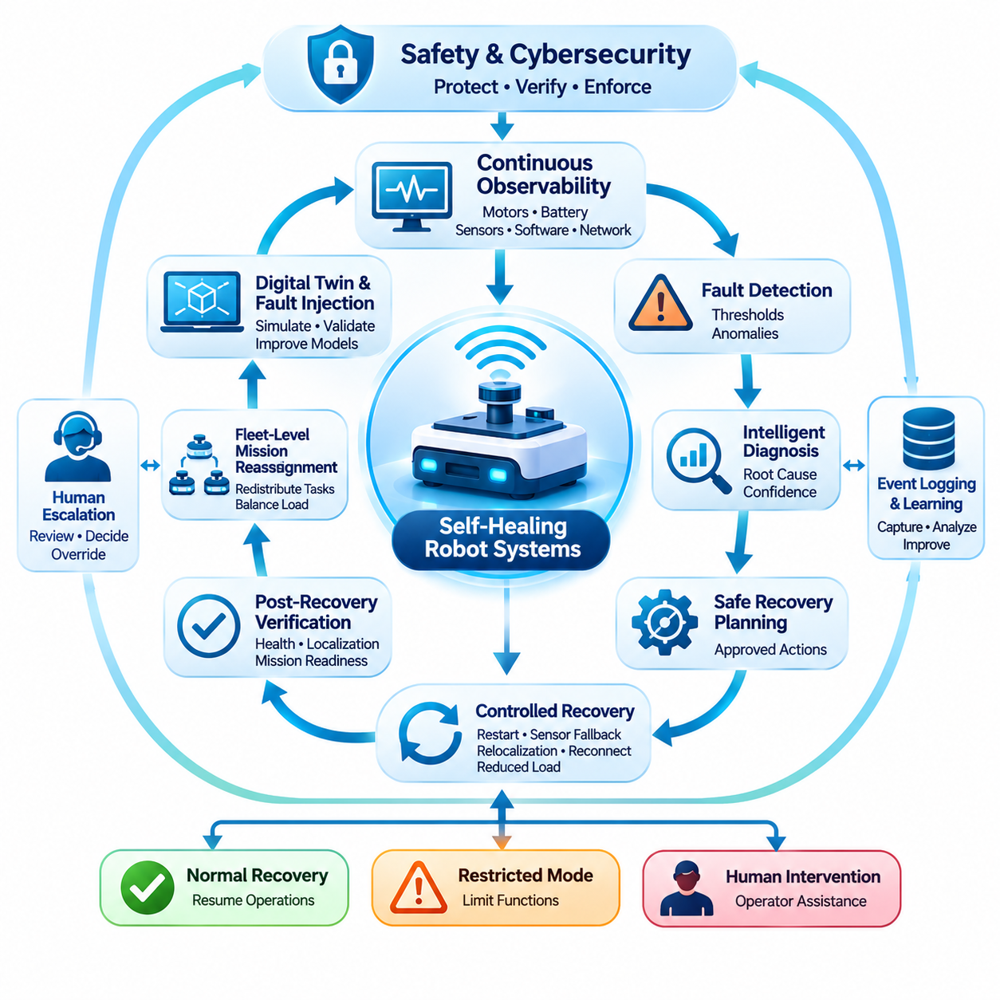
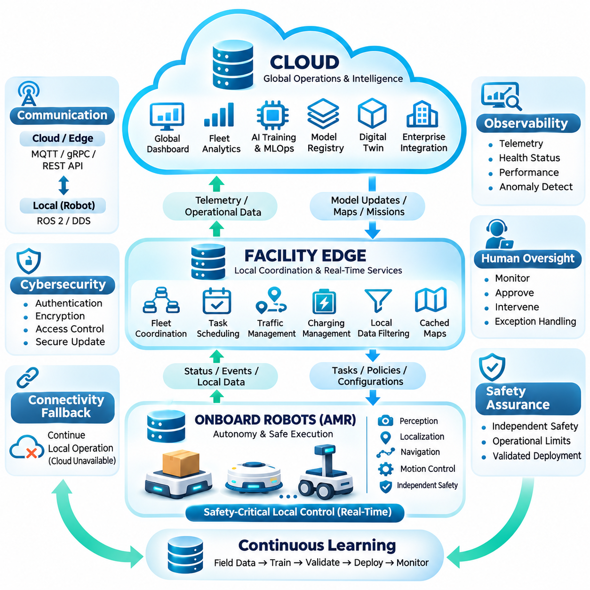
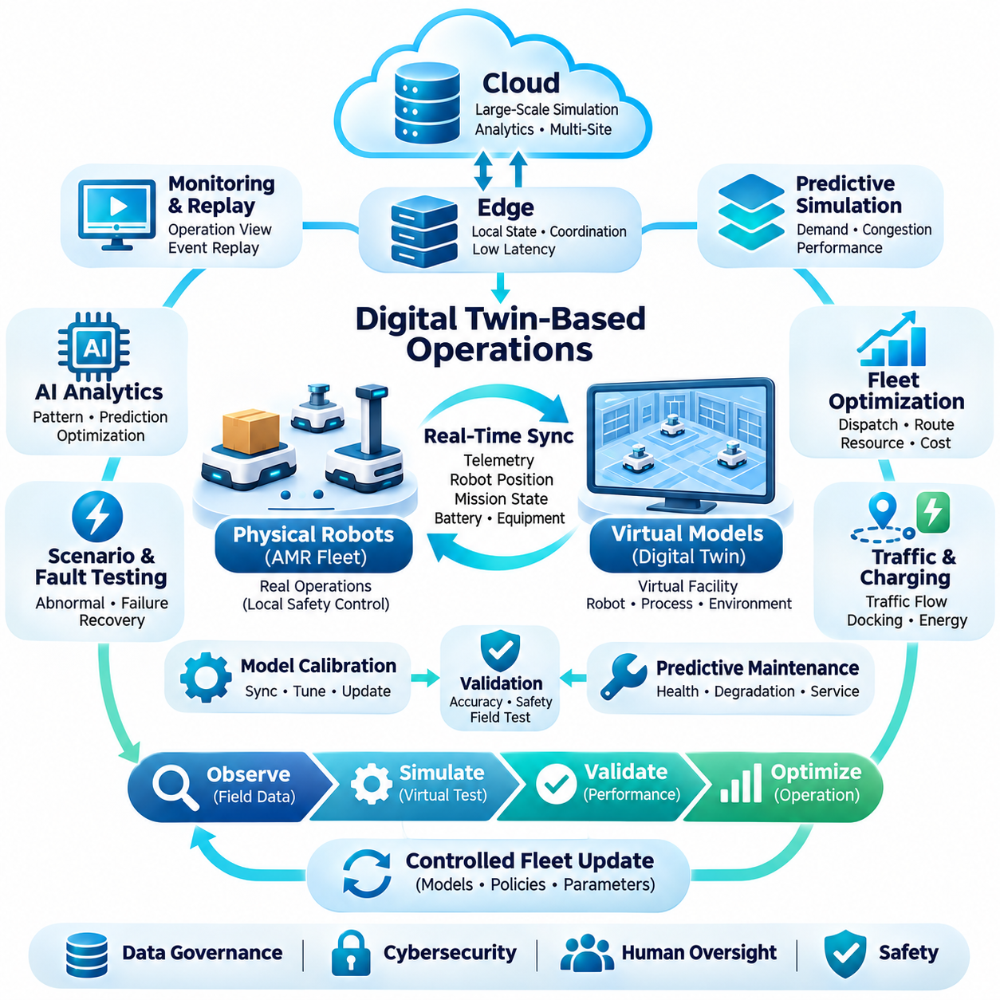
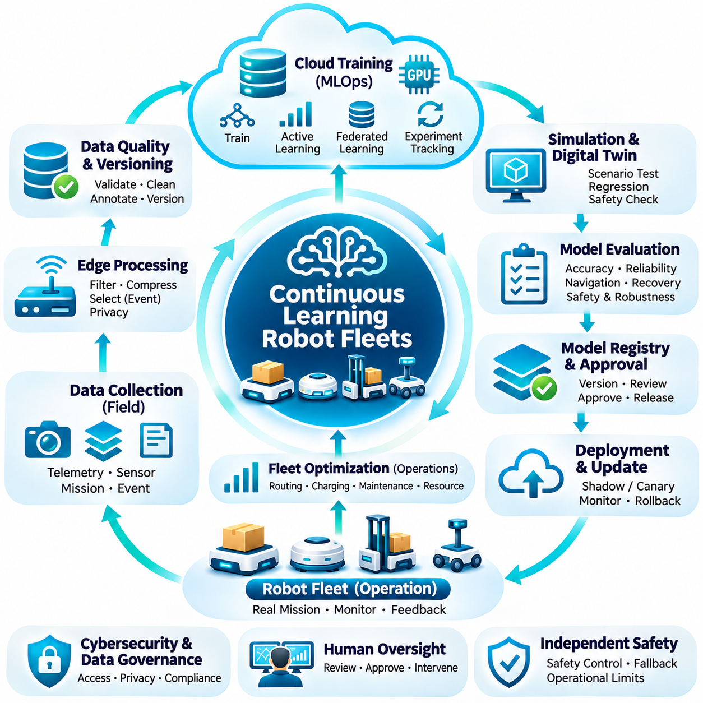
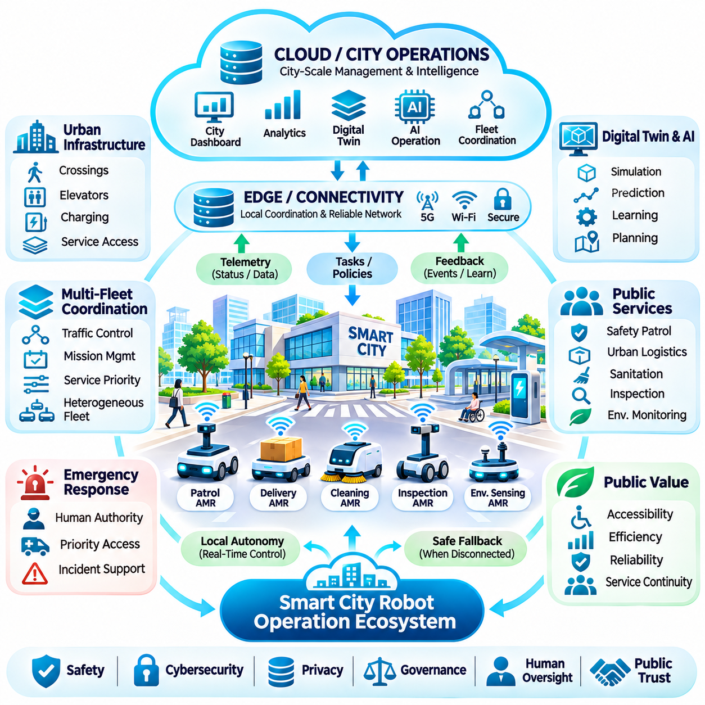
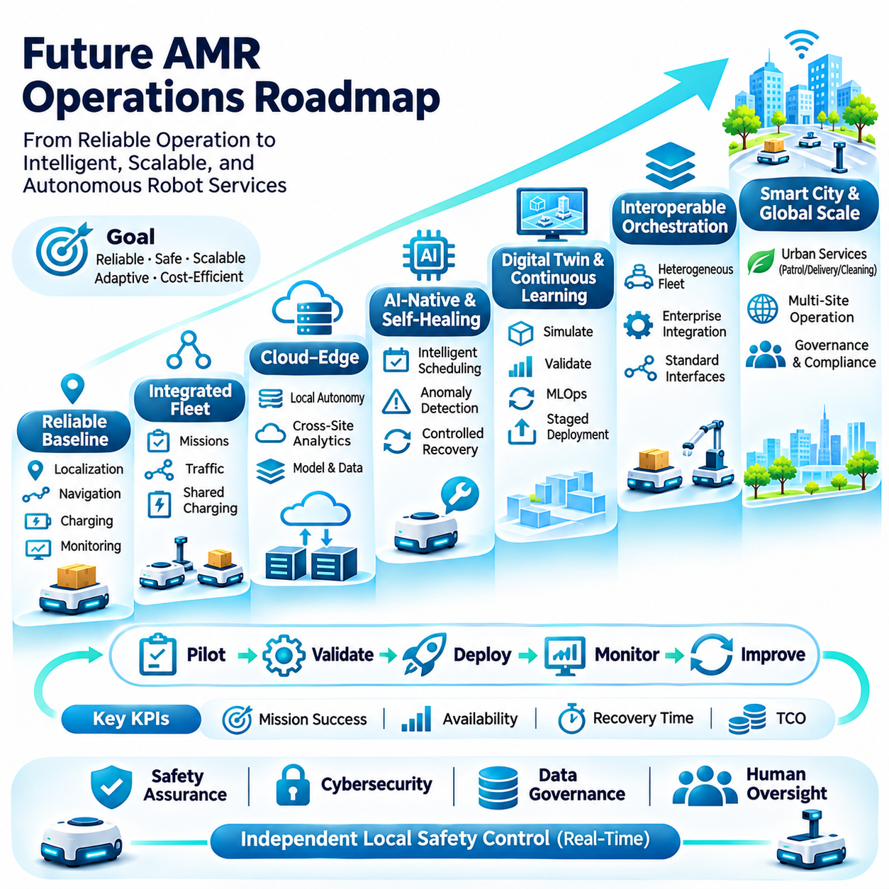

**Volume 08. AMR Operations, Deployment, and MLOps**

# Chapter 25. Future of Robot Operations

## 25.1 AI-Native Robot Operations

{width="7.268055555555556in" height="7.268055555555556in"}

AI-native robot operations represent a fundamental transformation in how autonomous mobile robots are deployed, managed, monitored, and continuously improved. Instead of treating artificial intelligence as an isolated perception or navigation component, AI becomes the operational foundation connecting mission planning, fleet coordination, maintenance, safety management, and business workflows. This approach enables robot systems to make increasingly informed operational decisions.

Traditional robot operations rely on predefined schedules, fixed operational rules, manual supervision, and reactive maintenance procedures. Although these approaches provide predictable behavior, they often struggle with changing environments, unexpected failures, and complex fleet interactions. AI-native operations introduce adaptive decision-making mechanisms that interpret operational context, predict emerging conditions, and recommend or execute appropriate responses within defined safety constraints.

The architecture of an AI-native robot operation platform integrates robot management systems, fleet management systems, edge computing, cloud infrastructure, and machine learning operations. These components exchange operational information through standardized interfaces and event-driven communication mechanisms. A unified intelligence layer analyzes robot status, mission priorities, environmental conditions, and historical performance to coordinate operational decisions across the entire fleet.

Operational intelligence begins with continuous acquisition of high-quality field data. Robots generate sensor observations, localization estimates, navigation events, battery measurements, diagnostic information, and mission execution records. These data streams provide the foundation for understanding actual operating conditions. Effective AI-native platforms transform raw telemetry into structured operational knowledge through filtering, synchronization, contextual labeling, and automated event correlation.

AI-driven mission orchestration extends conventional task scheduling by considering dynamic operational priorities and resource availability. A fleet management platform can evaluate robot capabilities, payload requirements, travel distances, battery reserves, traffic congestion, and service deadlines before assigning missions. When conditions change, the orchestration system can reconsider assignments and recommend alternative execution strategies while preserving operational constraints and mission dependencies.

Context-aware decision-making is particularly important in environments shared by robots, people, and conventional equipment. An AI-native platform combines real-time perception with historical observations to recognize patterns that influence operational performance. For example, recurring congestion near elevators, loading stations, or warehouse intersections can inform scheduling adjustments. Such intelligence allows the system to anticipate operational bottlenecks rather than responding only after delays occur.

Edge intelligence provides the computational foundation for decisions requiring immediate responses. Onboard processors execute perception, localization, navigation, anomaly detection, and local mission adaptation without depending on continuous cloud connectivity. Cloud infrastructure supports computationally intensive analytics, historical optimization, model development, and fleet-wide coordination. This division allows AI-native operations to balance response latency, computational efficiency, communication costs, and operational resilience.

AI-native operations also introduce intelligent resource management across heterogeneous robot fleets. Different platforms may possess distinct mobility configurations, payload capacities, sensors, manipulators, and computing capabilities. The orchestration system must understand these differences when selecting robots for specific tasks. Capability-aware scheduling prevents unsuitable assignments while improving utilization of specialized equipment and reducing unnecessary mission interruptions.

Predictive maintenance becomes an integrated function of operational intelligence rather than a separate maintenance activity. Machine learning models examine battery degradation, motor current, vibration, thermal behavior, communication reliability, and component fault histories. By identifying deviations from established operating patterns, the platform can estimate maintenance requirements and recommend service windows. Predictions must include uncertainty estimates and remain subject to engineering validation.

A major advantage of AI-native operations is the ability to connect operational performance with continuous learning pipelines. Difficult navigation scenarios, unexpected obstacles, localization failures, and unsuccessful mission executions can be identified automatically for further investigation. Selected field data are transferred into controlled data management and model development environments. Updated models undergo validation, regression testing, approval, and staged deployment before entering operational service.

Large language models and multimodal foundation models can provide additional capabilities for operational interpretation and human interaction. Operators may describe mission requirements using natural language, investigate incidents through conversational interfaces, or request explanations of fleet behavior. However, language-model outputs should be translated into validated commands through structured interfaces. Safety-critical motion control must remain governed by deterministic controllers and independently enforced safety mechanisms.

Intelligent incident management combines event detection, contextual analysis, and coordinated recovery procedures. When a robot reports an abnormal condition, the platform can correlate diagnostic logs, recent software updates, environmental observations, and related fleet events. AI-based reasoning may help identify probable causes and propose recovery actions. Automated recovery should be restricted to verified procedures, while uncertain or potentially hazardous situations require authorized human intervention.

Operational safety remains a foundational requirement regardless of the intelligence available to the platform. AI-native systems must maintain clear boundaries between adaptive optimization and safety-related control functions. Emergency stopping, protective separation, speed limitations, and safety-zone enforcement require appropriate independent safeguards. Every autonomous operational decision should be traceable through recorded inputs, applicable constraints, software versions, and resulting actions.

Cybersecurity becomes increasingly important as robots exchange information across distributed intelligence platforms. Secure identity management, encrypted communications, authenticated software packages, and role-based access control protect operational infrastructure. AI-driven security monitoring can identify unusual network behavior, unauthorized command patterns, and suspicious configuration changes. Security responses must preserve safe robot behavior and prevent compromised services from issuing uncontrolled physical commands.

Human supervision evolves from continuous manual monitoring toward exception-based operational management. Instead of observing every robot movement, operators supervise fleet objectives, investigate abnormal events, approve sensitive decisions, and evaluate operational performance. Explainable AI interfaces can present the evidence supporting scheduling changes, maintenance recommendations, or mission reassignment. Effective human-machine collaboration requires clear responsibility boundaries and accessible mechanisms for overriding autonomous decisions.

The performance of AI-native operations should be evaluated through measurable operational outcomes rather than model accuracy alone. Relevant indicators include mission completion rate, fleet availability, intervention frequency, recovery time, energy consumption, task throughput, and maintenance cost. AI-specific measurements should also examine prediction reliability, decision latency, model drift, and automated action success. These metrics connect intelligent capabilities with operational value and customer expectations.

Digital twins can strengthen AI-native operations by providing simulation environments connected to real fleet conditions. Operational data continuously update virtual representations of robots, infrastructure, traffic patterns, and mission workflows. The platform can evaluate alternative schedules, charging strategies, or routing policies before applying them to physical systems. Simulation results require validation against real-world behavior because incomplete models may produce misleading operational recommendations.

Scalable AI-native platforms must support deployments spanning individual facilities, multiple customer sites, and geographically distributed fleets. Standardized robot interfaces, modular services, and hierarchical orchestration architectures enable consistent management across different environments. Local controllers maintain site-level autonomy, while regional or global services coordinate analytics, software governance, and operational policies. This architecture reduces dependence on centralized connectivity and improves deployment flexibility.

The transition toward AI-native operations should follow a progressive engineering strategy. Initial capabilities may focus on unified telemetry, automated diagnostics, and intelligent dashboards. Subsequent stages introduce predictive maintenance, adaptive scheduling, assisted incident recovery, and controlled autonomous orchestration. Each expansion requires operational validation, cybersecurity assessment, safety review, and evidence that automated decisions improve performance without introducing unacceptable risks.

Ultimately, AI-native robot operations transform autonomous robots from individually managed machines into coordinated, data-driven operational systems. Their long-term value depends on combining machine intelligence with reliable engineering, disciplined MLOps, transparent governance, and human accountability. As these capabilities mature, robot fleets can become more adaptive, efficient, and resilient while maintaining the safety and predictability required for sustained deployment in real-world environments.

## 25.2 Autonomous Fleet Operations

{width="7.268055555555556in" height="7.268055555555556in"}

Autonomous fleet operations represent the evolution from centrally supervised robot management toward intelligent systems capable of coordinating multiple autonomous mobile robots with minimal human intervention. Rather than executing isolated missions according to fixed schedules, robots operate as collaborative resources within a shared operational environment. Fleet-level intelligence continuously evaluates mission demand, robot availability, environmental conditions, and operational constraints to optimize overall system performance.

Traditional fleet management systems depend heavily on predefined dispatching rules, static traffic policies, and operator intervention when unexpected situations occur. Autonomous fleet operations introduce adaptive coordination mechanisms that respond to changing workloads, robot failures, and environmental disruptions. These mechanisms combine real-time operational data with predictive models and optimization algorithms to maintain mission continuity while reducing unnecessary delays and manual supervision.

The architecture of an autonomous fleet operation platform integrates robot management systems, fleet management systems, mission orchestration engines, distributed edge controllers, and cloud-based analytics services. Individual robots retain responsibility for local perception, navigation, and immediate obstacle avoidance. Fleet-level services coordinate shared resources, task priorities, traffic flow, and operational objectives through standardized communication interfaces and synchronized system states.

Autonomous task allocation is a central capability of intelligent fleet operations. The orchestration system evaluates robot location, payload capacity, battery condition, equipment configuration, mission priority, and estimated completion time before assigning tasks. Dynamic allocation algorithms can redistribute missions when demand changes or robots become unavailable. This approach improves resource utilization and reduces the operational inefficiencies associated with fixed robot-to-task assignments.

Fleet-wide mission planning extends beyond selecting the nearest available robot. Intelligent planning must consider task dependencies, service deadlines, charging requirements, congestion risks, and the availability of shared infrastructure. For example, a hospital delivery mission may depend on elevator access, restricted-area permissions, and coordinated handover procedures. Autonomous orchestration evaluates these dependencies to establish feasible execution sequences and reduce conflicts between simultaneous missions.

Multi-robot traffic coordination becomes increasingly important as fleet density increases. Robots operating in shared corridors, intersections, docking areas, and loading zones must avoid deadlocks while maintaining predictable movement. Fleet management algorithms can reserve critical route segments, assign intersection priorities, and regulate access to constrained spaces. Local safety controllers remain responsible for immediate collision prevention, independently of centralized traffic optimization decisions.

Predictive traffic management improves fleet efficiency by anticipating congestion before it affects mission execution. Historical navigation records and real-time robot positions can reveal recurring bottlenecks associated with elevators, narrow passages, charging stations, or production schedules. Predictive models estimate future traffic demand and recommend alternative routes or departure times. Such capabilities reduce unnecessary waiting and improve the consistency of mission completion times.

Autonomous fleet operations require coordinated energy management because charging decisions directly influence mission availability. Intelligent charging strategies consider battery state of charge, predicted energy consumption, mission urgency, charging station occupancy, and expected workload. Instead of charging every robot according to fixed thresholds, the platform schedules charging opportunities according to operational demand. Battery health constraints and minimum energy reserves remain mandatory throughout optimization.

Heterogeneous fleet coordination enables different robot types to participate in shared operational workflows. Mobile transport robots, autonomous forklifts, towing platforms, inspection robots, and mobile manipulators possess different capabilities and operational limitations. A capability-aware orchestration system matches mission requirements with suitable platforms while coordinating their interactions. Standardized interfaces help integrate equipment from different manufacturers without assuming identical navigation or control architectures.

Distributed intelligence improves operational resilience by separating immediate robot control from fleet-level optimization. Edge controllers maintain essential navigation and safety functions when communication with centralized services becomes unavailable. Local coordination mechanisms may continue previously authorized missions under defined conditions. When connectivity is restored, the platform reconciles operational states, resolves conflicting assignments, and updates mission records without compromising safety or data consistency.

Autonomous exception handling allows fleet systems to respond systematically to operational disruptions. When a robot encounters a blocked route, failed docking attempt, unavailable elevator, or hardware malfunction, the system evaluates alternative actions. These may include route replanning, task reassignment, controlled waiting, or dispatching another robot. Recovery actions must respect validated operating boundaries, while uncertain or hazardous situations require escalation to authorized personnel.

Artificial intelligence can enhance fleet-level decision-making through reinforcement learning, predictive optimization, and learned operational policies. Simulation environments provide opportunities to evaluate scheduling and traffic strategies under varied workload conditions. However, learned policies require extensive testing against deterministic baselines, safety constraints, and unusual operating scenarios. Production deployment should include monitoring, bounded decision authority, and mechanisms for reverting to verified control strategies.

Digital twin technology supports autonomous fleet operations by maintaining virtual representations of robots, facilities, traffic networks, and operational resources. These models enable evaluation of alternative mission schedules, fleet sizes, charging configurations, and infrastructure layouts. Real operational data can continuously improve simulation fidelity. Nevertheless, digital twin predictions must be validated against field measurements before they influence consequential operational decisions.

Continuous operational learning enables fleet management policies to improve through accumulated experience. Mission delays, traffic conflicts, battery consumption, recovery events, and operator interventions provide valuable information about system behavior. Data analysis identifies recurring inefficiencies and opportunities for optimization. Proposed improvements are evaluated through controlled experiments, simulation, and staged deployment before becoming part of routine autonomous operations.

Human supervision remains essential even when fleet coordination becomes highly autonomous. Operators define mission objectives, operational priorities, safety restrictions, and acceptable service levels. Autonomous systems manage routine scheduling and coordination within these boundaries, while humans investigate exceptional situations and authorize high-impact changes. Explainable operational interfaces should present the reasoning behind task reassignment, traffic restrictions, and resource allocation decisions.

Operational cybersecurity must protect the communication and decision-making infrastructure connecting autonomous robots. Secure device identities, authenticated commands, encrypted communication channels, and role-based access controls prevent unauthorized fleet manipulation. Monitoring systems detect suspicious command sequences, unusual network behavior, and unexpected configuration changes. Security failures must trigger controlled responses that preserve safe robot operation and prevent unauthorized physical actions.

Performance evaluation should measure the effectiveness of the complete fleet rather than individual robot productivity alone. Important indicators include mission completion rate, fleet utilization, average task waiting time, traffic congestion duration, charging efficiency, intervention frequency, and operational availability. Additional measurements assess scheduling stability, recovery performance, and resource fairness. These metrics help determine whether autonomous coordination produces measurable improvements in service quality and operating cost.

Scalable fleet architectures must support increasing robot populations without creating excessive communication overhead or centralized processing bottlenecks. Hierarchical orchestration can distribute coordination responsibilities across robots, local facility controllers, and regional management services. Event-driven communication and selective state synchronization reduce unnecessary data exchange. Capacity planning should evaluate computational demand, network reliability, database performance, and the complexity of shared operational resources.

The transition toward autonomous fleet operations should follow a progressive deployment strategy. Initial implementations may automate task dispatching and charging coordination while retaining conventional traffic management. Later stages introduce predictive scheduling, adaptive traffic optimization, autonomous exception handling, and coordinated multi-site operations. Each stage requires measurable acceptance criteria, field validation, operational risk assessment, and clearly defined procedures for human intervention.

Ultimately, autonomous fleet operations transform collections of independent robots into coordinated operational systems capable of adapting to changing demands and environmental conditions. Their effectiveness depends on combining distributed autonomy, reliable communication, intelligent orchestration, continuous learning, and enforceable safety constraints. As these technologies mature, robot fleets can achieve greater operational flexibility, resource efficiency, and resilience while preserving human accountability and predictable service delivery.

## 25.3 Self-Healing Robot Systems

{width="7.268055555555556in" height="7.268055555555556in"}

{width="7.268055555555556in" height="7.268055555555556in"}

Self-healing robot systems represent an advanced operational architecture in which autonomous mobile robots can detect abnormalities, diagnose failures, and execute controlled recovery procedures with limited human intervention. Unlike conventional fault management, which primarily reports errors to operators, self-healing systems actively evaluate recovery options. Their objective is to restore operational functionality, maintain mission continuity, and prevent minor disturbances from escalating into major service interruptions.

The foundation of self-healing robotics is continuous system observability across hardware, software, communication, and operational processes. Robots collect diagnostic information from motors, batteries, sensors, controllers, operating systems, and network interfaces. Monitoring services correlate these measurements with mission execution records and environmental conditions. This integrated perspective enables early identification of abnormal behavior that isolated component monitoring might overlook.

Self-healing architectures typically combine fault detection, diagnosis, recovery planning, execution, and post-recovery verification within a closed operational loop. Each stage requires clearly defined interfaces and decision boundaries. Detection identifies deviations from expected behavior, diagnosis estimates probable causes, and recovery planning selects permissible corrective actions. Verification determines whether the intervention restored acceptable operation or whether further escalation is necessary.

Fault detection mechanisms use threshold monitoring, statistical analysis, anomaly detection, and model-based consistency checks. A motor controller may report abnormal current consumption, while localization software may detect growing uncertainty in position estimates. Combining multiple observations improves diagnostic confidence and reduces false alarms. Detection algorithms must distinguish temporary disturbances from persistent faults to avoid unnecessary recovery actions.

Intelligent fault diagnosis extends beyond recognizing error codes by examining relationships between symptoms and underlying system conditions. Diagnostic models can correlate sensor degradation, processor overload, network latency, and navigation instability. Historical failure records and dependency graphs provide additional context for identifying probable root causes. Because diagnosis remains uncertain, recovery decisions should consider confidence levels, potential consequences, and available evidence.

Recovery planning determines how a robot can safely return to an acceptable operational state. Possible actions include restarting a noncritical software service, switching to a redundant sensor, recalibrating a permitted subsystem, reducing computational workload, or requesting mission reassignment. Recovery policies must distinguish reversible software interventions from hardware failures requiring physical inspection. No automated action should bypass established safety functions or equipment protection limits.

Software self-healing is particularly valuable in distributed robot architectures containing numerous interconnected processes. Supervisory services can detect crashed applications, stalled communication channels, memory exhaustion, and abnormal execution delays. Container orchestration and process supervision mechanisms may restart failed components or restore verified configurations. However, automatic restarts require dependency checks and controlled sequencing to prevent repeated failures or inconsistent system states.

Sensor fault tolerance enables robots to maintain limited functionality when individual sensing components become unreliable. A robot using LiDAR, cameras, inertial sensors, and wheel odometry can compare observations to identify inconsistent measurements. Under validated conditions, the localization system may reduce reliance on a degraded sensor or transition to an approved fallback configuration. Such adaptation must preserve required safety coverage and avoid unsupported assumptions about environmental visibility.

Communication resilience is another essential capability because autonomous robots frequently depend on wireless networks for fleet coordination and remote supervision. Self-healing communication services can detect packet loss, excessive latency, interrupted sessions, and unavailable network paths. Recovery strategies may include reconnecting services, switching approved communication channels, or temporarily entering a restricted operating mode. Mission execution must respect connectivity requirements and local safety constraints.

Battery and power management systems can contribute to self-healing operations by detecting abnormal voltage, temperature, current, and state-of-charge behavior. Intelligent monitoring identifies degradation patterns and potential power distribution problems before they cause unexpected shutdowns. When appropriate, the robot may reduce nonessential computational loads or request early charging. Critical battery protection remains under dedicated hardware and battery management safeguards rather than adaptive AI decisions.

Self-healing navigation systems address disturbances such as localization degradation, blocked routes, map inconsistencies, and unsuccessful docking attempts. Recovery may involve controlled relocalization, alternative route planning, temporary waiting, or returning to a validated reference position. Repeated navigation failures should trigger diagnostic escalation rather than unlimited retries. Recovery logic must maintain collision avoidance, speed restrictions, and environmental safety requirements throughout the process.

Fleet-level self-healing extends recovery capabilities beyond individual robots. When a robot becomes unavailable, the fleet management system can redistribute pending missions, reserve alternative resources, and adjust operational schedules. Other robots may continue essential services while the affected unit enters maintenance or diagnostic mode. This coordinated response improves service continuity without assuming that every hardware or software failure can be repaired autonomously.

Artificial intelligence enhances self-healing through predictive anomaly detection, probabilistic diagnosis, and recovery policy optimization. Machine learning models can identify complex relationships between operational symptoms that conventional rules may not capture. Nevertheless, AI-generated recommendations require validation against established engineering constraints. High-risk interventions should remain subject to human authorization, and uncertain diagnoses must not trigger uncontrolled physical actions.

Digital twins and simulation environments provide valuable tools for developing and validating self-healing mechanisms. Engineers can reproduce sensor failures, communication interruptions, software crashes, and actuator abnormalities without exposing operational robots to unnecessary risk. Fault injection experiments reveal whether recovery procedures behave correctly under controlled conditions. Simulation results must be supplemented by hardware testing and representative field validation.

Recovery verification is essential because successful execution of a corrective action does not necessarily mean that the underlying problem has been resolved. After recovery, the system should evaluate component health, communication stability, localization quality, and mission readiness. Repeated failures or deteriorating measurements may indicate unresolved root causes. Verification outcomes should determine whether normal operation resumes, restricted operation continues, or maintenance intervention becomes mandatory.

Self-healing systems require comprehensive event logging and traceability to support engineering analysis and operational governance. Each incident record should include detection time, observed symptoms, diagnostic evidence, selected recovery action, software configuration, and verification results. These records support root cause analysis, reliability improvement, and future model development. Structured incident histories also help identify recurring failures that require permanent engineering corrections.

Cybersecurity controls must prevent self-healing mechanisms from becoming unauthorized pathways for modifying robot behavior. Recovery commands should be authenticated, authorized, logged, and restricted to approved operational functions. Software restoration must use trusted packages and verified configurations. Security incidents may require isolation or controlled shutdown rather than automatic reconnection. Recovery automation must never override cybersecurity boundaries or established safety protections.

The effectiveness of self-healing robot systems should be evaluated using measurable reliability and recovery indicators. Important metrics include fault detection latency, diagnostic accuracy, mean time to recovery, successful recovery rate, repeated failure frequency, and human intervention requirements. Operational availability and mission completion rates provide broader evidence of service improvement. Evaluation should also measure false recovery attempts and unintended consequences to prevent excessive automation.

A practical deployment strategy introduces self-healing capabilities progressively, beginning with monitoring, diagnostics, and low-risk software recovery. Subsequent stages may incorporate redundant sensor management, controlled navigation recovery, predictive maintenance integration, and fleet-level mission redistribution. Every recovery function requires documented operating boundaries, validation criteria, rollback procedures, and escalation rules before production deployment.

Ultimately, self-healing robot systems transform fault management from a predominantly reactive maintenance activity into a continuous process of detection, diagnosis, controlled adaptation, and verification. Their long-term effectiveness depends on reliable system observability, validated recovery mechanisms, intelligent fleet coordination, and strict safety governance. As these capabilities mature, autonomous robot fleets can achieve greater resilience, higher availability, and reduced operational disruption without sacrificing human accountability.

## 25.4 Cloud-Edge Robot Operation Platform

{width="7.268055555555556in" height="7.268055555555556in"}

A cloud-edge robot operation platform provides a unified architecture for managing autonomous mobile robots through coordinated cloud services, local edge infrastructure, and onboard computing systems. Its primary objective is to distribute intelligence and operational responsibilities according to latency, reliability, security, and computational requirements. This approach enables robot fleets to maintain immediate local autonomy while benefiting from centralized analytics, orchestration, and continuous improvement.

Traditional robot management architectures often depend on centralized servers or isolated onboard controllers, creating limitations in scalability and operational flexibility. Cloud-edge integration addresses these limitations by separating time-critical control from computationally intensive fleet services. Robots execute essential perception, navigation, and safety functions locally, while edge servers coordinate nearby resources and cloud platforms manage broader operational intelligence and historical information.

The platform architecture typically consists of three interconnected computing layers. Onboard robot controllers handle sensor processing, localization, motion planning, and actuator interfaces. Facility-level edge servers provide low-latency mission coordination, traffic management, and local data processing. Cloud infrastructure supports global fleet visibility, machine learning pipelines, long-term storage, and enterprise integration. Clearly defined interfaces establish responsibility boundaries between these layers.

Workload placement is a fundamental engineering consideration in cloud-edge robot operations. Tasks requiring deterministic timing or immediate physical responses must remain close to the robot hardware. Fleet scheduling, map distribution, and operational diagnostics may execute on facility edge servers when local coordination is advantageous. Large-scale model training, historical analytics, and cross-site optimization are generally better suited to cloud or dedicated data center infrastructure.

Communication architecture connects distributed computing resources through reliable messaging and standardized interfaces. Robot systems may use ROS 2 and DDS for local communication, while MQTT, gRPC, REST APIs, or event streaming technologies support higher-level integration. Protocol selection depends on message frequency, delivery guarantees, network conditions, and interoperability requirements. Communication design must distinguish command channels from telemetry and bulk data transfer.

Reliable operation requires explicit management of communication latency, bandwidth, and connectivity failures. High-frequency control loops should not depend on unpredictable wide-area network delays. Edge services can cache mission information, maintain local coordination, and continue authorized workflows during temporary cloud outages. When connectivity returns, synchronization mechanisms reconcile mission states and operational records while preventing duplicate commands or inconsistent task assignments.

Edge computing infrastructure acts as an operational coordination layer between individual robots and centralized services. Local servers can maintain facility maps, coordinate shared intersections, manage docking stations, and process selected sensor data. Edge intelligence reduces unnecessary cloud communication and supports faster responses to site-specific events. Redundant infrastructure and failover mechanisms may be required where operational continuity is critical.

Cloud services provide centralized capabilities that benefit from aggregated fleet information and scalable computing resources. These include global dashboards, model registries, software distribution, operational analytics, customer management, and multi-site performance comparison. Cloud-native services can scale independently according to workload demand. However, their availability must not become a prerequisite for maintaining essential robot safety or immediate motion control.

Data management is central to effective cloud-edge integration because robot fleets generate large volumes of heterogeneous information. Raw sensor recordings, diagnostic logs, mission events, maps, and AI inference results have different storage and transmission requirements. Edge filtering, compression, event-based selection, and retention policies reduce bandwidth consumption. Data pipelines should preserve timestamps, robot identities, software versions, and contextual metadata for reliable analysis.

Artificial intelligence deployment across cloud and edge environments requires coordinated model lifecycle management. Training and evaluation may occur on centralized GPU infrastructure, while optimized inference models execute on onboard accelerators or local edge servers. Model packaging must account for hardware compatibility, memory constraints, runtime dependencies, and inference latency. Controlled distribution and version tracking ensure that operational robots execute approved configurations.

Machine learning operations connect field observations with continuous model improvement. Operational data are collected, validated, labeled, and incorporated into controlled training datasets. Candidate models undergo offline benchmarking, simulation, regression testing, and deployment approval. Cloud-edge orchestration then distributes approved versions through staged updates. Monitoring services detect performance degradation and support rollback when updated models fail to satisfy operational requirements.

Fleet management systems use cloud-edge coordination to optimize mission execution across multiple robots. Facility edge controllers can manage real-time task assignment, traffic reservations, charging schedules, and shared infrastructure access. Cloud services aggregate information across sites to support capacity planning and strategic optimization. Hierarchical orchestration prevents global management functions from interfering with time-sensitive local coordination and safety enforcement.

Digital twins can extend the platform by maintaining virtual representations of robots, operational environments, and infrastructure resources. Edge systems provide current operational states, while cloud computing supports large-scale simulation and historical scenario analysis. Engineers can evaluate traffic policies, charging strategies, and fleet configurations before physical deployment. Simulation predictions require validation against actual field measurements to avoid unreliable operational decisions.

Cybersecurity must be implemented consistently across onboard controllers, edge servers, communication networks, and cloud infrastructure. Secure boot, device authentication, encrypted communication, role-based authorization, and signed software packages protect distributed operations. Network segmentation limits unauthorized movement between services. Security monitoring correlates events across computing layers, while recovery procedures preserve safe robot behavior during suspected compromise.

Operational observability requires unified monitoring of robot health, edge infrastructure, cloud services, and communication performance. Distributed tracing, structured logging, metrics collection, and synchronized timestamps enable engineers to investigate failures across system boundaries. Monitoring dashboards should distinguish robot faults from infrastructure or network problems. Automated alerts and diagnostic correlation improve incident response while reducing unnecessary operator intervention.

Scalability depends on modular services, standardized interfaces, and carefully designed resource allocation. Increasing robot populations creates additional demands on messaging infrastructure, databases, compute accelerators, and network capacity. Horizontal scaling can expand cloud services, while additional edge nodes distribute facility workloads. Capacity testing should evaluate peak traffic, concurrent missions, data ingestion rates, and recovery behavior under degraded operating conditions.

Cost optimization is another important consideration because cloud-edge platforms introduce expenses associated with computing, networking, storage, and maintenance. Intelligent workload placement reduces unnecessary data transfer and avoids excessive cloud processing. Edge aggregation can lower recurring bandwidth costs, while centralized services reduce duplicated management infrastructure. Economic evaluation should consider total cost of ownership, service availability, operational efficiency, and future fleet expansion.

Human operators interact with the platform through unified operational interfaces that combine robot status, mission progress, alerts, and maintenance information. Role-based dashboards provide appropriate visibility for technicians, facility managers, fleet operators, and administrators. Remote intervention functions require authenticated access and clearly defined control authority. Operational interfaces should explain automated decisions and preserve traceability for safety reviews and incident investigations.

Deployment should progress from a validated single-site architecture toward distributed multi-site operations. Initial implementations establish reliable onboard control, edge coordination, cloud connectivity, and monitoring. Later stages introduce advanced analytics, automated model deployment, predictive maintenance, and cross-site orchestration. Each expansion requires cybersecurity assessment, performance benchmarking, failure testing, and documented operational acceptance criteria.

Ultimately, the cloud-edge robot operation platform establishes the infrastructure required for scalable, intelligent, and resilient autonomous robot services. Its effectiveness depends on assigning responsibilities to appropriate computing layers, maintaining reliable communication, and integrating operational intelligence with rigorous safety controls. As robot fleets expand, this architecture enables coordinated automation, continuous learning, and consistent service delivery across diverse environments.

## 25.5 Digital Twin-Based Operations

{width="7.268055555555556in" height="7.268055555555556in"}

Digital twin-based operations represent an advanced approach to managing autonomous mobile robots through continuously updated virtual representations of physical robots, facilities, and operational processes. Unlike conventional simulation models, operational digital twins maintain connections with real-world data to reflect changing system conditions. Their primary purpose is to improve operational visibility, predict future behavior, evaluate alternative decisions, and support reliable fleet optimization.

A digital twin architecture integrates physical assets, virtual models, data synchronization services, simulation engines, and operational management applications. Physical robots provide sensor measurements, localization estimates, mission states, and diagnostic information. Virtual models reproduce relevant mechanical, computational, and environmental characteristics. Synchronization mechanisms connect both domains, enabling engineers to compare expected behavior with actual operating conditions.

Digital twin fidelity determines how accurately virtual models reproduce physical system behavior. Geometric fidelity represents facility layouts, obstacles, and robot dimensions, while dynamic fidelity describes motion, acceleration, braking, and energy consumption. Operational fidelity captures task scheduling, traffic interactions, and infrastructure availability. Model complexity should reflect the intended decision rather than unnecessarily reproducing every physical detail.

Real-time synchronization is essential for maintaining operational relevance. Robot telemetry, mission events, battery conditions, equipment status, and environmental observations update corresponding virtual entities. Timestamp alignment and consistent coordinate systems prevent misleading interpretations of robot positions and events. Synchronization services must also identify delayed, missing, or contradictory information rather than presenting outdated virtual states as current reality.

Digital twin-based monitoring provides operators with contextual awareness beyond conventional status dashboards. A virtual facility can display robot locations, active missions, congestion areas, charging stations, and restricted zones. Historical events may be replayed to investigate navigation failures or operational delays. Combining spatial information with diagnostic records helps engineers understand how local disturbances influence overall fleet performance.

Predictive simulation enables operators to evaluate possible future conditions before they affect physical operations. Simulation engines can estimate traffic congestion, mission completion times, charging demand, and equipment utilization under different workloads. These predictions support proactive scheduling and resource allocation. Because simulations contain uncertainty, operational decisions should consider prediction confidence and deviations between modeled and observed behavior.

Fleet optimization is a major application of operational digital twins. Engineers can compare robot population sizes, dispatching policies, route configurations, and charging strategies without disrupting production environments. Virtual experiments reveal potential bottlenecks and resource conflicts before implementation. Optimization results should be evaluated against mission completion rates, operational availability, energy efficiency, and total service cost.

Traffic management benefits from digital twins that reproduce shared corridors, intersections, elevators, and docking areas. Simulated robot interactions help identify deadlocks, congestion patterns, and inefficient routing policies. Alternative reservation rules and traffic priorities can be tested under representative operating conditions. Validated improvements may then be introduced through controlled fleet management updates while preserving independent local safety functions.

Digital twins also support predictive maintenance by linking equipment condition monitoring with virtual degradation models. Motor temperature, vibration, battery behavior, and actuator performance provide evidence of changing component health. Simulation and historical analysis can estimate maintenance requirements and possible failure consequences. Such predictions should supplement established inspection procedures rather than replace mandatory physical maintenance.

Scenario testing enables engineers to evaluate operational resilience under abnormal conditions. Virtual environments can reproduce network interruptions, sensor degradation, blocked passages, charging failures, and unexpected mission demand. Fault injection experiments reveal weaknesses in recovery procedures and fleet coordination. However, simulation cannot establish complete safety assurance, and critical recovery mechanisms require hardware testing and representative field validation.

Artificial intelligence can improve digital twin capabilities through learned environment models, predictive analytics, and adaptive operational optimization. Machine learning algorithms identify relationships between workload, traffic behavior, energy consumption, and mission outcomes. AI-assisted simulation may generate additional scenarios for testing. Learned predictions must remain distinguishable from measured facts and should be validated before influencing consequential operational decisions.

Cloud-edge integration determines where digital twin processing and synchronization should occur. Onboard controllers maintain immediate perception and safety functions, while edge servers manage facility-level states and low-latency coordination. Cloud infrastructure supports large-scale simulation, historical analysis, and multi-site comparisons. This distributed architecture prevents digital twin services from becoming dependencies for time-critical robot control.

Data governance is essential because digital twins combine operational records, spatial maps, sensor information, and potentially sensitive facility data. Standardized schemas, asset identifiers, version control, and retention policies support consistent model management. Access permissions should restrict sensitive information and unauthorized modifications. Data provenance allows engineers to trace simulation assumptions and operational conclusions to their original sources.

Model calibration maintains alignment between virtual representations and physical reality. Engineers compare simulated trajectories, energy consumption, task durations, and congestion patterns with field measurements. Differences reveal inaccurate parameters, missing environmental constraints, or changes in robot performance. Periodic recalibration is necessary because facility layouts, equipment characteristics, and operational workloads evolve over time.

Validation must establish whether a digital twin is sufficiently accurate for its intended operational purpose. A visualization model may tolerate larger approximations than a model used to evaluate braking behavior or safety-critical traffic interactions. Validation criteria should specify measurable error limits, operating conditions, and uncertainty bounds. Models that fail acceptance criteria must not be used to authorize consequential physical actions.

Digital twin-based commissioning can reduce deployment risks by evaluating facility configurations before robots begin routine operations. Virtual testing supports route design, docking placement, charging infrastructure planning, and mission scheduling. Engineers can identify accessibility limitations and resource conflicts early. Nevertheless, physical commissioning remains necessary to verify sensor performance, localization accuracy, communication reliability, and real-world safety behavior.

Operational cybersecurity must protect the interfaces connecting physical systems with their virtual counterparts. Authenticated data sources, encrypted communication, access control, and audit logging reduce risks of unauthorized manipulation. Digital twin commands capable of affecting real robots require stronger authorization than passive monitoring functions. Compromised or inconsistent model states should trigger controlled isolation rather than unsafe automated corrections.

Performance evaluation should measure both digital twin accuracy and its contribution to operational improvement. Relevant indicators include synchronization latency, model prediction error, simulation execution time, congestion reduction, maintenance effectiveness, and mission completion improvement. Engineers should also track false predictions and operational decisions that fail to produce expected benefits. These measurements establish whether digital twin investments deliver practical value.

Implementation should progress from basic visualization and historical replay toward predictive simulation and controlled operational optimization. Initial deployments establish reliable telemetry, asset models, and synchronization mechanisms. Later stages introduce calibrated simulation, predictive maintenance, AI-assisted scenario analysis, and multi-site coordination. Each capability requires documented validation procedures, cybersecurity controls, and clear boundaries for automated decisions.

Ultimately, digital twin-based operations connect physical robot fleets with continuously evolving computational models that support observation, prediction, experimentation, and optimization. Their effectiveness depends on trustworthy data, calibrated simulations, scalable computing infrastructure, and rigorous operational governance. As digital twin technologies mature, autonomous robot fleets can improve efficiency, resilience, and adaptability while preserving validated safety controls and human accountability.

## 25.6 Continuous Learning Robot Fleets

{width="7.268055555555556in" height="7.268055555555556in"}

Continuous learning robot fleets represent an advanced operational model in which autonomous mobile robots improve their capabilities through accumulated field experience. Instead of relying exclusively on models developed before deployment, these fleets collect operational evidence to refine perception, navigation, scheduling, and recovery strategies. Continuous learning connects real-world robot behavior with controlled model development while preserving safety, reliability, and operational accountability.

The foundation of continuous fleet learning is a structured feedback loop connecting robots, edge infrastructure, centralized data platforms, and model development environments. Robots generate observations during routine missions, including sensor measurements, navigation outcomes, task delays, and exceptional events. Data pipelines transform these observations into reusable learning resources. Validated improvements return to operational fleets through controlled software and model deployment.

Operational data collection must balance learning value against bandwidth, storage, privacy, and computational constraints. Recording every sensor stream continuously may be impractical for large fleets. Event-triggered collection, selective sampling, and edge filtering prioritize information associated with uncertainty, failures, or unusual conditions. Collection policies should preserve sufficient context for analysis while minimizing unnecessary data transfer and operational interference.

Data quality determines whether accumulated experience produces reliable improvements. Robot observations may contain corrupted measurements, inconsistent timestamps, incomplete metadata, or duplicated events. Validation pipelines identify these problems before data enter training repositories. Dataset versioning, provenance tracking, and standardized annotations establish traceability between field observations, training examples, model configurations, and deployment outcomes.

Learning systems must distinguish routine operational variation from meaningful changes in environmental conditions. Lighting, pedestrian traffic, floor surfaces, facility layouts, and equipment configurations can influence robot performance. Distribution shift detection identifies differences between current observations and previously validated training conditions. These signals help determine when additional data collection, model evaluation, or operational restrictions become necessary.

Active learning improves data efficiency by selecting observations that provide the greatest potential value for model development. Robots may identify uncertain object classifications, ambiguous navigation situations, or unfamiliar environmental features. Selected examples receive additional review or annotation before entering training datasets. Sampling strategies should account for rare but safety-relevant events rather than concentrating exclusively on frequently encountered situations.

Fleet-wide learning enables knowledge gathered by one robot to benefit other compatible platforms. Shared datasets can reveal recurring navigation difficulties, docking failures, and environmental patterns across facilities. However, differences in sensors, mechanical configurations, software versions, and operating environments affect transferability. Model improvements must be evaluated against the capabilities and limitations of each target robot configuration.

Centralized learning architectures aggregate operational data into shared training environments where computationally intensive model development can occur. Cloud platforms or dedicated GPU infrastructure support dataset processing, model training, benchmarking, and experiment tracking. Edge systems may perform preprocessing and local evaluation to reduce communication demands. Clear separation between learning infrastructure and safety-critical control prevents experimental models from directly influencing physical actions.

Federated learning provides an alternative when operational data cannot be transferred freely between facilities or organizations. Participating robots or edge servers train local model updates while sharing selected parameters or aggregated information. This approach can reduce raw data movement but introduces challenges involving heterogeneous data, communication overhead, and model consistency. Privacy and security guarantees require additional controls beyond federated training alone.

Continuous learning extends beyond perception models to operational decision-making and fleet coordination. Historical mission records can improve task allocation, charging schedules, congestion prediction, and maintenance planning. Optimization algorithms identify patterns associated with delays, resource conflicts, and inefficient energy use. Proposed policies must be tested against established operational baselines before replacing verified scheduling or traffic management strategies.

Simulation and digital twins provide controlled environments for evaluating candidate learning outcomes. Engineers can reproduce difficult navigation conditions, changing workloads, sensor disturbances, and rare operational failures. Synthetic scenarios expand test coverage when representative field examples are limited. Nevertheless, simulation fidelity and domain differences must be considered, and virtual success cannot replace physical validation for consequential behaviors.

Model evaluation requires measurable criteria covering both task performance and operational safety. Relevant indicators include perception accuracy, localization reliability, navigation success, mission completion rate, inference latency, and recovery effectiveness. Regression testing identifies capabilities that deteriorate after training updates. Evaluation should also include rare events, degraded sensors, unfamiliar environments, and interactions with people or other robots.

Machine learning operations provide governance for the complete model lifecycle, from dataset preparation to production monitoring. Model registries preserve training configurations, dataset versions, evaluation results, and deployment approvals. Automated pipelines support reproducible experiments and controlled software packaging. Human review remains necessary when updates affect safety boundaries, operational permissions, or behaviors that have not been adequately validated.

Deployment strategies should introduce improved models gradually rather than updating an entire fleet simultaneously. Shadow evaluation compares candidate predictions with active models without granting control authority. Canary deployments expose selected robots to approved updates under monitored conditions. Wider rollout follows only after predefined acceptance criteria are satisfied. Rollback mechanisms restore previously validated versions when unexpected performance degradation occurs.

Online adaptation requires particularly strict controls because model behavior may change during active operation. Limited adaptation may be appropriate for noncritical parameters or carefully bounded environmental estimates. Changes affecting collision avoidance, motion control, or safety decisions require independent validation and appropriate authorization. Learning components must never override certified safety functions or established operational constraints.

Human feedback contributes valuable information that automated metrics may fail to capture. Operators can identify incorrect object interpretations, inefficient routes, confusing recovery behavior, and unexpected service interruptions. Structured feedback interfaces associate observations with mission records and system states. Review processes distinguish genuine model weaknesses from infrastructure problems, operational misuse, or environmental conditions outside approved operating boundaries.

Cybersecurity and data governance protect continuous learning pipelines against unauthorized modification and contaminated training information. Secure data collection, authenticated model distribution, access controls, and integrity verification establish trust across the lifecycle. Data poisoning and malicious annotations can undermine model reliability. Sensitive operational records require appropriate retention, anonymization, and access restrictions according to applicable requirements.

Fleet learning performance should be evaluated through measurable operational benefits rather than model accuracy alone. Important indicators include reduction in human interventions, improved mission success, lower recovery frequency, better energy utilization, and reduced operational downtime. Learning efficiency can be assessed through data requirements, training cost, update frequency, and improvement stability. These measurements determine whether continuous learning produces sustainable operational value.

A progressive implementation strategy begins with reliable data collection, event analysis, and offline model improvement. Subsequent stages introduce automated dataset curation, simulation-based validation, staged deployment, and coordinated fleet-wide learning. More advanced implementations may incorporate federated learning and bounded adaptation. Every stage requires documented approval procedures, monitoring responsibilities, and clearly defined rollback conditions.

Ultimately, continuous learning robot fleets transform operational experience into a systematic source of intelligence and long-term performance improvement. Their success depends on trustworthy data, reproducible training, rigorous validation, secure deployment, and enforceable safety constraints. As learning infrastructure matures, autonomous robot fleets can become increasingly adaptable, efficient, and resilient while retaining predictable behavior and meaningful human oversight.

## 25.7 Smart City Robot Operation Ecosystem

{width="7.268055555555556in" height="7.268055555555556in"}

A smart city robot operation ecosystem integrates autonomous mobile robots, urban infrastructure, digital services, and public institutions into a coordinated operational environment. Rather than treating robots as isolated devices, the ecosystem manages them as interconnected urban service resources. Its primary objective is to improve public safety, municipal efficiency, accessibility, and service continuity through reliable automation and shared operational intelligence.

Smart city robotics encompasses diverse applications, including public safety patrols, environmental monitoring, facility inspection, urban logistics, sanitation, and infrastructure maintenance. Each application introduces different mobility requirements, sensing capabilities, and operational constraints. A unified ecosystem must support heterogeneous robots while maintaining consistent standards for safety, communication, service management, and public accountability.

The ecosystem architecture connects onboard robot intelligence, local edge infrastructure, city-level management platforms, and cloud services. Robots perform immediate perception, navigation, and motion control, while edge systems coordinate activities within designated urban zones. Centralized platforms aggregate operational information across districts and service providers. Clearly defined interfaces prevent centralized coordination from interfering with essential local autonomy.

Urban robot deployment requires integration with physical infrastructure such as sidewalks, pedestrian crossings, elevators, charging stations, and service access points. Digital interfaces may provide infrastructure status and authorized access permissions. Robots must still detect physical conditions independently because infrastructure information may be delayed or inaccurate. Successful integration depends on accessible design, reliable communication, and cooperation among infrastructure operators.

Multi-robot coordination becomes increasingly important as different service fleets share public spaces. Patrol robots, delivery platforms, cleaning machines, and inspection vehicles may operate simultaneously along common routes. Fleet coordination systems can manage shared resources, operational zones, and service priorities. However, traffic coordination must respect pedestrian rights, emergency access requirements, and the independent safety responsibilities of individual robots.

Urban connectivity combines cellular networks, municipal wireless infrastructure, local edge networks, and secure cloud communication. Different communication channels support telemetry, mission coordination, remote assistance, and software distribution. Network coverage may vary across buildings, underground passages, and densely developed areas. Robots therefore require local autonomy, connectivity monitoring, and safe fallback behavior when communication becomes unavailable.

City-scale robot management platforms provide unified visibility into fleet locations, mission progress, operational availability, and infrastructure conditions. Municipal operators can monitor service coverage and identify areas requiring intervention. Role-based interfaces distinguish responsibilities among city authorities, service providers, maintenance teams, and emergency personnel. Shared visibility should not imply unrestricted access to robot controls or sensitive operational information.

Public safety operations represent an important application of smart city robotics. Autonomous patrol robots can observe designated areas, identify predefined anomalies, and transmit relevant alerts to authorized personnel. Environmental sensors and imaging systems may support infrastructure monitoring and incident assessment. These capabilities require clear operational boundaries, privacy safeguards, and human review before consequential enforcement or emergency decisions.

Urban logistics robots can support short-distance delivery between public facilities, commercial buildings, transportation hubs, and community service locations. Coordinated routing and scheduled access to shared infrastructure can reduce operational conflicts. Delivery performance depends on pedestrian density, weather, accessibility, and secure handover procedures. Economic evaluation should consider service reliability and maintenance costs alongside transportation efficiency.

Environmental and infrastructure monitoring benefits from distributed robotic sensing across urban districts. Robots may collect information about air quality, surface conditions, structural anomalies, or equipment status within approved operating areas. Georeferenced observations support maintenance prioritization and trend analysis. Measurement accuracy, sensor calibration, and data provenance are essential because unreliable observations can produce inappropriate municipal responses.

Digital twins provide virtual representations of urban robot operations and supporting infrastructure. Real-time fleet information can update maps of service coverage, congestion, charging demand, and infrastructure availability. Simulation allows planners to evaluate deployment density, routing policies, and operational disruptions before implementing changes. Digital twin predictions require validation against actual city conditions and should not substitute for field safety testing.

Artificial intelligence supports urban perception, mission planning, anomaly detection, and predictive maintenance. Fleet learning systems can identify recurring operational difficulties and improve approved models using accumulated field data. However, urban environments introduce significant variability involving pedestrians, vehicles, weather, construction, and temporary obstacles. Model evaluation must address unfamiliar situations, distribution shifts, and interactions with vulnerable road users.

Cybersecurity is fundamental because interconnected robots and municipal systems expand the potential attack surface. Device authentication, encrypted communication, signed software updates, network segmentation, and access control protect operational infrastructure. Security monitoring should identify unauthorized commands and abnormal communication patterns. Incident response procedures must preserve safe robot behavior while isolating compromised systems and maintaining essential municipal services.

Privacy and data governance require particular attention when robots operate in publicly accessible environments. Cameras, microphones, localization systems, and operational records may capture information about individuals and sensitive locations. Data minimization, purpose limitation, retention controls, and authorized access reduce unnecessary exposure. Governance policies should define responsibility for collection, processing, sharing, deletion, and auditing under applicable regulations.

Regulatory compliance involves robotics safety requirements, traffic rules, accessibility standards, cybersecurity obligations, and local operating permissions. Requirements vary according to robot classification, operating location, and jurisdiction. Municipal authorities and service providers must establish approved operating domains and documented responsibilities. Regulatory review should occur before deployment and whenever robot capabilities or operating conditions materially change.

Public acceptance influences the long-term sustainability of urban robot services. Residents must be able to understand robot behavior, recognize operational purposes, and report unsafe or disruptive interactions. Clear identification, predictable movement, accessible reporting channels, and transparent service policies improve trust. Human-centered design should prioritize pedestrians and people with disabilities rather than maximizing robot throughput at the expense of accessibility.

Emergency management requires coordination between robotic services and authorized response organizations. Robots may provide situational observations, inspect accessible hazardous areas, or support logistics under defined operational permissions. Emergency vehicles and responders must retain priority over routine robotic missions. Communication failures, evacuation conditions, and unexpected crowds require conservative fallback procedures and explicit human control authority.

Economic sustainability depends on shared infrastructure, scalable management services, and measurable public value. Common charging facilities, standardized interfaces, and coordinated maintenance can reduce duplicated investment. Service performance should be evaluated through coverage, availability, incident response support, energy consumption, and total cost of ownership. Procurement decisions should consider interoperability and long-term maintenance rather than initial equipment cost alone.

Implementation should begin with limited operational zones and clearly defined municipal use cases. Pilot deployments establish safety performance, infrastructure compatibility, communication reliability, and community feedback mechanisms. Expansion across districts requires standardized data interfaces, coordinated fleet governance, and validated operational procedures. Each stage should include measurable acceptance criteria and independent review of significant risks.

Ultimately, a smart city robot operation ecosystem establishes a framework for integrating autonomous robotic services into everyday urban infrastructure. Its success depends on technical interoperability, trustworthy artificial intelligence, resilient operations, regulatory compliance, and public confidence. As cities adopt increasingly diverse robot fleets, coordinated governance and human-centered design will determine whether automation delivers sustainable improvements to urban life.

## 25.8 Future AMR Operations Roadmap

{width="7.268055555555556in" height="7.268055555555556in"}

The future autonomous mobile robot operations roadmap describes a progressive transition from independently managed robots toward intelligent, coordinated, and increasingly autonomous service ecosystems. Its purpose is to align technological development with operational reliability, safety, scalability, and economic sustainability. Rather than assuming immediate full autonomy, the roadmap establishes measurable capabilities and validation requirements for each stage of operational maturity.

The initial development stage focuses on establishing dependable robot operations through standardized deployment, monitoring, and maintenance procedures. Robots must demonstrate stable localization, navigation, obstacle avoidance, charging, and mission execution. Operational teams require documented recovery procedures and performance indicators. Reliable baseline operations provide the evidence needed before introducing advanced automation or fleet-wide intelligence.

The next stage introduces integrated fleet management systems capable of coordinating multiple robots and shared infrastructure. Centralized mission assignment, traffic management, charging coordination, and operational dashboards improve resource utilization. Standardized interfaces reduce dependence on individual robot vendors. Fleet performance should be evaluated through mission success, availability, congestion, operator workload, and service continuity.

Cloud-edge integration provides the computing foundation for expanding robot operations across facilities and geographic regions. Onboard processors retain immediate perception and safety responsibilities, while edge infrastructure supports local coordination. Cloud services manage historical analytics, model distribution, and cross-site visibility. Clear responsibility boundaries prevent communication failures from compromising essential robot autonomy.

Artificial intelligence becomes increasingly important as operational environments grow more complex. AI-native operations can support contextual mission interpretation, anomaly recognition, adaptive scheduling, and intelligent recovery recommendations. However, learned models must operate within validated constraints. Human authorization remains necessary for consequential decisions, while independent safety mechanisms retain authority over physical motion and emergency responses.

Self-healing capabilities represent a transition from reactive maintenance toward automated fault detection and controlled recovery. Robots and infrastructure services monitor performance degradation, identify probable causes, and initiate approved corrective actions. Recovery mechanisms may restart noncritical services, restore configurations, or request assistance. Safety-critical faults must trigger conservative behavior and appropriate escalation rather than unrestricted automated intervention.

Digital twin-based operations extend fleet management through synchronized virtual representations of robots, facilities, and infrastructure. Simulation environments enable operators to evaluate routing policies, charging demand, deployment configurations, and potential disruptions. Historical replay supports incident investigation and model calibration. Predictive recommendations become operationally useful only when virtual models are validated against representative field measurements.

Continuous learning introduces structured feedback between deployed robots and centralized model development environments. Operational observations support dataset improvement, model training, simulation testing, and controlled deployment. Fleet-wide knowledge sharing can reduce repeated failures and improve performance across compatible platforms. Learning systems must preserve dataset traceability, model versioning, regression testing, and reliable rollback capabilities.

Interoperability becomes essential as organizations deploy heterogeneous robots from multiple manufacturers. Common communication interfaces, mission representations, operational status models, and infrastructure access protocols reduce integration complexity. Standards-based coordination enables robots to share facilities without requiring identical internal architectures. Compatibility testing must verify both functional behavior and safe interaction across different platforms.

Advanced operational orchestration combines fleet management, facility infrastructure, enterprise applications, and intelligent decision support. Hierarchical control separates immediate robot safety from local traffic coordination and global service optimization. Automated scheduling can consider mission priorities, battery availability, maintenance conditions, and resource constraints. Transparent decision records allow operators to understand and review automated actions.

Cybersecurity and data governance must evolve alongside increasing operational connectivity. Secure device identities, encrypted communication, signed updates, access controls, and continuous monitoring protect distributed robot services. Learning datasets and operational records require provenance, retention policies, and authorized access. Security architecture must also support isolation and recovery when individual robots, edge nodes, or cloud services become compromised.

Safety assurance remains a continuous requirement throughout the roadmap rather than a milestone completed during initial deployment. Hazard analysis, operational design domains, independent protective functions, and structured incident reviews establish safety boundaries. Changes to robot hardware, software, AI models, or operating environments require appropriate reassessment. Simulation evidence must be complemented by physical testing and documented field validation.

Operational observability develops from basic status monitoring into predictive diagnostics and coordinated incident management. Unified telemetry, structured logs, synchronized timestamps, and health indicators reveal interactions between robots and infrastructure. Predictive maintenance models can identify emerging failures before service interruptions occur. Operators should distinguish verified faults from uncertain predictions to avoid unnecessary maintenance or unsafe corrective actions.

The roadmap also requires improvements in energy management and infrastructure efficiency. Coordinated charging, battery health monitoring, route optimization, and workload balancing can reduce energy consumption and downtime. Larger fleets may benefit from shared charging infrastructure and demand-aware scheduling. Economic analysis should include battery replacement, infrastructure maintenance, electricity costs, and operational availability over the complete service lifecycle.

Human roles evolve as routine monitoring and coordination become increasingly automated. Operators transition toward exception handling, system supervision, service optimization, and governance responsibilities. Training programs must address AI limitations, cybersecurity, incident response, and remote intervention authority. Human-machine interfaces should communicate uncertainty, explain automated decisions, and provide clear mechanisms for authorized intervention.

City-scale deployment represents a later stage in which robotic services interact with public infrastructure and multiple institutional stakeholders. Patrol, logistics, inspection, and sanitation robots may share urban operating environments. Coordination platforms must account for pedestrians, accessibility, emergency services, and changing infrastructure conditions. Public acceptance, regulatory compliance, and transparent accountability become essential deployment requirements.

Global scaling requires operational models that accommodate regional regulations, language differences, service networks, and data governance requirements. Common platform architectures support consistent monitoring and maintenance across sites, while local configurations address jurisdiction-specific constraints. Regional support teams need standardized diagnostics and escalation procedures. Expansion decisions should reflect demonstrated service reliability rather than robot deployment numbers alone.

Roadmap governance should connect technical milestones with measurable operational acceptance criteria. Relevant indicators include mission completion rates, mean time between failures, recovery time, human intervention frequency, model regression results, and total cost of ownership. Each maturity transition requires evidence from representative operating conditions. Deployment expansion should pause when unresolved safety, reliability, or cybersecurity risks exceed approved limits.

Implementation priorities should be determined by operational value, technical dependencies, and organizational readiness. Early investment in data quality, safety engineering, standardized interfaces, and reliable infrastructure enables later AI capabilities. Advanced features should be introduced incrementally through pilots, monitored deployments, and documented acceptance reviews. This approach reduces technology risk while preserving opportunities for future architectural expansion.

Ultimately, the future AMR operations roadmap establishes a disciplined pathway toward scalable, adaptive, and resilient robotic service ecosystems. Progress depends on combining autonomous intelligence with trustworthy infrastructure, continuous learning, validated safety controls, and effective human governance. The long-term objective is not simply to increase robot autonomy, but to deliver dependable services that improve operational performance across diverse real-world environments.
